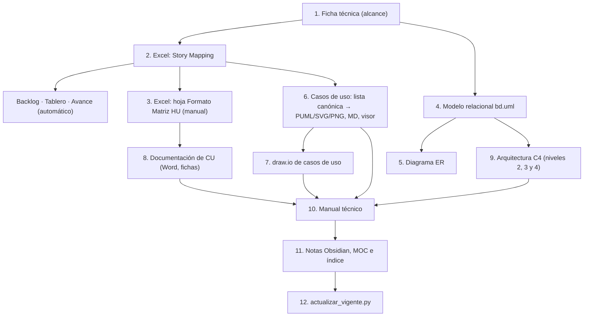

# Cascada documental

> **Regla permanente (2026-11-17, Alejandro):** cualquier cambio que se aplique, en cualquier documento, se propaga **en el mismo trabajo** a todos los documentos clave que afecte, sin esperar a que alguien lo pida. Los documentos clave son: **manual técnico**, **ficha técnica**, **modelado** (bd.uml + visor + diagrama ER), **Excel Tablero Kanban / Story Mapping / Matriz HU** y **casos de uso** (Word, sistema generado y draw.io). La C4 se deriva del modelo y también se revisa. Si el cambio afecta al frontend, primero se cierra el acuerdo del grill con Claude Omar y después se propaga. Faltantes conocidos del manual: [[Faltantes_Manual_v6]].

La **ficha técnica** es el documento raíz: define el alcance (procesos y subprocesos). Cuando cambia, el resto se actualiza en este orden, porque cada paso usa el resultado del anterior.

| # | Documento | Dónde | Qué revisar | Automático |
|---|---|---|---|---|
| 1 | Ficha técnica | `06_.../Fichas_Tecnicas/` | Objetivos, alcance web y mobile | — |
| 2 | Story Mapping | Tablero Kanban, hoja *Story Mapping* | Una columna por subproceso (historia + puntos). Si cambia el número de columnas, ampliar el rango `D:AU…` de las fórmulas del Backlog y de `B5`, `B6` y `B7` | Backlog, Tablero Kanban y Avance |
| 3 | Matriz HU | Tablero Kanban, hoja *Formato Matriz HU* | **No se actualiza sola**: HU y criterios por subproceso. No renumerar códigos existentes | Resumen automático (columnas R–T) |
| 4 | Modelo relacional | `04_Modelado_DB/Modelo_Relacional/` | Tablas, FK, TableGroups (1 por subproceso), Records | — |
| 5 | Diagrama ER | `04_Modelado_DB/Diagramas/` | Regenerar desde el `bd.uml` vigente | — |
| 6 | Casos de uso (sistema generado) | `05_Casos_de_Uso/scripts/` | `actualizar_casos_uso_canonicos.py` (lista canónica) → `actualizar_documentacion_casos_uso.py` → `generar_mapa_interactivo.py`; PNG = captura del SVG a 1050×750 | PUML, SVG, MD, visor |
| 7 | draw.io | `05_Casos_de_Uso/Diagramas_DrawIO/` | Un carril por subproceso | — |
| 8 | Documentación de CU (Word) | `05_.../Documentacion_Word/` | Fichas `HU_###` (continuar la numeración) | — |
| 9 | C4 | `05_Casos_de_Uso/Arquitectura_C4/` | Nivel 2 (BD), Nivel 3 (módulos), Nivel 4 (clases desde `bd.uml`) | — |
| 10 | Manual técnico | `10_Manual_Tecnico/Documentos_Word/` | Mockups, diagramas de CU, C4, fichas, BD | — |
| 11 | Notas | MOC, `00_INDICE_GENERAL`, RN, DB, CU | Rutas y conteos | — |
| 12 | Vigentes | `00_Documentacion_Vigente/` | `python3 00_Contexto_Versiones/actualizar_vigente.py` | Sí |

**No se afectan por cambios de subprocesos:** investigación (01), mapa de procesos de negocio (03), ensayos y plantilla de informe (08), mockups existentes (07; los nuevos módulos se diseñan en Figma).

## Último cambio aplicado
**2026-11-02 (commits C-041 a C-050):** sin Empleados, Permisos ni Categoría de proveedor; con Configuraciones del sistema y Menú. Detalle en [[CHANGELOG]].
