# 🍱 00 ÍNDICE GENERAL — La Coca de Jacks (JackSoft)

Bienvenido a **LaCocaData**, el sistema de gestión del conocimiento centralizado y estructurado del software **JackSoft** para la empresa **La Coca de Jacks S.A.S.** (Proyecto formativo SENA ADSO, Ficha 3312824).

Este vault de Obsidian organiza los procesos, reglas de negocio, arquitectura de base de datos, investigación formativa, casos de uso, gestión de proyecto bajo Scrum, diseño UI/UX, entregables académicos institucionales y el manual técnico oficial con sus auditorías de calidad. Todas las notas están conectadas bidireccionalmente mediante enlaces internos (Wikilinks) para facilitar la navegación y la visualización gráfica en el **Graph View** de Obsidian.

> 🗂️ **Control de versiones:** cada documento entregable está en carpetas `vN_AAAA-MM-DD` y la vigente es la de número más alto. Convención en [[00_MOC_Versiones]], versión vigente de cada documento en [[ESTADO_ACTUAL]] e historial tipo git en [[CHANGELOG]] (`00_Contexto_Versiones/`). La última versión de cada documento está copiada en `00_Documentacion_Vigente/` ([[00_LEEME_Vigente]]); la secuencia para cambios de alcance está en [[CASCADA_DOCUMENTAL]]. La coordinación con el agente del frontend está en `chat/ (un archivo por mensaje, ver chat/00_LEEME_reglas_del_chat.md)` (copia oficial en Google Drive › JackSoft › JackSoft › chat).

---

## 🗺️ Mapas de Contenido (MOCs por Categoría)

```mermaid
graph TD
    IG["[[00_INDICE_GENERAL]]"] --> MOC_INV["01. [[00_MOC_Investigacion]]"]
    IG --> MOC_RN["02. [[00_MOC_Reglas_Negocio]]"]
    IG --> MOC_PROC["03. [[00_MOC_Procesos]]"]
    IG --> MOC_DB["04. [[00_MOC_Modelo_DB]]"]
    IG --> MOC_CU["05. [[00_MOC_Casos_de_Uso]]"]
    IG --> MOC_SCRUM["06. [[00_MOC_Gestion_Proyecto]]"]
    IG --> MOC_DIS["07. [[00_MOC_Diseno_Mockups]]"]
    IG --> MOC_ENT["08. [[00_MOC_Entregables]]"]
    IG --> MOC_BAK["09. [[00_MOC_Backups]]"]
    IG --> MOC_MT["10. [[00_MOC_Manual_Tecnico]]"]

    MOC_INV --> INV_PROB["[[Arbol_de_Problemas]]"]
    MOC_RN --> RN_COCAS["[[RN_Logistica_Cocas]]"]
    MOC_PROC --> PROC_REG["[[PROC_Registro_y_Venta]]"]
    MOC_DB --> DB_SUSC["[[DB_Tabla_Suscripciones]]"]
    MOC_CU --> CU_LOG["[[CU_06_Logistica_y_Domicilios]]"]
    MOC_SCRUM --> FICHA["[[Ficha_de_Proyecto]]"]
    MOC_MT --> INCONG["[[Contexto_e_Incongruencias_JackSoft]]"]
    MOC_MT --> CORREC["[[Correcciones_Manual_Tecnico_v1]]"]
```

---

## 📚 Estructura de Módulos del Proyecto

### 1. 🔬 [[00_MOC_Investigacion|01. Investigación y Análisis Formativo]]
Estudios de diagnóstico operativo, metodología de marco lógico y referentes conceptuales.
* [[Planteamiento_del_Problema]] — Diagnóstico de la operación manual actual.
* [[Analisis_5W1H]] — Metodología de las 6 preguntas (Kipling) aplicada al negocio.
* [[Arbol_de_Problemas]] — Causalidad: causas raíz, problema central y efectos operacionales.
* [[Arbol_de_Objetivos]] — Árbol de medios y fines para la transformación digital.
* [[Importancia_Conocer_en_Detalle]] — Justificación de la especificación profunda de requisitos.
* [[Que_Son_Los_Requisitos]] — Fundamentos de ingeniería de requisitos en software.
* [[Rubrica_Investigacion_Objetivos]] — Criterios de evaluación y formulación de objetivos e hipótesis.
* **Diagramas y Gráficos (`Diagramas/<Diagrama>/vN_fecha/`):** Árbol de problemas (`Arbol_de_Problemas/v1`), Árbol de objetivos (`Arbol_de_Objetivos/v1`), Metodología 5W1H (`Analisis_5W1H/v2`), Mapa Mental (`Mapa_Mental/v2`).
* **Scripts:** `generar_arbol_objetivos.py`.

---

### 2. ⚖️ [[00_MOC_Reglas_Negocio|02. Reglas de Negocio (RN)]]
Políticas, restricciones y comportamiento lógico del sistema de información.
* [[RN_Logistica_Cocas]] — Cobro de $70.000 COP, rotación de 2 juegos de recipientes e incidencias.
* [[RN_Festivos_y_Agenda]] — Días no hábiles, descuento automático y no desplazamiento de fechas.
* [[RN_Limite_Suscripcion_Semanal]] — Cierre semanal de suscripciones (domingo 5:00 PM por defecto), gracia de pago y solicitudes fuera del límite.
* [[RN_Suspensiones_Voluntarias]] — Notificaciones de ausencia, pérdida asumida por cliente, sin devoluciones.
* [[RN_Domiciliarios_y_Rutas]] — Geofencing por zonas, paradas optimizadas y rastreo GPS en vivo.
* [[RN_Suscripciones_y_Menus]] — Planes (Semanal, Quincenal, Mensual), menús personalizados (+$10.000 COP).
* [[RN_Pagos_y_Comprobantes]] — Validación manual de transferencias (Nequi/Bancolombia) y estado Pendiente/Activa.
* [[RN_QA_y_Auditoria]] — Trazabilidad, borrado lógico con campo `estado` e integridad relacional.
* [[Documentacion_Reglas_Negocio_QA]] — Compendio y matriz de auditoría de reglas de negocio.

---

### 3. 🔄 [[00_MOC_Procesos|03. Procesos Operativos (PROC)]]
Flujos de trabajo paso a paso dentro de la compañía.
* [[PROC_Registro_y_Venta]] — Flujo de captura de cliente, selección de plan y kit de cocas.
* [[PROC_Validacion_de_Pagos]] — Verificación de comprobantes bancarios y activación del plan.
* [[PROC_Planeacion_Cocina_y_Recetas]] — Consolidación diaria de almuerzos, recetas y porcionado.
* [[PROC_Despacho_y_Distribucion]] — Agrupación por zonas, entrega física y recogida de cocas.
* [[PROC_Gestion_Incidencias]] — Reportes de cocas dañadas, ausencias en entrega y solución de tickets.
* [[PROC_Medicion_y_Dashboard]] — Métricas de rendimiento, KPI de ventas, churn y entregas.
* **Aplicativo Web de Procesos (`App_Mapa_Procesos/v2_2026-09-28/` vigente; `v1_2026-06-16/` = prototipo, repo `Mapa-procesos-`):** Visor interactivo web (`index.html`, `main.js`, `index.css`), diagrama de procesos (`mapa_procesos_lacoca_v2.svg`) y pitch comercial (`la-coca-de-jack-pitch.html`).

---

### 4. 🗄️ [[00_MOC_Modelo_DB|04. Modelado de Base de Datos (DB)]]
Diseño relacional, tablas, tipos de datos, enums y claves foráneas.
* [[DB_Esquema_General]] — Visión general del modelo E-R (33+ tablas relacionales).
* [[DB_Tabla_Suscripciones]] — Definición de la entidad central de contratos y liquidación.
* [[DB_Tabla_Ruta_Clientes]] — Entidad de paradas diarias y rotación de cocas.
* [[DB_Tabla_Incidencias]] — Auditoría de novedades físicas y operativas.
* [[DB_Tabla_Agenda]] — Calendario operativo de festivos y días hábiles.
* [[DB_Tabla_Suspensiones]] — Registro de ausencias voluntarias del cliente.
* [[DB_Tabla_Geolocalizacion]] — Coordenadas en tiempo real de domiciliarios.
* [[DB_Tablas_Usuarios_Permisos]] — Control de acceso por roles (RBAC).
* [[DB_Tablas_Inventario_Compras]] — Insumos, proveedores, compras y fichas técnicas.
* **Modelo relacional (`Modelo_Relacional/`):**
  * `v5_2026-11-03/bd.uml` (⭐ vigente, DBML v3.7: 41 tablas, 68 relaciones; alineado con el frontend).
  * `v4_2026-11-02/bd.uml` (DBML v3.6: 36 tablas, 56 relaciones; sin `empleados`, con `configuraciones_sistema` e `historial_configuraciones`).
  * `v3_2026-10-30/bd.uml` (DBML v3.5: 35 tablas, 53 relaciones).
  * `v2_2026-08-24/jacksoft_modelo_relacional_v2.dbml` (33 tablas, vigente hasta el 30 oct).
  * `v1_2026-08-13/jacksoft_modelo_relacional_v1.dbml` (versión inicial).
* **Diagramas Relacionales:** `Diagramas/v3_2026-11-03/LaCocaDiagramDB.svg` (⭐ generado desde bd.uml v3.7) · `v2_2026-11-02/` (v3.6) · `v1_2026-08-21/` (37 tablas, histórico).

---

### 5. 🎯 [[00_MOC_Casos_de_Uso|05. Casos de Uso y Arquitectura C4 (CU)]]
Especificación funcional detallada por macro-procesos del sistema y arquitectura de software.
* [[CU_01_Configuracion_y_Seguridad]] — Módulo de roles, permisos, seguridad y autenticación.
* [[CU_02_Compras_e_Inventario]] — Insumos, categorías, proveedores y orden de compra.
* [[CU_03_Produccion_y_Recetas]] — Fichas técnicas, órdenes de producción y producto terminado (el subproceso Empleados se eliminó el 2026-11-02).
* [[CU_04_Servicios_y_Operacion]] — Planes de servicio, categorías de servicios y agenda operativa.
* [[CU_05_Clientes_y_Ventas]] — Clientes, suscripciones, liquidación y comprobantes de pago.
* [[CU_06_Logistica_y_Domicilios]] — Polígonos de zona, rutas, tracking GPS en vivo y cocas.
* [[CU_07_Analitica_y_Metricas]] — Dashboard gerencial, KPIs operativos y reporte financiero.
* **Documentación Detallada v3:** `05_Casos_de_Uso/casos_de_uso_v3/` (243 casos de uso documentados por subproceso).
* **Documentos Oficiales (`Especificaciones/Documentacion_Word/`):**
  * `v4_2026-11-03/Documentacion_Casos_de_Uso_JackSoft.docx` (⭐ vigente, 245 fichas: sin menú personalizado; con Gestionar suscripciones con pago vencido y Publicar menú semanal).
  * `v3_2026-11-02/Documentacion_Casos_de_Uso_JackSoft.docx` ( 248 fichas renumeradas HU_001–HU_248 en orden del documento: sin Permisos, Asignar permisos ni Empleados; con Configuraciones del sistema, Menú y Aprobar solicitud fuera de límite).
  * `v2_2026-09-14/Documentacion_Casos_de_Uso_JackSoft.docx` (243 fichas).
  * `v1_2026-08-31/Documentacion_Casos_de_Uso_JackSoft_31ago.docx` (versión histórica).
* **Diagramas UML:**
  * 22 diagramas editables Draw.io (`Diagramas_DrawIO/Casos_de_usos.drawio`).
  * 23 diagramas en código PlantUML (`Diagramas_PUML/`).
  * 23 diagramas vectoriales (`Diagramas_SVG/`).
  * 24 diagramas en alta resolución (`Diagramas_PNG/`).
* **Visor Interactivo:** Aplicativo web independiente (`index.html` y `mapa_interactivo.html`; el SVG multifase anterior quedó obsoleto en `_Historial/Obsoletos/`).
* **Scripts de Generación:** Automatización en Python (`generar_casos_uso.py`, `generar_svg_casos_uso.py`, `generar_mapa_interactivo.py`, `generar_svg_interactivo_multifase.py`).
* **🏛️ Arquitectura de Software C4 (Niveles 1 al 4):** `05_Casos_de_Uso/Arquitectura_C4/`
  * `v4_2026-11-03/` (⭐ vigente): alineado con `bd.uml` v3.7.
  * `v3_2026-11-02/`: alineado con `bd.uml` v3.6 (módulos 1. Acceso y configuración y 5. Clientes, suscripciones y menú).
  * `v2_2026-10-30/`: alineado con `bd.uml` v3.5.
  * `v1_2026-09-14/`: primera versión basada en el modelo V2 (`.png`, `.svg`, `.puml`).
  * `Referencia/Diagramas C4.pptx.txt`: guía de clase.

---

### 6. 🚀 [[00_MOC_Gestion_Proyecto|06. Gestión de Proyecto (Scrum)]]
Ficha técnica del proyecto SENA ADSO, roadmap, matriz de historias de usuario y backlog.
* [[Ficha_de_Proyecto]] — Ficha oficial del proyecto formativo ADSO (Ficha 3312824).
* [[Scrum_Artefactos_y_Sprints]] — Roadmap por Sprints (01 al 11) de Requisitos a Implantación.
* [[Matriz_Historias_de_Usuario]] — Consolidado de Historias de Usuario (HU), Story Mapping y Kanban.
* **Fichas Técnicas (`Fichas_Tecnicas/vN_fecha/`):**
  * `v9_2026-11-03/Ficha_Jacksoft_CF_v9.docx` (⭐ vigente: precios 75/150/300 mil, kit 80 mil, sin menú personalizado, corte sábado 12:00 m e inicio sin pago).
  * `v8_2026-11-02/Ficha_Jacksoft_CF_v8_alcance.docx` ( sin Empleados, Permisos ni Categoría de proveedor; con Configuraciones del sistema y Menú).
  * `v7_2026-10-30/Ficha_3agosto Jacksoft CF_v2_festivos.docx` (corrige festivos según RN-02).
  * `v6_2026-09-13/Ficha_3agosto Jacksoft CF.docx` y `.pdf` (versión con VoBo de Requisitos del instructor Newton Pomare, 10 de septiembre).
  * Historial: `v1` 16 jun (formato inicial), `v2` 24 jul, `v3` 30 jul, `v4` 3 ago, `v5` 14 ago.
* **Hojas de Cálculo y Tableros (`Historias_de_Usuario_y_Kanban/`):**
  * `Tablero_Kanban/v7_2026-11-03/Tablero Kanban 03_11 v7.xlsx` (⭐ vigente: reglas del 3-nov y responsables por módulo).
  * `Tablero_Kanban/v6_2026-11-03/Tablero Kanban 03_11.xlsx` ( con responsable por módulo y carga equitativa; 23 subprocesos, 157 historias, hasta 12 por subproceso; Matriz HU con 194 HU renumeradas).
  * `Tablero_Kanban/v4_2026-10-23/Tablero Kanban 13_09.xlsx` (edición del 23 oct del tablero 13_09).
  * `Tablero_Kanban/v3_2026-09-13/` (Story Mapping v03 y 186 HU) · `v2_2026-08-21/` (`.xlsx`, `.numbers`, `.csv`) · `v1_2026-08-10/`.
  * `Matriz_HU/v1_2026-08-12/Matriz_Historias_de_Usuario_actualizada.xlsx` (superada por la matriz del Kanban).
* **Presentación Web:** Recurso web interactivo de artefactos Scrum (`Presentacion_Artefactos/v1_2026-07-27/index.html`).

---

### 7. 🎨 [[00_MOC_Diseno_Mockups|07. Diseño, Prototipos y Mockups]]
Recursos de diseño de interfaz, experiencia de usuario y conceptualización visual.
* **Mockups de Interfaz (`Mockups/v1_2026-08-09/`):** `Mokup url.docx` (enlaces a Figma para prototipos web y móvil de alta fidelidad).
* **Identidad y Formularios:** `headerGoogleForms.png` y `headerGoogleForms.svg` (cabeceras de captura de prospectos).
* **Facilitación Gráfica (`Facilitacion_Grafica/v1_2026-08-24/`):** `FacilitacionGrafica.jpeg`, `tablero_ajedrez.svg` e `image.png` (metáforas visuales de la operación y propuesta de valor).

---

### 8. 📑 [[00_MOC_Entregables|08. Entregables e Informes de Formación]]
Documentos de investigación formativa y entregables académicos institucionales SENA.
* **Informes Académicos (`Informes_Academicos/`):** `Plantilla_Informe/v2_2026-09-01/PlantillaInforme.docx` (⭐ vigente), `Rubrica_Investigacion/v1_2026-08-25/rubrica_investigacion_objetivos.txt`.
* **Ensayos y Monografías (`Ensayos_y_Monografias/<Ensayo>/v1_2026-06-16/`):**
  * `¿Qué son los requisitos_` (`.docx` / `.pdf`).
  * `Por qué es importante conocer en detalle` (`.docx` / `.pdf`).
* **Versión anterior de la plantilla (`Informes_Academicos/Plantilla_Informe/v1_2026-08-11/`):** `PlantillaInforme_v1_11ago.docx`, `PlantillaInforme.docx.md`, `informe.txt`.

---

### 9. 💾 [[00_MOC_Backups|09. Respaldos y Archivos Comprimidos]]
Archivos de respaldo históricos comprimidos y carpetas de resguardo del proyecto:
* `JackSoft-20260902T183910Z-1-001.zip` (Respaldo Google Drive integral).
* `5WH Y ARBOL-20260902T183950Z-1-001.zip` (Respaldo marco lógico inicial).
* `Legacy_JackSoft_Raw/` (Carpeta histórica original preservada para auditoría de fuentes).
* `Duplicados_Reorganizacion_2026-11-02/` (copias idénticas retiradas al reorganizar por versiones).

---

### 10. 📖 [[00_MOC_Manual_Tecnico|10. Manual Técnico y Control de Calidad]]
Documentos maestros del Manual Técnico oficial de JackSoft, bitácoras de cambios y auditorías de coherencia entre entregables.
* **Documentos Maestros Word (`Documentos_Word/vN_fecha/`):**
  * `v1_2026-09-23/Manual_Tecnico_v1_Jacksoft.docx` (33.1 MB — versión evaluada con comentarios C4, C9–C14, C40, C41).
  * `v2_2026-09-25/Manual_Tecnico_v2_septiembre_25.docx` (16.7 MB — versión con 22 diagramas rehechos en Draw.io y figuras numeradas).
  * `v5_2026-11-03/Manual_Tecnico_v2.3_Jacksoft.docx` (⭐ vigente: alineado con bd.uml v3.7).
  * `v4_2026-11-02/Manual_Tecnico_v2.2_Jacksoft.docx` ( cambio de alcance aplicado — mockups, diagramas de CU, C4 y fichas).
  * `v3_2026-09-25/Manual_Tecnico_v2.1_Jacksoft.docx` (16.7 MB — antes Fuente de verdad con depuración de fichas de casos de uso y armonización con las reglas de negocio).
* **Auditoría y Control de Calidad (`Auditoria_y_Control_Calidad/`):**
  * [[Contexto_e_Incongruencias_JackSoft]] — Matriz cruzada de coherencia entre Ficha, Kanban 13_09, Draw.io, BD relacional y Fichas.
  * [[Correcciones_Manual_Tecnico_v1]] — Trazabilidad de comentarios C9–C14, criterio de caso de uso vs validación/regla, y cascada de cambios al vault.

---

## 📌 Enlaces Clave y Relaciones Destacadas
* El [[Planteamiento_del_Problema]] fundamenta el [[Arbol_de_Problemas]], del cual derivan los [[Arbol_de_Objetivos]].
* El problema central de operación manual se resuelve mediante [[PROC_Registro_y_Venta]], [[PROC_Validacion_de_Pagos]] y [[PROC_Despacho_y_Distribucion]].
* Todas las reglas logísticas de recipientes están detalladas en [[RN_Logistica_Cocas]] y soportadas por [[DB_Tabla_Ruta_Clientes]] y [[DB_Tabla_Incidencias]].
* La estructura técnica está alineada con los entregables institucionales descritos en [[Ficha_de_Proyecto]] y los Sprints en [[Scrum_Artefactos_y_Sprints]].
* El desarrollo y las correcciones de Casos de Uso se auditan en [[Correcciones_Manual_Tecnico_v1]] y se consolidan en la versión vigente `Manual_Tecnico_v2.1_Jacksoft.docx` dentro de [[00_MOC_Manual_Tecnico]].
