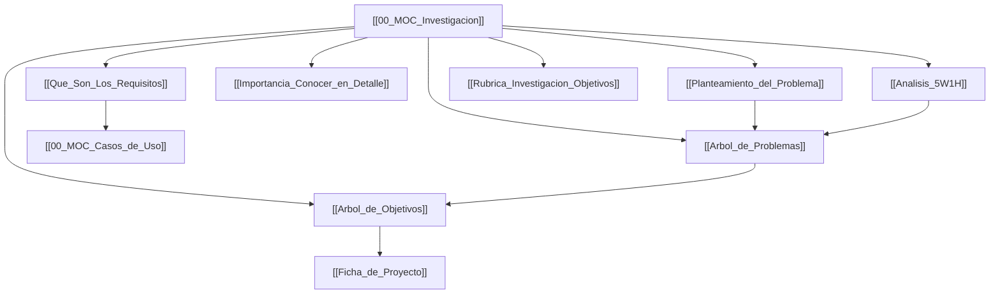

# 🔬 00 MOC — Investigación y Análisis Formativo

Este Mapa de Contenido (MOC) articula las bases conceptuales, metódicas y diagnósticas que sustentan la formulación del software **JackSoft** para la empresa **La Coca de Jacks S.A.S.**.

---

## 🗺️ Mapa Visual de la Investigación

---

## 📄 Documentos de Investigación

1. **[[Planteamiento_del_Problema]]**: Diagnóstico situacional de La Coca de Jacks S.A.S., caracterización del sector gastronómico de suscripción en la economía popular y justificación de la transformación digital.
2. **[[Analisis_5W1H]]**: Aplicación del método Kipling (What, Why, When, Where, Who, How) para delimitar el alcance del proyecto.
3. **[[Arbol_de_Problemas]]**: Estructura causa-efecto del problema central: *"Operación manual e ineficiente de La Coca de Jacks S.A.S."*.
4. **[[Arbol_de_Objetivos]]**: Conversión del árbol de problemas a una estructura positiva de Medios y Fines (Marco Lógico).
5. **[[Importancia_Conocer_en_Detalle]]**: Análisis crítico sobre la importancia del levantamiento detallado de requisitos operativos para evitar fracasos en el desarrollo de software.
6. **[[Que_Son_Los_Requisitos]]**: Definición formal de Requisitos Funcionales y No Funcionales aplicados al proyecto JackSoft.
7. **[[Rubrica_Investigacion_Objetivos]]**: Pauta e instrumentos de evaluación técnica para los objetivos general y específicos e hipótesis de investigación.
