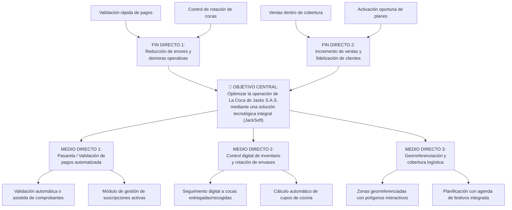

# 🎯 Árbol de Objetivos — Medios y Fines (JackSoft)

El Árbol de Objetivos traduce las situaciones negativas expresadas en el [[Arbol_de_Problemas]] en condiciones positivas deseables y alcanzables mediante la implementación del sistema **JackSoft**.

---

## 📊 Diagrama del Árbol de Objetivos (Mermaid)

---

## 🎯 Articulación de Medios y Fines

### 1. Medios de Solución (Acciones Tecnológicas)
* **Medio 1 (Pagos)**: Módulo de registro y validación de transferencias bancarias que pasa suscripciones de `pendiente` a `activa` de forma transparente.
* **Medio 2 (Inventario y Cocas)**: Aplicación móvil que permite al domiciliario auditar `cocas_entregadas` y `cocas_recogidas` en cada parada, registrando incidencias en tiempo real.
* **Medio 3 (Georreferenciación)**: Mapeo interactivo de zonas de cobertura que bloquea automáticamente ventas fuera del perímetro y optimiza la ruta de despacho.

### 2. Fines Perseguidos (Beneficios del Negocio)
* **Reducción de Errores Operativos**: Cero desabastecimiento en cocina y control absoluto de los recipientes en circulación.
* **Incremento de Ventas y Retención**: Mejora drástica en el tiempo de atención al cliente y entregas puntuales.

---

## 🔗 Relación con los Requerimientos del Sistema
Los medios definidos en este árbol constituyen los módulos funcionales del sistema especificados en [[00_MOC_Casos_de_Uso]] y formalizados en los objetivos de la [[Ficha_de_Proyecto]].
