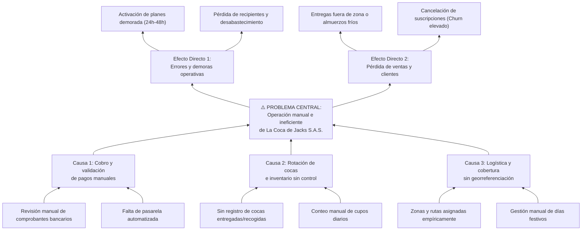

# 🌳 Árbol de Problemas — La Coca de Jacks S.A.S.

El Árbol de Problemas representa la estructura jerárquica de causalidad formulada mediante la Metodología de Marco Lógico para diagnosticar el problema central de la compañía.

---

## 📊 Diagrama del Árbol de Problemas (Mermaid)

---

## 🔍 Análisis Causal Detallado

### 1. Causas Raíz (Raíces)
1. **Cobro y Validación de Pagos Manuales**: El administrador debe interrumpir sus labores para validar transferencias en la app del banco.
2. **Rotación de Cocas e Inventario sin Control**: La ausencia de un registro de entregas/recogidas impide saber cuántas cocas tiene cada cliente.
3. **Logística y Cobertura sin Georreferenciación**: Agrupación empírica de pedidos por sectores sin verificación técnica de polígonos.

### 2. Problema Central (Tronco)
> **"Operación manual e ineficiente de La Coca de Jacks S.A.S."**
Los procesos clave de venta, cobro, cocina, empaque, ruta y reportería dependen exclusivamente de chats de WhatsApp y hojas de Excel sin integración.

### 3. Efectos e Impactos (Follaje/Ramas)
* **Errores y Demoras Operativas**: Retrasos en la preparación y pérdidas financieras por reposición no cobrada de recipientes.
* **Pérdida de Ventas y Clientes**: Clientes insatisfechos por demoras en entregas y desatención en horas pico.

---

## 🔗 Conversión a Solución
Este árbol de problemas se convierte directamente en el [[Arbol_de_Objetivos]], transformando las causas en medios y los efectos en fines.
