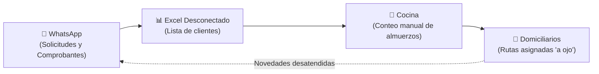

# 📋 Planteamiento del Problema — La Coca de Jacks S.A.S.

## 🏢 Contexto Empresarial
La empresa **La Coca de Jacks S.A.S.** (Representante Legal: Richard Daniel Ortiz), ubicada en la Calle 27 # 65 B - 40 en Medellín, Antioquia, opera un modelo de negocio de alimentación casera bajo el esquema de **comercialización por suscripción recurrente** (planes Semanal, Quincenal y Mensual) de lunes a viernes.

A diferencia de un restaurante convencional, el cliente no efectúa compras esporádicas sino que contrata un servicio recurrente. El servicio combina:
1. **Producto Físico**: Almuerzos caseros balanceados con menús rotativos semanales.
2. **Logística de Recipientes Reutilizables ("Cocas")**: Rotación diaria de dos juegos de envases metálicos/plásticos por cliente para erradicar el empaque desechable.
3. **Distribución Georreferenciada**: Entrega domiciliaria en franja del mediodía en modalidades Fija o Híbrida.

---

## ⚠️ Diagnóstico de la Operación Manual Actual

Actualmente, el 100% de la operación se gestiona mediante herramientas informales e inconexas: **chats de WhatsApp, cuadernos físicos y hojas de cálculo de Excel**.

### 1. Ineficiencias en Registro y Venta de Planes
* **Transcripción manual**: Los datos de contacto, direcciones y restricciones alimentarias se copian manualmente de WhatsApp a Excel.
* **Perdida de ventas**: En horas pico, las solicitudes quedan sin respuesta durante horas.
* **Falta de control en cobro de recipientes**: El cobro inicial de $70.000 COP por el par de cocas se registra de memoria, provocando descalces en caja.

### 2. Cuello de Botella en Validación de Pagos
* El cliente transfiere por Bancolombia/Nequi y envía foto del comprobante.
* El administrador debe pausar la operación para revisar la app del banco en su celular.
* **Riesgos**: Activaciones demoradas de 24 a 48 horas, vulnerabilidad a comprobantes falsos o adulterados.

### 3. Incertidumbre en Planeación de Cocina
* Al final de la tarde, el jefe de cocina cuenta a mano en el Excel cuántos clientes tienen plan activo al día siguiente.
* Debe contrastar con chats de WhatsApp por cancelaciones o ausencias voluntarias de última hora.
* **Consecuencia**: Desperdicio de insumos por sobreproducción o desabastecimiento por subconteo.

### 4. Entregas e Inventario de Cocas Descontrolados
* Agrupación empírica por sectores sin georreferenciación técnica.
* Los domiciliarios eligen su propia ruta, incrementando tiempos y costos de combustible.
* **Pérdida de envases**: No hay trazabilidad de cuántas cocas vacías entrega o recibe el cliente en la parada diaria.

---

## 🎯 Impactos Generales
1. **Financiero**: Fuga de dinero por comprobantes no validados y cocas no cobradas/perdidas.
2. **Operacional**: Carga cognitiva extrema para el administrador y retrasos diarios en cocina y rutas.
3. **Satisfacción del Cliente**: Almuerzos fríos o fuera de hora, y riesgo de reacciones alérgicas por errores de transcripción en restricciones dietéticas.

---

## 🔗 Relaciones con el Sistema
* El planteamiento del problema da origen a las causas analizadas en el [[Arbol_de_Problemas]].
* Requiere la implementación de las reglas logísticas de [[RN_Logistica_Cocas]] y [[RN_Pagos_y_Comprobantes]].
* Las soluciones operativas se especifican en [[PROC_Registro_y_Venta]] y [[PROC_Despacho_y_Distribucion]].
