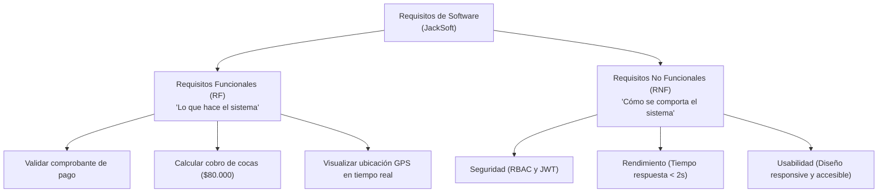

# 📝 ¿Qué son los Requisitos de Software?

Un **Requisito de Software** es una condición o capacidad que debe poseer un sistema para satisfacer un contrato, norma, especificación o las necesidades de los stakeholders (usuarios, administradores y dueños del negocio).

---

## 🏗️ Clasificación de Requisitos

---

## 1. Requisitos Funcionales (RF)
Definen las funciones, acciones y servicios que el sistema debe ejecutar de forma explícita.
* **RF-01**: El sistema debe permitir el registro de clientes con modalidad de entrega Fija o Híbrida.
* **RF-02**: El sistema debe verificar la ubicación de entrega mediante polígonos de geofencing.
* **RF-03**: El sistema debe descontar automáticamente el valor de los días festivos registrados en la agenda.
* **RF-04**: El sistema debe registrar las cocas entregadas y recogidas por el domiciliario en cada parada.

---

## 2. Requisitos No Funcionales (RNF)
Especifican las propiedades emergentes, restricciones de calidad, rendimiento, seguridad y mantenibilidad del sistema.
* **Seguridad**: Autenticación segura mediante tokens JWT, cifrado de contraseñas y control de acceso basado en roles (RBAC).
* **Usabilidad**: Interfaz web intuitiva en React y App Móvil optimizada para la operación en calle del domiciliario.
* **Trazabilidad y Conservación de Datos**: Ningún registro se elimina físicamente; se utiliza el borrado lógico mediante el atributo `estado` (activo/inactivo).

---

## 🔗 Aplicación en el Proyecto
La totalidad de los requisitos identificados se mapean directamente a los casos de uso descritos en [[00_MOC_Casos_de_Uso]] y se verifican a lo largo de los Sprints del proyecto en [[Scrum_Artefactos_y_Sprints]].
