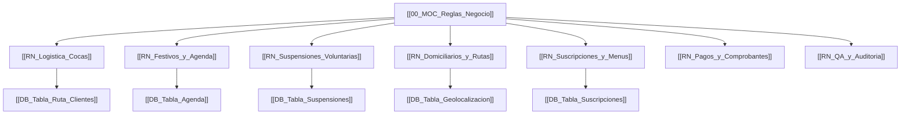

# ⚖️ 00 MOC — Reglas de Negocio (RN)

Este Mapa de Contenido centraliza la documentación oficial de las políticas, restricciones lógicas, modelos operativos y criterios de calidad que gobiernan la plataforma **JackSoft**.

---

## 🗺️ Mapa Visual de las Reglas de Negocio

---

## 📋 Catálogo de Reglas de Negocio

1. **[[RN_Logistica_Cocas]]**: Política de rotación de recipientes reutilizables, cobro único inicial de $80.000 COP, control de cocas entregadas/recogidas y reporte de incidencias por rotura o extravío.
2. **[[RN_Festivos_y_Agenda]]**: Gestión del calendario operativo, días no laborables, liquidación proporcional con descuento automático de festivos y principio de no desplazamiento del vencimiento semanal.
3. **[[RN_Suspensiones_Voluntarias]]**: Tratamiento de ausencias notificadas por el cliente, supresión de orden de producción sin devoluciones de dinero ni extensión de vigencia.
4. **[[RN_Domiciliarios_y_Rutas]]**: Geofencing por polígonos, asignación de rutas por zona de cobertura, rastreo GPS en tiempo real y flujo de entregas.
5. **[[RN_Suscripciones_y_Menus]]**: Tipos de venta (Nueva, Renovación, Reingreso), recargo por menú personalizado (+$10.000 COP), tipos de plan y ciclos de vida.
6. **[[RN_Pagos_y_Comprobantes]]**: Proceso de validación de comprobantes de transferencia bancaria, estados del pago (Pendiente, Aprobado, Rechazado) y liberación de suscripción.
7. **[[RN_QA_y_Auditoria]]**: Políticas de calidad, conservación de trazabilidad mediante borrado lógico (campo `estado`) y restricciones de integridad referencial.

## 🔄 Nueva regla (2026-11-03)
* [[RN_Limite_Suscripcion_Semanal]] — Día y hora límite para suscribirse a la semana siguiente, gracia de pago y solicitudes fuera del límite.
