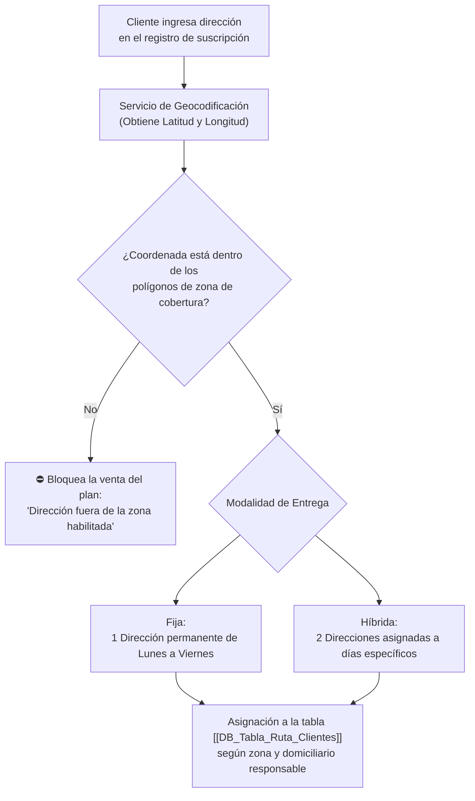

# 🛵 RN-04: Domiciliarios, Rutas y Zonas de Cobertura Geográfica

## 📌 Declaración de la Regla
Para resolver las entregas empíricas ("a ojo") y la ineficiencia logística, la distribución del servicio opera bajo **zonas de cobertura geográfica delimitadas por polígonos (Geofencing)** sobre un mapa interactivo. El sistema bloquea ventas fuera del perímetro y asigna secuencialmente las paradas de ruta optimizadas a los repartidores.

---

## ⚙️ Especificaciones de la Logística Georreferenciada

### 1. Polígonos de Cobertura y Geofencing
* El administrador dibuja los polígonos de servicio (ej. El Poblado, Laureles, Belén) en la plataforma web.
* **Validación en Venta**: Si la dirección geocodificada no intersecta ningún polígono activo, la plataforma impide completar la compra.

### 2. Modalidades de Entrega
* **Modalidad Fija**: El cliente recibe su almuerzo en una única dirección permanente de lunes a viernes (casa u oficina).
* **Modalidad Híbrida**: Permite parametrizar 2 direcciones distintas asociadas a días específicos de la semana (ej. Lunes/Miércoles/Viernes en la oficina y Martes/Jueves en casa).

### 3. Asignación de Rutas y Paradas Optimizadas
* Cada mañana, el sistema agrupa los pedidos activos de la zona y genera la secuencia de paradas mediante el campo `orden_entrega` en la tabla [[DB_Tabla_Ruta_Clientes]].
* El repartidor visualiza la lista ordenada de entregas en su aplicación móvil.

### 4. Monitoreo GPS en Tiempo Real
* La App Móvil del repartidor transmite sus coordenadas geográficas (`latitud`, `longitud`, `fecha_hora`) periódicamente a la tabla [[DB_Tabla_Geolocalizacion]].
* **Plataforma Web (Backoffice)**: El administrador monitorea en vivo la posición de la flota en un mapa interactivo.
* **App Móvil Cliente**: El cliente consulta la proximidad del repartidor durante la franja de despacho.

---

## 🔗 Relaciones del Sistema
* **Procesos**: [[PROC_Despacho_y_Distribucion]], [[PROC_Registro_y_Venta]].
* **Tablas de BD**: [[DB_Tabla_Geolocalizacion]], [[DB_Tabla_Ruta_Clientes]].
* **Casos de Uso**: [[CU_06_Logistica_y_Domicilios]].

## 🔄 Cambio de alcance 2026-11-02
El domiciliario es un usuario con rol Domiciliario (no existe módulo de empleados). La modalidad de dirección híbrida se puede activar o desactivar en [[DB_Tabla_Configuraciones_Sistema]] (`modalidad_hibrida_activa`).

## 🔄 Ajuste con el frontend 2026-11-03 (bd.uml v3.7)
Cada zona tiene un **domiciliario fijo** (`zonas_cobertura.domiciliario_id`); las rutas del día lo toman por defecto y se pueden reasignar ese día. Las entregas usan los estados programada, en_ruta, entregada, suspendida e incidencia, y el cliente puede calificar el almuerzo (1 a 5).

## Rutas = zonas (2026-11-20, bd.uml v4.8)
Una ruta es una **zona de cobertura activa + su domiciliario**. Las rutas del día se **generan solas**, una por zona; no se crean a mano y el administrador solo cambia el domiciliario. El domiciliario envía su GPS desde el navegador (la app móvil queda pendiente), registra las cocas recogidas y consulta su historial de entregas; el administrador y el cliente ven la ubicación. El dashboard calcula el costo-beneficio por zona con el costo diario del domiciliario (`costo_diario_domiciliario`) repartido entre sus zonas según las entregas.
