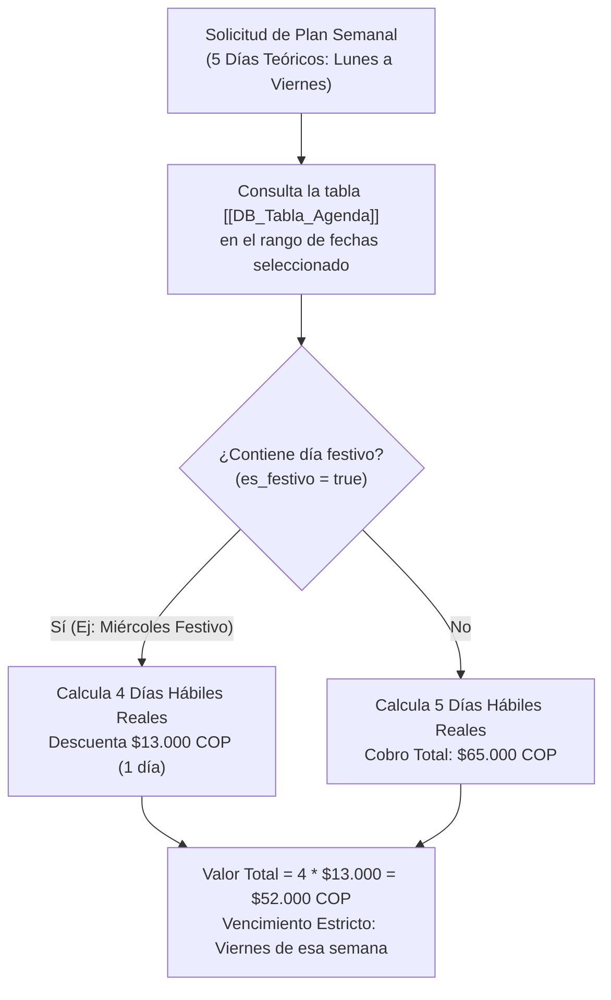

# 📅 RN-02: Días Festivos y Agenda Operativa

## 📌 Declaración de la Regla
Los ciclos operativos de cocina y distribución de **La Coca de Jacks S.A.S.** inician estrictamente el día **lunes** y finalizan el día **viernes** de cada semana. Por ningún motivo se pospone o traslada la entrega de un almuerzo coincidente con un día festivo hacia la siguiente semana. En su lugar, **el sistema descuenta automáticamente el valor proporcional del día no hábil en la liquidación del plan**.

---

## ⚙️ Reglas de Cálculo y Liquidación Proporcional

### 1. Invariancia del Ciclo Semanal
* El catálogo de recetas rota por semanas completas.
* Si el cliente adquiere un plan Semanal (Lunes a Viernes) y el miércoles es festivo oficial en Colombia:
  * **No se corre la entrega al lunes subsiguiente**.
  * El plan finaliza indefectiblemente el día viernes de la semana contratada.

### 2. Algoritmo de Descuento Automático
* La tarifa diaria base del plan se obtiene mediante: 
  $$\text{Tarifa Diaria} = \frac{\text{Precio del Plan Base}}{\text{Días Hábiles Teóricos}}$$
* **Ejemplo Práctico**:
  * Plan Semanal Base (5 días): **$65.000 COP** ($\text{Tarifa Diaria} = \$13.000 \text{ COP}$).
  * Si la semana incluye 1 festivo, el sistema calcula:
    $$\text{Días A Pagar} = 5 - 1 = 4 \text{ días}$$
    $$\text{Total A Cobrar} = 4 \times \$13.000 = \$52.000 \text{ COP}$$

### 3. Parametrización en la Tabla Agenda
* El administrador configura anualmente el calendario en la tabla [[DB_Tabla_Agenda]].
* Cada registro especifica:
  * `fecha` (DATE).
  * `es_festivo` (BOOLEAN).
  * `descripcion` (VARCHAR, e.g., "Batalla de Boyacá").

> [!NOTE]
> Al cotizar o registrar una suscripción en [[PROC_Registro_y_Venta]], la aplicación realiza una consulta `COUNT(*)` sobre [[DB_Tabla_Agenda]] filtrando por `es_festivo = false` en el rango de fechas del plan para determinar los días efectivamente facturables.

---

## 🔗 Relaciones del Sistema
* **Procesos**: [[PROC_Registro_y_Venta]] (cotización), [[PROC_Planeacion_Cocina_y_Recetas]] (programación).
* **Tablas de BD**: [[DB_Tabla_Agenda]], [[DB_Tabla_Suscripciones]].
* **Casos de Uso**: [[CU_04_Servicios_y_Operacion]], [[CU_05_Clientes_y_Ventas]].
