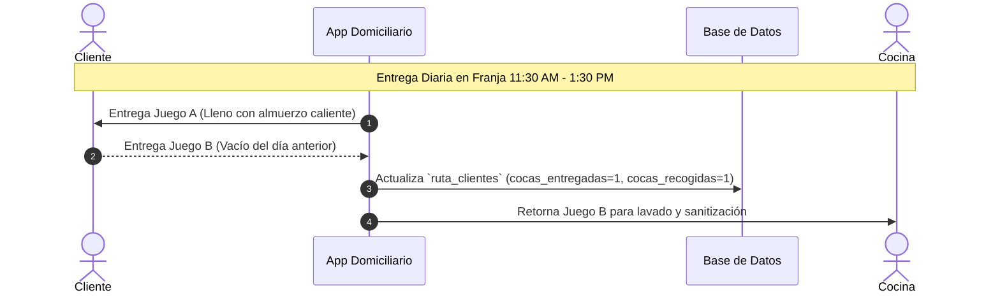

# 📦 RN-01: Logística de Recipientes Reutilizables ("Cocas")

## 📌 Declaración de la Regla
Para eliminar el uso de empaques desechables y mantener la rentabilidad y sostenibilidad del servicio, **La Coca de Jacks S.A.S.** opera bajo un **modelo logístico cerrado de rotación de dos (2) juegos de cocas oficiales por cliente**.

---

## ⚙️ Especificación Detallada de la Operación

### 1. Sistema de Rotación Diaria (2 Juegos)
* **Juego A**: En poder del cliente (contiene el almuerzo entregado hoy).
* **Juego B**: En poder de la cocina (en proceso de sanitización y empaque para mañana).
* Durante la parada del repartidor, el intercambio es **sincrónico**: se entrega 1 juego lleno y se recoge 1 juego vacío.

### 2. Cobro Inicial Obligatorio ($80.000 COP)
* **Venta Nueva (Primer Registro)**: Si el cliente declara no poseer los dos juegos de recipientes oficiales, el sistema aplica automáticamente un **cobro único e inalterable de $80.000 COP** en su primera factura.
* **Renovaciones y Reingresos**: En contratos futuros o reactivaciones, **este cobro NO se vuelve a aplicar**, salvo que el cliente haya perdido los recipientes previa auditoría.
* **Soporte en Base de Datos**: El campo `cobro_cocas` ($80.000) en la tabla [[DB_Tabla_Suscripciones]] suma directamente al `valor_total` de la venta inicial.

### 3. Trazabilidad por Parada y Domiciliario
* En cada parada de la ruta, el repartidor debe confirmar en su App Móvil:
  * `cocas_entregadas` (entero, por defecto 1).
  * `cocas_recogidas` (entero, por defecto 1).
* Estos datos alimentan la tabla [[DB_Tabla_Ruta_Clientes]] en tiempo real.

### 4. Gestión de Incidencias con Recipientes
Si ocurre alguna de las siguientes novedades:
1. El cliente **no entrega** la coca vacía.
2. La coca es devuelta **dañada, rota o sucia a nivel extremo**.
3. El cliente informa la **pérdida** del contenedor.

> [!WARNING]
> El repartidor genera un reporte de novedad desde la App Móvil. El sistema crea un registro en [[DB_Tabla_Incidencias]] con `tipo_incidencia = 'coca_danada'` o `'coca_no_devuelta'`, notificando al administrador para gestionar el cobro de reposición o bloquear renovaciones.

---

## 🔗 Relaciones del Sistema
* **Procesos**: Se ejecuta en [[PROC_Registro_y_Venta]] (cobro inicial) y [[PROC_Despacho_y_Distribucion]] (intercambio diario).
* **Tablas de BD**: [[DB_Tabla_Suscripciones]], [[DB_Tabla_Ruta_Clientes]], [[DB_Tabla_Incidencias]].
* **Casos de Uso**: [[CU_05_Clientes_y_Ventas]], [[CU_06_Logistica_y_Domicilios]].

## 🔄 Cambio de alcance 2026-11-02
El valor del cobro único del kit de cocas ($80.000 COP) es parametrizable en [[DB_Tabla_Configuraciones_Sistema]] (clave `cobro_cocas`); cada suscripción guarda el valor vigente al momento de la venta.

## 🔄 Ajuste con el frontend 2026-11-03 (bd.uml v3.7)
El kit de cocas vale **$80.000 COP** y es configurable (`cobro_cocas`). Lo paga solo la venta nueva, antes de iniciar.
