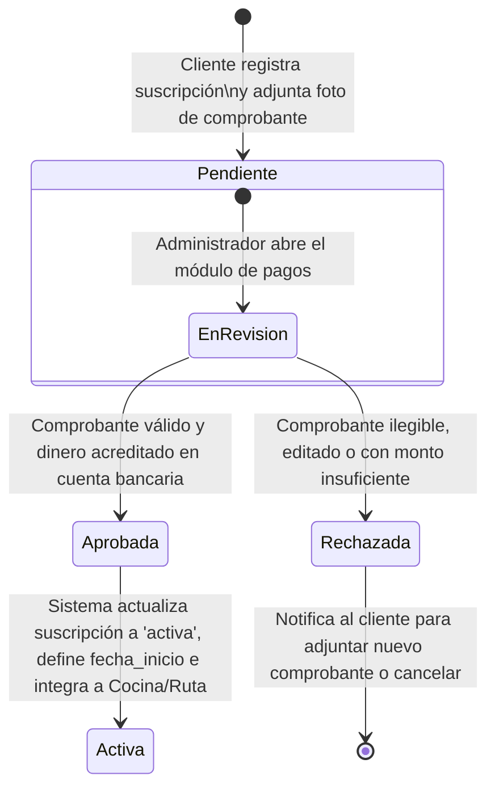

# 💳 RN-06: Pagos, Comprobantes Bancarios y Estados de Transacción

## 📌 Declaración de la Regla
El flujo transaccional de **La Coca de Jacks S.A.S.** se realiza mediante **transferencia bancaria directa** a la cuenta de **Bancolombia** (único medio de pago; Nequi salió el 2026-11-20). Para evitar fraudes y pérdidas financieras, **ninguna suscripción genera entregas de almuerzo ni órdenes a cocina mientras permanezca en estado `pendiente`**.

---

## ⚙️ Máquina de Estados del Pago y Suscripción

### 1. Requisitos para la Aprobación del Pago
El administrador valida desde el backoffice los siguientes campos obligatorios del comprobante:
1. **Monto Exacto**: Coincidencia total con el `valor_total` de la suscripción (Plan − descuento por festivos + Cocas si aplica).
2. **Número de Referencia/Comprobante**: Código único de la transacción bancaria.
3. **Fecha y Hora de la Transferencia**: Coincidencia con la ventana de contratación.

### 2. Transición a Estado `Activa`
* Al marcar el pago como `aprobado`, el sistema ejecuta una transacción atómica:
  * Cambia el estado de la suscripción de `pendiente` a `activa`.
  * Calcula la `fecha_vencimiento` oficial cruzando la cantidad de días contratados con [[DB_Tabla_Agenda]].
  * Registra la suscripción en el consolidado de producción para la fecha de inicio.

---

## 🔗 Relaciones del Sistema
* **Procesos**: [[PROC_Validacion_de_Pagos]], [[PROC_Registro_y_Venta]].
* **Tablas de BD**: [[DB_Tabla_Suscripciones]].
* **Casos de Uso**: [[CU_05_Clientes_y_Ventas]].

## 🔄 Ajuste con el frontend 2026-11-03 (bd.uml v3.7)
* El pago queda con canal (web, app, WhatsApp o panel), quién subió el comprobante y, si se rechaza, el **motivo de rechazo** que ve el cliente.
* Renovación y reingreso pueden iniciar sin pagar y tienen 3 días hábiles para hacerlo ([[RN_Limite_Suscripcion_Semanal]]).
