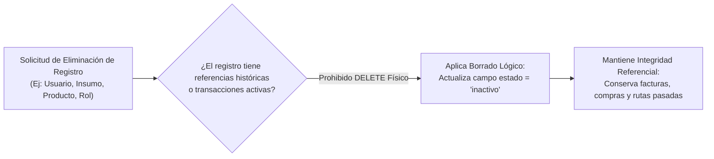

# 🛡️ RN-07: QA, Auditoría y Conservación de Trazabilidad (Borrado Lógico)

## 📌 Declaración de la Regla
Para garantizar la integridad referencial de los datos históricos, auditoría financiera y cumplimiento de estándares de QA en el software **JackSoft**, **está estrictamente prohibido el borrado físico (`DELETE`) de registros maestros y transaccionales en la base de datos**.

---

## ⚙️ Políticas de Trazabilidad y Seguridad

### 1. Mecanismo de Borrado Lógico (`estado`)
* Todas las tablas del sistema incorporan una columna de estado general (`estado` Enum `'activo'`, `'inactivo'`).
* Cuando un administrador ejecuta una acción de "eliminar" sobre un usuario, producto, insumo o proveedor:
  * El sistema efectúa un `UPDATE tabla SET estado = 'inactivo' WHERE id = :id`.
  * El registro se oculta en los listados operativos habituales, pero permanece accesible en consultas de auditoría y reportes históricos.

### 2. Auditoría Atómica (`created_at`, `updated_at`)
* Cada tabla transaccional registra marcas temporales inalterables:
  * `created_at`: Fecha y hora exacta de creación del registro.
  * `updated_at`: Fecha y hora del último cambio realizado.

---

## 🔗 Relaciones del Sistema
* **Modelado DB**: [[DB_Esquema_General]], [[DB_Tablas_Usuarios_Permisos]].
* **Casos de Uso**: [[CU_01_Configuracion_y_Seguridad]].
