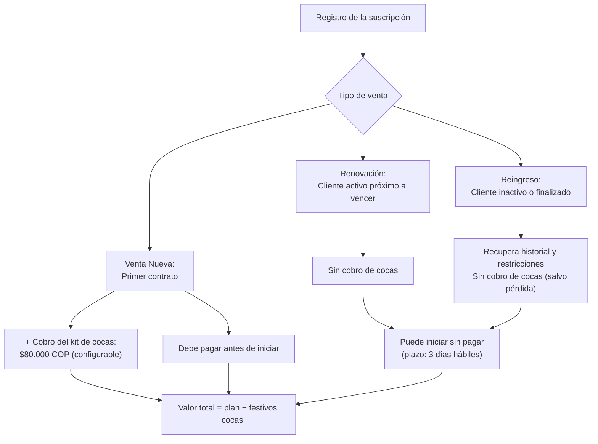

# 📜 RN-05: Suscripciones, Tipos de Venta y Menú con Alternativas

> Actualizada el 2026-11-03 (bd.uml v3.7): ya **no existe el menú personalizado** ni su recargo. Los clientes con restricciones reciben **alternativas** definidas en el menú de cada día.

## 📌 Declaración de la Regla
La entidad **Suscripción** es el contrato entre el cliente y el negocio. Define el plan (Semanal, Quincenal o Mensual), la condición del cliente (**Venta Nueva, Renovación o Reingreso**) y su ciclo de estados.

---

## ⚙️ Reglas de Venta y Tarifación

### 1. Planes y precios
| Plan | Días hábiles | Valor |
| :--- | :---: | :---: |
| Semanal | 5 | $75.000 COP |
| Quincenal | 10 | $150.000 COP |
| Mensual | 20 | $300.000 COP |

Los festivos se descuentan del valor y no mueven la fecha final ([[RN_Festivos_y_Agenda]]).

### 2. Menú y restricciones alimentarias
* El menú se programa por día hábil y se **publica por semana** (borrador → publicado). Solo los menús de una semana publicada se muestran al cliente y generan órdenes de producción.
* **No hay menú personalizado.** Cada cliente registra sus restricciones de una lista cerrada (carne, cerdo, mariscos, gluten, lácteos) y cada producto indica qué contiene.
* Si un plato contiene algo que el cliente no puede comer, recibe la **alternativa** definida para ese plato en el menú del día (`menu_alternativas`).
* Las alergias se registran aparte, como texto libre, para la cocina.

### 3. Modalidades de venta, pago y ciclo de vida
* **Venta Nueva:** cobra el kit de cocas ($80.000 COP, configurable en [[DB_Tabla_Configuraciones_Sistema]]) y debe pagar antes de iniciar.
* **Renovación:** la fecha de inicio se empalma con el día hábil posterior al fin del plan anterior.
* **Reingreso:** reactiva al cliente y recupera sus restricciones y direcciones, sin cobrar de nuevo el kit.
* **Inicio sin pago (renovación y reingreso):** si la configuración lo permite, la suscripción inicia en la semana que pidió y el cliente tiene **3 días hábiles** (configurable) para pagar. Si no paga, el **administrador decide** si continúa, se suspenden las entregas o se cancela. El corte semanal está en [[RN_Limite_Suscripcion_Semanal]].
* **Estados:** pendiente de pago → verificando → activa → finalizada; también rechazada (pago no válido) y cancelada. Una suscripción que inició sin pagar queda **activa** con el indicador de pago pendiente.

---

## 🔗 Relaciones del Sistema
* **Procesos**: [[PROC_Registro_y_Venta]], [[PROC_Planeacion_Cocina_y_Recetas]].
* **Tablas de BD**: [[DB_Tabla_Suscripciones]], [[DB_Tablas_Menu]].
* **Casos de Uso**: [[CU_05_Clientes_y_Ventas]].
