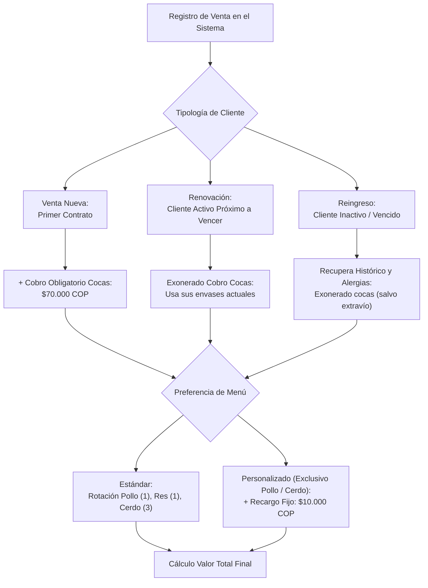

# 📜 RN-05: Suscripciones, Tipos de Venta y Personalización de Menú

## 📌 Declaración de la Regla
La entidad **Suscripción** actúa como el contrato comercial inteligente entre el cliente y el negocio. Define el catálogo de servicios (Planes Semanal, Quincenal y Mensual), las preferencias alimentarias de proteína y el flujo según la condición histórica del cliente (**Venta Nueva, Renovación o Reingreso**).

---

## ⚙️ Reglas de Venta y Tarifación de Menús

### 1. Tipos de Planes
* **Plan Semanal**: Duración de 5 días hábiles teóricos (Lunes a Viernes).
* **Plan Quincenal**: Duración de 10 días hábiles teóricos.
* **Plan Mensual**: Duración de 20 días hábiles teóricos.

### 2. Distribución de Proteínas y Recargo por Menú Personalizado
* **Menú Estándar**: Menú rotativo de cocina con la siguiente distribución semanal estándar:
  * 3 almuerzos con proteína de **Cerdo**.
  * 1 almuerzo con proteína de **Pollo**.
  * 1 almuerzo con proteína de **Res**.
* **Menú Personalizado**: El cliente puede exigir un menú exclusivo durante toda la semana (ej. Solo Pollo o Solo Cerdo).
  * **Regla de Recargo**: El sistema aplica un recargo obligatorio de **$10.000 COP** adicionales sobre el valor total del plan contratado.

### 3. Modalidades de Venta y Ciclo de Vida
* **Venta Nueva (Primer Registro)**: Obliga al cobro del kit de 2 cocas ($70.000 COP) descritas en [[RN_Logistica_Cocas]].
* **Renovación**: Aplica cuando el plan actual está vigente o próximo a vencer. La `fecha_inicio` se empalma automáticamente con el día hábil posterior a la terminación del plan anterior.
* **Reingreso**: Reactiva la cuenta de un cliente vencido. Recupera automáticamente sus alergias y direcciones registradas previamente sin volver a cobrar el kit de recipientes.

---

## 🔗 Relaciones del Sistema
* **Procesos**: [[PROC_Registro_y_Venta]], [[PROC_Planeacion_Cocina_y_Recetas]].
* **Tablas de BD**: [[DB_Tabla_Suscripciones]].
* **Casos de Uso**: [[CU_05_Clientes_y_Ventas]].

## 🔄 Cambio de alcance 2026-11-02
El recargo por menú personalizado ($10.000 COP) y la posibilidad de ofrecerlo son parametrizables en [[DB_Tabla_Configuraciones_Sistema]] (`recargo_menu_personalizado`, `menu_personalizado_activo`). La programación del menú es ahora el subproceso **Menú** del proceso de Ventas ([[DB_Tablas_Menu]]).

El cierre semanal para entrar en la semana siguiente está en [[RN_Limite_Suscripcion_Semanal]].
