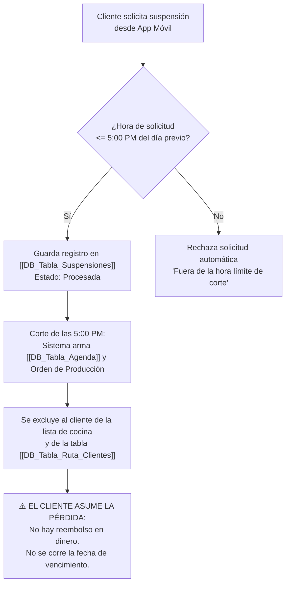

# 🚫 RN-03: Suspensiones Voluntarias de Entrega

## 📌 Declaración de la Regla
Si un cliente con suscripción activa planea ausentarse (viajes, reuniones externas, imprevistos personales) y decide no recibir el almuerzo en un día determinado, **debe notificar la suspensión desde su App Móvil antes de la hora límite de corte (5:00 PM del día anterior)**. La empresa omitirá la preparación del alimento para no desperdiciar insumos, **pero el cliente asume la pérdida económica del día; no existen devoluciones monetarias ni extensión de la fecha de vencimiento del plan**.

---

## ⚙️ Especificaciones y Restricciones Operativas

### 1. Hora Límite de Corte (5:00 PM)
* Las notificaciones de suspensión deben registrarse antes de las **5:00 PM del día hábil anterior** a la entrega.
* A las 5:01 PM, las órdenes de producción y la compra de insumos quedan bloqueadas en el sistema. Solicitudes posteriores no serán procesadas.

### 2. Política de No Reembolso y Vigencia Invariable
* **Sin Devolución Financiera**: No se realizan reembolsos en dinero ni abonos en saldo a favor por los días no recibidos voluntariamente.
* **Vencimiento Fijo**: La `fecha_vencimiento` del contrato en la tabla [[DB_Tabla_Suscripciones]] permanece **inalterada**. Si la suscripción vencía el viernes, caducará el viernes independientemente de las suspensiones solicitadas.

### 3. Impacto en Cocina y Rutas
* **Exclusión en Cocina**: La consulta SQL que genera la orden de producción diaria filtra los clientes con registros activos en [[DB_Tabla_Suspensiones]] para esa fecha, impidiendo el despacho de insumos innecesarios.
* **Exclusión en Ruta**: El domiciliario no visualiza la parada del cliente suspendido en su aplicación de reparto.

---

## 🔗 Relaciones del Sistema
* **Procesos**: Se integra en [[PROC_Planeacion_Cocina_y_Recetas]] (exclusión en el conteo) y [[PROC_Despacho_y_Distribucion]].
* **Tablas de BD**: [[DB_Tabla_Suspensiones]], [[DB_Tabla_Suscripciones]].
* **Casos de Uso**: [[CU_04_Servicios_y_Operacion]].

## 🔄 Cambio de alcance 2026-11-02
La hora límite de corte (5:00 PM) es parametrizable en [[DB_Tabla_Configuraciones_Sistema]] (`hora_limite_suspension`).

## 🔄 Ajuste con el frontend 2026-11-03 (bd.uml v3.7)
Se mantiene la hora límite del día anterior (5:00 PM, configurable). En el frontend la pausa debe validarse con esta regla y no con horas de anticipación.
