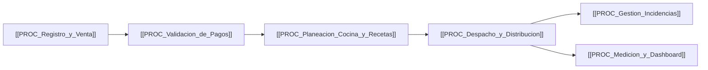

# 🔄 00 MOC — Procesos Operativos (PROC)

Este Mapa de Contenido describe la cadena de valor y los flujos de trabajo operativos integrados en el software **JackSoft** para **La Coca de Jacks S.A.S.**.

---

## 🗺️ Mapa de Procesos Integrados (Cadena de Valor)

---

## 📋 Catálogo de Procesos Operativos

1. **[[PROC_Registro_y_Venta]]**: Captura del cliente, selección de plan (Semanal, Quincenal, Mensual), preferencia de proteína, dirección geocodificada y cotización con recipientes.
2. **[[PROC_Validacion_de_Pagos]]**: Carga del comprobante bancario, revisión por backoffice, verificación de coincidencia y activación de la suscripción.
3. **[[PROC_Planeacion_Cocina_y_Recetas]]**: Consolidado automático de almuerzos diarios a las 5:00 PM, consulta de alergias, fichas técnicas e insumos requeridos.
4. **[[PROC_Despacho_y_Distribucion]]**: Agrupación por zonas de cobertura, orden de paradas de entrega, despacho en cocas y rastreo GPS en tiempo real.
5. **[[PROC_Gestion_Incidencias]]**: Recepción y solución de novedades en ruta o cliente (cocas dañadas, ausencia, dirección errónea).
6. **[[PROC_Medicion_y_Dashboard]]**: Consolidación gerencial de KPIs de ventas, retención de clientes, mermas de cocina y desempeño logístico.
