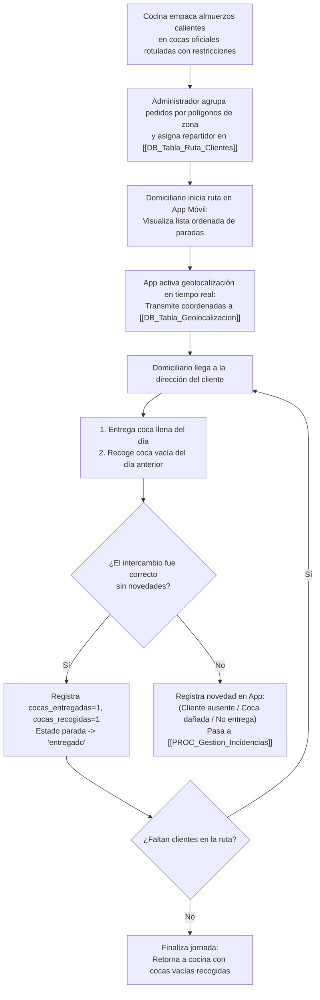

# 🛵 PROC-04: Despacho, Distribución y Rotación de Recipientes en Ruta

## 📌 Resumen del Proceso
El proceso de Despacho y Distribución abarca desde la salida de los paquetes empacados desde la cocina hasta la entrega física en la puerta del cliente. Gestiona la asignación de rutas por zona, el ordenamiento óptimo de paradas, la transmisión GPS en vivo del repartidor y el intercambio físico de recipientes reutilizables.

---

## 🔄 Flujo Operativo en Ruta (Franja 11:30 AM - 1:30 PM)

---

## 📊 Matriz de Entregables de la Ruta
* **Almuerzo Caliente Empacado**: Rotulado con el nombre del cliente y alergias especificadas.
* **Confirmación Digital**: Timestamp y coordenadas del momento del despacho.
* **Control de Inventario Físico de Cocas**: Balance actualizado en el sistema al cerrar el recorrido.

---

## 🔗 Vinculación con Reglas de Negocio
* Se rige por las políticas de rotación de envases de [[RN_Logistica_Cocas]].
* Aplica las restricciones de zonas de geofencing descritas en [[RN_Domiciliarios_y_Rutas]].
* Alimenta las entidades [[DB_Tabla_Ruta_Clientes]] y [[DB_Tabla_Geolocalizacion]].
