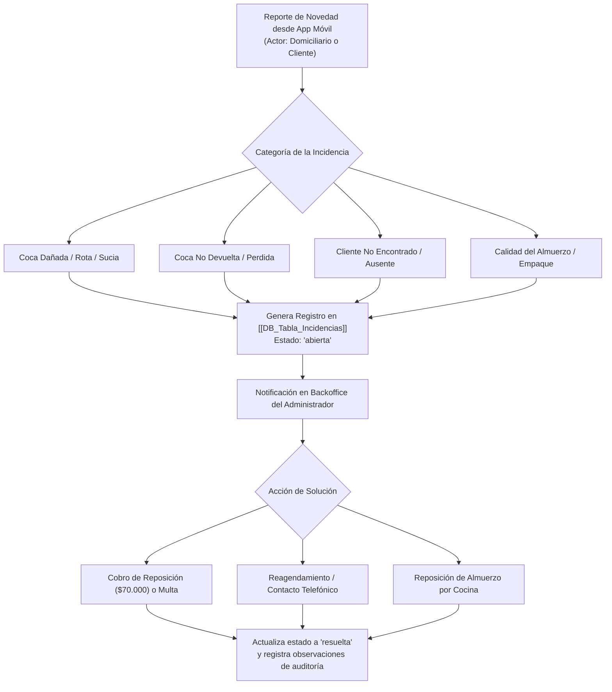

# ⚠️ PROC-05: Gestión de Novedades e Incidencias Operativas

## 📌 Resumen del Proceso
Este proceso centraliza el reporte, seguimiento y resolución de imprevistos surgidos durante el ciclo de vida del servicio. Permite capturar novedades tanto desde la App del Domiciliario (cliente no encontrado, dirección errónea, coca dañada/no entregada) como desde la App del Cliente (calidad del alimento, empaque defectuoso).

---

## 🔄 Flujo de Gestión y Solución de Incidencias

---

## 📋 Tipología de Incidencias y Acciones Correctivas

| Código | Tipo de Incidencia | Reportante | Impacto en Sistema | Acción de Gestión |
| :--- | :--- | :---: | :--- | :--- |
| **INC-01** | Coca Dañada / Defectuosa | Domiciliario | Crea registro en [[DB_Tabla_Incidencias]] | Genera cobro de reposición al cliente o descuento al proveedor. |
| **INC-02** | Coca No Devuelta | Domiciliario | Incrementa contador de cocas pendientes | Bloquea renovaciones hasta que se devuelva o cancele el valor. |
| **INC-03** | Cliente No Encontrado | Domiciliario | Marca estado parada como `no_entregado` | Notifica al cliente vía Push/WhatsApp para coordinar retiro. |
| **INC-04** | Reclamo de Calidad / Menú | Cliente | Notifica con foto adjunta al Administrador | Revisión con jefe de cocina e indemnización si aplica. |

---

## 🔗 Vinculación con Módulos
* Soportado por la entidad [[DB_Tabla_Incidencias]].
* Intersecta las reglas de [[RN_Logistica_Cocas]] y el proceso [[PROC_Despacho_y_Distribucion]].
