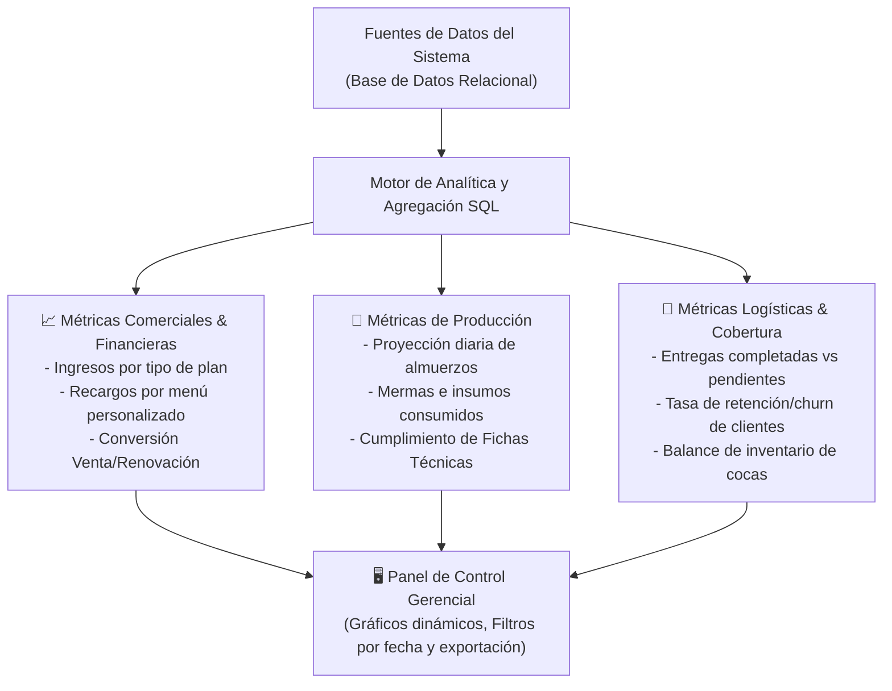

# 📈 PROC-06: Medición, KPIs y Dashboard Gerencial

## 📌 Resumen del Proceso
Este proceso consolida, calcula y visualiza en tiempo real los Indicadores Clave de Rendimiento (KPIs) financieros, operativos, de producción y de distribución a través de un panel gerencial interactivo.

---

## 📊 Arquitectura del Dashboard Interactivo

---

## 📐 Principales Indicadores Clave (KPIs)

### 1. Tasa de Churn de Clientes (Deserción)
$$\text{Churn Rate (\%)} = \left( \frac{\text{Clientes Cancelados o Vencidos No Renovados}}{\text{Total Clientes Activos al Inicio del Mes}} \right) \times 100$$

### 2. Rentabilidad Promedio por Suscripción (ARPU)
$$\text{ARPU} = \frac{\text{Ingresos Totales por Suscripciones + Recargos}}{\text{Número de Suscripciones Activas}}$$

### 3. Índice de Eficiencia Logística de Entregas
$$\text{Eficiencia Logística (\%)} = \left( \frac{\text{Entregas Completadas a Tiempo}}{\text{Total de Entregas Programadas en Ruta}} \right) \times 100$$

---

## 🔗 Vinculación con Módulos
* Mapeado directamente con la especificación de [[CU_07_Analitica_y_Metricas]].
* Consume datos de [[DB_Tabla_Suscripciones]], [[DB_Tabla_Ruta_Clientes]] e [[DB_Tabla_Incidencias]].
