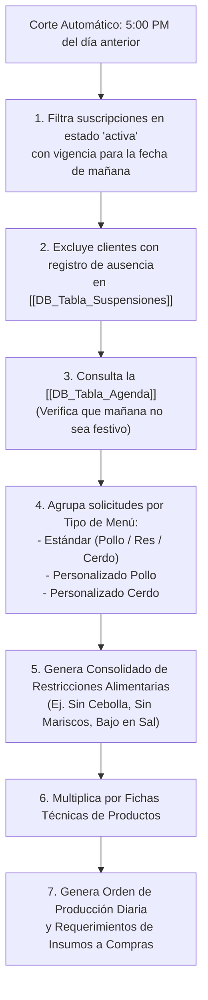

# 🍳 PROC-03: Planeación de Cocina, Fichas Técnicas y Recetas

## 📌 Resumen del Proceso
Este proceso consolida diariamente, de forma automatizada a las 5:00 PM, la cantidad exacta de almuerzos que la cocina debe preparar para la jornada del día siguiente. Cruza las suscripciones activas, las restricciones dietéticas de los clientes, las suspensiones notificadas y las fichas técnicas de los platos para generar la orden de producción y la lista de compras de insumos.

---

## 🔄 Algoritmo de Consolidación Diaria de Producción

---

## 📋 Fichas Técnicas y Porcionado
Cada producto del menú se compone de una Ficha Técnica detallada que registra:
* **Ingredientes e Insumos**: Cantidad exacta por porción (gramos, mililitros, unidades).
* **Proteína Principal**: Tipo de carne (Pollo, Res, Cerdo, Pescado).
* **Costo Unitario Estimado**: Sumatoria de insumos por plato.

### Ejemplo de Ficha Técnica: *Almuerzo Casero Pechuga a la Plancha*
| Insumo / Ingrediente | Categoría | Porción por Cliente | Unidad de Medida |
| :--- | :--- | :---: | :---: |
| Pechuga de Pollo | Proteína | 220 | Gramos |
| Arroz Blanco | Carbohidrato | 150 | Gramos |
| Ensalada Mixta | Vegetal | 100 | Gramos |
| Papa Salada | Tubérculo | 1 | Unidad |
| Jocoque / Aderezo | Salsa | 30 | Mililitros |

---

## 🔗 Vinculación con Reglas y Módulos
* Cruza con [[RN_Suspensiones_Voluntarias]] (exclusión de clientes) y [[RN_Festivos_y_Agenda]].
* Entidades involucradas: [[DB_Tablas_Inventario_Compras]] (fichas técnicas, productos, insumos).
* Casos de uso: [[CU_03_Produccion_y_Recetas]].
