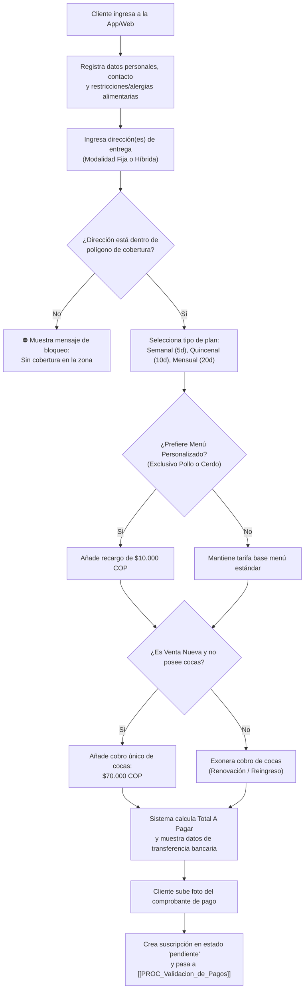

# 🛒 PROC-01: Registro de Clientes y Venta de Suscripciones

## 📌 Resumen del Proceso
El proceso de Registro y Venta gestiona el ingreso de nuevos usuarios o la renovación/reingreso de clientes existentes. Permite seleccionar el plan deseado, configurar preferencias alimentarias, validar la cobertura geográfica y realizar la liquidación inicial incluyendo el kit de recipientes cuando corresponda.

---

## 🔄 Flujo Paso a Paso (Diagrama de Actividades)

---

## 📑 Entradas y Salidas del Proceso

* **Entradas**:
  * Datos personales del cliente (Nombre, ID, Teléfono, Correo).
  * Restricciones y alergias alimentarias.
  * Dirección(es) y coordenadas GPS de entrega.
  * Plan seleccionado y preferencia de proteína.
  * Comprobante de transferencia bancaria (imagen/PDF).
* **Salidas**:
  * Registro en la tabla de clientes.
  * Registro en la tabla [[DB_Tabla_Suscripciones]] en estado `pendiente`.
  * Ticket de notificación enviado al panel del Administrador.

---

## 🔗 Vinculación con Reglas y Base de Datos
* Aplicación estricta de [[RN_Logistica_Cocas]] ($70.000 COP) y [[RN_Suscripciones_y_Menus]] (+$10.000 COP recargo).
* Verificación geográfica mediante polígonos descritos en [[RN_Domiciliarios_y_Rutas]].
* Mapeo de la entidad en [[DB_Tabla_Suscripciones]].
