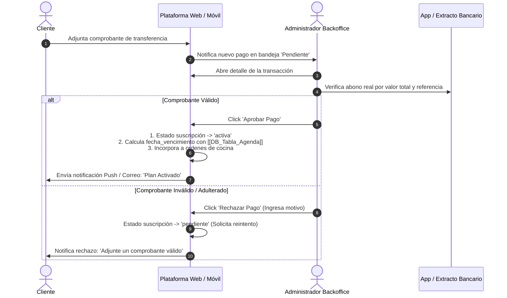

# 💸 PROC-02: Validación de Pagos y Activación de Suscripciones

## 📌 Resumen del Proceso
Este proceso centraliza la revisión manual o asistida por backoffice de los comprobantes de transferencia bancaria subidos por los clientes, garantizando el ingreso real de los fondos a las cuentas de la empresa antes de autorizar la preparación de alimentos y la asignación a rutas.

---

## 🔄 Flujo de Validación Transaccional

---

## 🔑 Criterios Operativos de Verificación
1. **Verificación del Monto**: El administrador valida que el valor ingresado coincida con la liquidación total de [[PROC_Registro_y_Venta]].
2. **Fecha de Inicio de la Suscripción**:
   * Si el pago se aprueba **antes de las 5:00 PM**, la suscripción puede iniciar al día hábil siguiente.
   * Si se aprueba **después de las 5:00 PM**, inicia el segundo día hábil posterior (para dar margen a la compra de insumos de cocina).
3. **Cálculo de Vigencia**: La fecha final de la suscripción se calcula automáticamente omitiendo los festivos marcados en [[DB_Tabla_Agenda]].

---

## 🔗 Vinculación con Reglas de Negocio
* Implementa la máquina de estados estipulada en [[RN_Pagos_y_Comprobantes]].
* Impacta directamente la consulta de clientes activos en [[PROC_Planeacion_Cocina_y_Recetas]].
