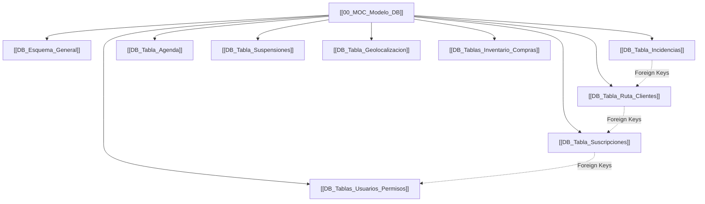

# 🗄️ 00 MOC — Modelado de Base de Datos (DB)

Este Mapa de Contenido estructura la arquitectura física y relacional del esquema de base de datos del software **JackSoft**, diseñado a partir de la especificación DBML oficial.

---

## 🗺️ Mapa de Dominio de la Base de Datos

---

## 📋 Entidades y Tablas del Esquema

1. **[[DB_Esquema_General]]**: Visión global del modelo E-R, convenciones de claves primarias, enumeraciones (Enums) e integridad referencial.
2. **[[DB_Tabla_Suscripciones]]**: Entidad principal de contratación, montos, personalización de menús y cobro de cocas.
3. **[[DB_Tabla_Ruta_Clientes]]**: Tabla intermedia de paradas diarias de reparto y conteo de cocas entregadas/recogidas.
4. **[[DB_Tabla_Incidencias]]**: Auditoría de novedades físicas (recipientes dañados, ausencias, ausencias).
5. **[[DB_Tabla_Agenda]]**: Calendario operativo parametrizado con festivos oficiales.
6. **[[DB_Tabla_Suspensiones]]**: Registro de ausencias voluntarias notificadas por los clientes.
7. **[[DB_Tabla_Geolocalizacion]]**: Histórico de coordenadas GPS enviadas por los domiciliarios.
8. **[[DB_Tablas_Usuarios_Permisos]]**: Modelo RBAC (`usuarios`, `roles`, `permisos`, `rol_permisos`).
9. **[[DB_Tablas_Inventario_Compras]]**: Cadena de abastecimiento (`insumos`, `proveedores`, `compras`, `fichas_tecnicas`, `ordenes_produccion`).

---

## 🗃️ Archivos de Esquema y Diagramas

- **Esquemas DBML (`04_Modelado_DB/Modelo_Relacional/vN_fecha/`):**
  - `v5_2026-11-03/bd.uml`: ⭐ Versión vigente, DBML v3.7 (3 de noviembre, 41 tablas, 68 relaciones): ajuste con el frontend.
  - `v4_2026-11-02/bd.uml`: DBML v3.6 (2 de noviembre, 36 tablas, 56 relaciones, 23 subprocesos). Sin `empleados`; nuevas [[DB_Tabla_Configuraciones_Sistema]] y menús en [[DB_Tablas_Menu]].
  - `v3_2026-10-30/bd.uml`: DBML v3.5 (30 de octubre, 35 tablas, 53 relaciones, 22 TableGroups).
  - `v1_2026-08-13/jacksoft_modelo_relacional_v1.dbml`: Versión inicial (13 de agosto, 33 tablas).
  - `v2_2026-08-24/jacksoft_modelo_relacional_v2.dbml`: Versión consolidada (24 de agosto, 33 tablas adaptadas a los módulos vigentes).
- **Diagrama Relacional Vectorial:** ⭐ `04_Modelado_DB/Diagramas/v3_2026-11-03/LaCocaDiagramDB.svg` (generado desde bd.uml v3.7). Anteriores: `v2_2026-11-02/` (v3.6). Histórico en `v1_2026-08-21/`:
  - `LaCocaDiagramDB.svg`: Diagrama conceptual y físico completo de la base de datos (37 tablas con relaciones foráneas).
