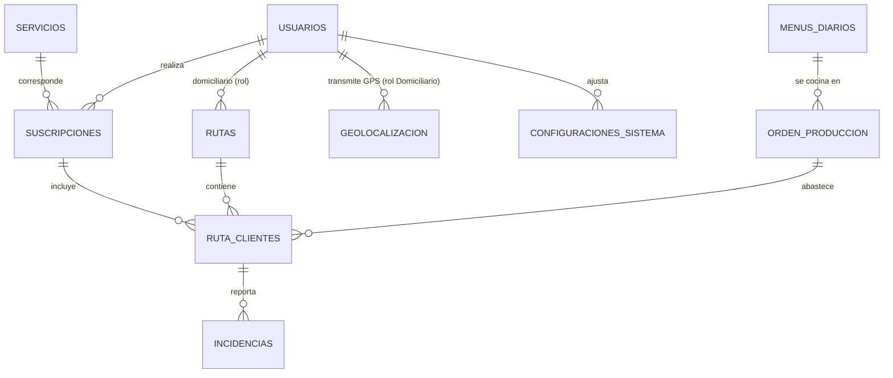

# 🗄️ DB-00: Esquema General de Base de Datos y Convenios

## 📌 Principios de Diseño
El modelo relacional del software **JackSoft** fue diseñado en sintaxis DBML alineado con las reglas de negocio de **La Coca de Jacks S.A.S.**.

### Convenciones Generales
1. **Primary Keys (PK)**: Identificador entero autoincremental (`id INT AUTO_INCREMENT`) en todas las tablas.
2. **Borrado Lógico**: Inexistencia de `DELETE` físico. Las tablas maestras incorporan `estado` Enum (`'activo'`, `'inactivo'`) para mantener la trazabilidad ([[RN_QA_y_Auditoria]]).
3. **Auditoría**: Campos `created_at` y `updated_at` en tablas transaccionales.
4. **Relaciones N:M**: Resueltas mediante tablas intermedias explícitas (`rol_permisos`, `insumo_proveedores`, `compra_detalle`, `ficha_tecnica_detalle`, `orden_produccion_detalle`, `ruta_clientes`).

---

## 🔠 Enumeraciones (Enums) del Sistema

```dbml
Enum estado_general { activo; inactivo }
Enum estado_registro { pendiente; aprobado; rechazado }
Enum estado_suscripcion { pendiente; activa; cancelada; vencida }
Enum tipo_venta { nueva; renovacion; reingreso }
Enum tipo_menu { estandar; pollo; cerdo }
Enum modalidad_entrega { fija; hibrida }
Enum tipo_plan { semanal; quincenal; mensual }
Enum estado_compra { pendiente; aprobada; anulada }
Enum estado_orden_produccion { planificada; en_preparacion; finalizada; cancelada }
Enum estado_entrega { pendiente; en_ruta; entregado; no_entregado }
Enum tipo_reportante { cliente; domiciliario }
Enum estado_incidencia { abierta; en_gestion; resuelta }
```

---

## 📐 Diagrama Entidad-Relación Simplificado (Mermaid)



---

## 🔗 Enlaces a Tablas Detalladas
* [[DB_Tabla_Suscripciones]] — Venta y liquidación.
* [[DB_Tabla_Ruta_Clientes]] — Logística diaria y cocas.
* [[DB_Tabla_Incidencias]] — Novedades físicas.
* [[DB_Tabla_Agenda]] — Calendario operativo.
* [[DB_Tabla_Suspensiones]] — Ausencias.
* [[DB_Tabla_Geolocalizacion]] — Coordenadas repartidor.
* [[DB_Tablas_Usuarios_Permisos]] — Autenticación y RBAC.
* [[DB_Tablas_Inventario_Compras]] — Insumos y producción.

## 🔄 Cambio de alcance 2026-11-02 (bd.uml v3.6)
* Se elimina la tabla `empleados`: el personal interno es un usuario con rol (Administrador, Cocina, Domiciliario). Las FK de producción, rutas, entregas, geolocalización e incidencias apuntan a `usuarios.id`.
* Nuevas tablas [[DB_Tabla_Configuraciones_Sistema]] (`configuraciones_sistema`, `historial_configuraciones`).
* `menus_diarios` y `menu_items` pasan al subproceso **Menú** del proceso de Ventas: ver [[DB_Tablas_Menu]].
