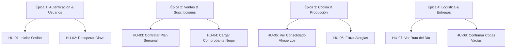
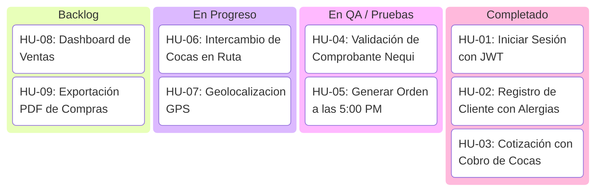

# 📋 Matriz de Historias de Usuario, Story Mapping y Kanban

Esta nota consolida la estructura del **Story Mapping** y la **Matriz de Historias de Usuario (HU)** priorizadas en el Product Backlog para el desarrollo del software **JackSoft**.

---

## 🗺️ Mapa de Actividades del Usuario (Story Mapping Structure)

---

## 📑 Matriz Sintética de Historias de Usuario Destacadas

| ID HU | Épica / Módulo | Título de la Historia | Criterios de Aceptación Clave | Sprint | Prioridad |
| :---: | :--- | :--- | :--- | :---: | :---: |
| **HU-01** | Configuración | Iniciar Sesión con JWT | Valida credenciales activas en `usuarios` y retorna token de sesión. | Sprint 03 | Alta |
| **HU-02** | Clientes | Registro con Modalidad Híbrida | Permite ingresar 2 direcciones asignadas a días específicos. | Sprint 04 | Alta |
| **HU-03** | Ventas | Cotización con Cobro de Cocas | Aplica automáticamente $70.000 COP si es primer contrato. | Sprint 04 | Alta |
| **HU-04** | Ventas | Validación de Transferencia | Permite al Administrador revisar la foto del comprobante y activar el plan. | Sprint 05 | Alta |
| **HU-05** | Cocina | Generar Orden a las 5:00 PM | Suma clientes activos omitiendo suspensiones y festivos. | Sprint 05 | Alta |
| **HU-06** | Logística | Intercambio de Cocas en Ruta | Repartidor confirma `cocas_entregadas` y `cocas_recogidas` en la App. | Sprint 06 | Alta |
| **HU-07** | Logística | Geolocalización GPS en Vivo | Transmite latitud y longitud a la tabla `geolocalizacion_domiciliarios`. | Sprint 06 | Media |
| **HU-08** | Analítica | Dashboard de Ventas y Churn | Gráficos interactivos de retención e ingresos por tipo de plan. | Sprint 07 | Media |

---

## 📌 Tablero Kanban (Estado del Backlog)

---

## 🔗 Relaciones con el Sistema
* Cada Historia de Usuario mapea con un Caso de Uso listado en [[00_MOC_Casos_de_Uso]].
* Planificadas según el cronograma de [[Scrum_Artefactos_y_Sprints]].

## 🔄 Cambio de alcance 2026-11-02 (Tablero Kanban v5)
* **Story Mapping:** 23 subprocesos y 157 historias (hasta 12 por subproceso, filas 7 a 18). Se quitó la columna EMPLEADOS; se agregaron CONFIGURACIONES DEL SISTEMA (8 historias, 24 puntos) y MENU (9 historias, 25 puntos); ROLES pierde "Asignar permisos"; SUSCRIPCIONES suma "Aprobar solicitud fuera de límite"; "No coincide con el MockUp" pasó a comentario en el encabezado de PRODUCCION. El Backlog, el Tablero y el Avance se recalculan solos.
* **Matriz HU (hoja Formato Matriz HU):** 194 HU **renumeradas** (subprocesos consecutivos por proceso; Producción pasa a 04.1–04.3). Nuevas **01.2 Configuraciones del sistema** y **06.3 Gestión de menú**. Los actores "Empleado" se renombraron por su rol (Cocinero, Jefe de producción, Personal de cocina, Domiciliario).
* Archivo: `Tablero_Kanban/v5_2026-11-02/Tablero Kanban 02_11.xlsx`.

## 👥 Responsables por módulo (Tablero Kanban v6, 2026-11-03)
Carga equitativa: 97–98 puntos y 31–32 historias por integrante. Se edita en la fila 21 del Story Mapping; el Backlog toma el responsable automáticamente.

| Integrante | Módulos | Historias | Puntos |
| :--- | :--- | :---: | :---: |
| Alejandro Gómez | Usuarios · Clientes · Suscripciones · Incidencias | 31 | 98 |
| Omar Meneses | Producción (orden) · Ficha técnica · Servicio · Menú | 31 | 98 |
| Erick Camargo | Roles · Configuraciones del sistema · Insumos · Producto terminado · Dashboard | 32 | 98 |
| Luis Gabriel Mesa | Categoría productos · Proveedores · Categoría de servicios · Domiciliarios · Monitoreo y rutas | 32 | 97 |
| Samuel Morales | Acceso · Categoría de insumos · Productos · Compras · Calendario | 31 | 97 |

## 🔄 Tablero Kanban v7 (Ajuste con el frontend 2026-11-03 (bd.uml v3.7))
* SUSCRIPCIONES: "Aprobar solicitud fuera de límite" se reemplaza por **"Gestionar suscripciones con pago vencido"** (mismos 5 puntos). MENU: "Cambiar estado del menú" pasa a **"Publicar menú semanal"**. La carga por integrante no cambia (97–98 puntos).
* Matriz HU: criterios con kit de $80.000, alternativas por restricción en lugar de menú personalizado y estados nuevos de la suscripción.
