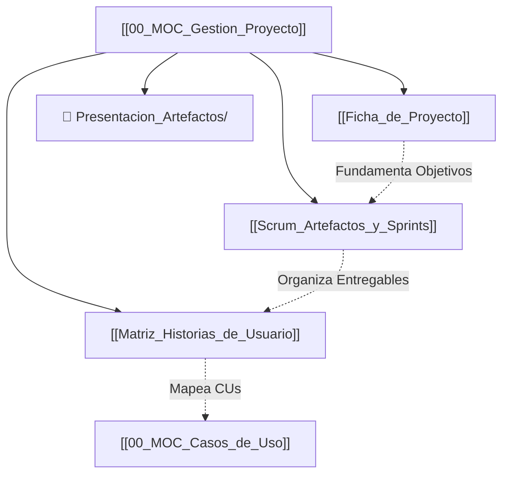

# 🚀 00 MOC — Gestión de Proyecto y Metodología Scrum

Este Mapa de Contenido centraliza la documentación metodológica, administrativa e institucional del proyecto formativo **JackSoft** del programa SENA ADSO (Ficha 3312824).

---

## 🗺️ Mapa de Artefactos de Gestión

---

## 📋 Documentos de Gestión del Proyecto

1. **[[Ficha_de_Proyecto]]**: Ficha técnica oficial del proyecto SENA (Ficha 3312824), datos del cliente (La Coca de Jacks S.A.S.), aprendices participantes, justificación, objetivos general/específicos y alcance detallado.
   - **Versión más reciente:** `Fichas_Tecnicas/v8_2026-11-02/Ficha_Jacksoft_CF_v8_alcance.docx` (cambio de alcance: sin Empleados, Permisos ni Categoría de proveedor; con Configuraciones del sistema y Menú).
   - **Versión anterior:** `Fichas_Tecnicas/v7_2026-10-30/Ficha_3agosto Jacksoft CF_v2_festivos.docx` (festivos según RN-02).
   - **Versión con VoBo:** `Fichas_Tecnicas/v6_2026-09-13/Ficha_3agosto Jacksoft CF.docx` y `.pdf` (VoBo de Requisitos del instructor Newton Pomare el 10/09/2026).
   - **Historial de Versiones:** `v1_2026-06-16` … `v5_2026-08-14` (ver [[ESTADO_ACTUAL]] y [[CHANGELOG]]).

2. **[[Scrum_Artefactos_y_Sprints]]**: Roadmap de ejecución estructurado en **11 Sprints** abarcando las 5 fases institucionales (Requisitos, Análisis, Modelado, Construcción, Implantación).
   - Incluye la definición de Producto (DoD), acuerdos de equipo y entregables por iteración.

3. **[[Matriz_Historias_de_Usuario]]**: Matriz consolidada de Historias de Usuario (HU), Story Mapping, priorización del Product Backlog y tablero Kanban de seguimiento.
   - **Tablero Vigente:** `Historias_de_Usuario_y_Kanban/Tablero_Kanban/v6_2026-11-03/Tablero Kanban 03_11.xlsx` (responsable por módulo con carga equitativa; 23 subprocesos, 158 historias, Matriz HU con 194 HU). Anterior: `v4_2026-10-23/Tablero Kanban 13_09.xlsx` (edición del 23 oct del tablero 13_09: Story Mapping v03 con 22 módulos/135 historias y Matriz HU con 22 subprocesos/186 HU).
   - **Archivos Históricos:** `Tablero_Kanban/v3_2026-09-13/`, `v2_2026-08-21/` (`.xlsx`, `.numbers`, `.csv`), `v1_2026-08-10/`; `Matriz_HU/v1_2026-08-12/`.

4. **Presentación Web Interactiva de Artefactos (`Presentacion_Artefactos/v1_2026-07-27/`):**
   - Aplicación web con visualización interactiva de artefactos Scrum: Product Backlog iceberg, Sprint Focus, Increment Blocks y Definition of Done shield (`index.html`).
