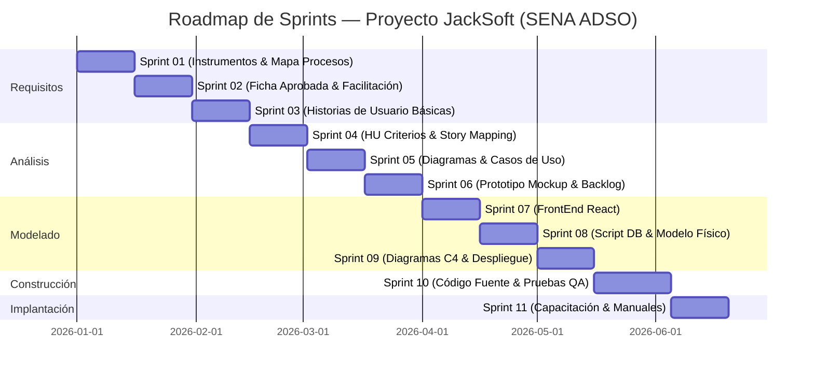

# 🏃 Roadmap de Sprints y Artefactos Scrum — JackSoft

El plan de trabajo del proyecto **JackSoft** se estructura en **11 Sprints** agrupados en las 5 fases del ciclo de vida del software instituido por el SENA (Requisitos, Análisis, Modelado, Construcción e Implantación).

---

## 📊 Cronograma por Fases y Sprints (Mermaid)

---

## 📋 Entregables Detallados por Sprint

| Fase | Sprint | Entregables Principales | Vinculación a Notas |
| :--- | :---: | :--- | :--- |
| **Requisitos** | **Sprint 01** | Instrumentos de recolección de información. Mapa de Procesos v1. | [[Planteamiento_del_Problema]] |
| | **Sprint 02** | Ficha de Proyecto Aprobada. Facilitación gráfica v1. | [[Ficha_de_Proyecto]] |
| | **Sprint 03** | Historias de Usuario para procesos básicos. Manual Técnico v1. | [[Matriz_Historias_de_Usuario]] |
| **Análisis** | **Sprint 04** | Historias de usuario con criterios de aceptación y estimaciones. Story Mapping. | [[Matriz_Historias_de_Usuario]] |
| | **Sprint 05** | Modelo Relacional, Diagramas de Casos de uso y Documentación formal de Casos de uso. | [[00_MOC_Casos_de_Uso]] |
| | **Sprint 06** | Prototipo – Mockup (Figma/Adobe). Product Backlog refinado. Manual Técnico v1. | [[Matriz_Historias_de_Usuario]] |
| **Modelado** | **Sprint 07** | FrontEnd en React con arquitectura modular. | [[CU_01_Configuracion_y_Seguridad]] |
| | **Sprint 08** | Script DDL/DML y Diagrama físico de Base de Datos (DBML/SQL). | [[DB_Esquema_General]] |
| | **Sprint 09** | Diagramas C4 (Contexto, Contenedor, Componente), Diagrama de Despliegue. | [[00_MOC_Modelo_DB]] |
| **Construcción**| **Sprint 10**| Código fuente backend/frontend, Informe de Evaluación de Calidad, Documentación de Pruebas. | [[RN_QA_y_Auditoria]] |
| **Implantación**| **Sprint 11**| Capacitación al cliente, Manual de Usuario, Manual Técnico v4 final. | [[Ficha_de_Proyecto]] |

---

## 🔗 Relaciones Institucionales
* Los entregables garantizan el cumplimiento de los objetivos de la [[Ficha_de_Proyecto]].
* El desglose granular de tareas se visualiza en la [[Matriz_Historias_de_Usuario]].
