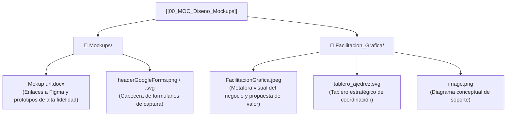

# 🎨 00 MOC — Diseño, Prototipos y Mockups

Este Mapa de Contenido (MOC) reúne los recursos gráficos, interfaces de usuario, enlaces a prototipos navegables en Figma y herramientas de conceptualización visual del software **JackSoft** para la empresa **La Coca de Jacks S.A.S.**.

---

## 🧭 Estructura del Módulo

---

## 🖥️ 1. Prototipos y Mockups de Interfaz

Ubicación: `07_Diseno_y_Mockups/Mockups/v1_2026-08-09/`

* **`Mokup url.docx`**: Documento oficial que contiene los enlaces a las pantallas y flujos interactivos de JackSoft diseñados en Figma (Web y Móvil).
* **`headerGoogleForms.png` / `headerGoogleForms.svg`**: Identidad visual y encabezados utilizados en los formularios de captura inicial de clientes y encuestas de satisfacción.

---

## 🖌️ 2. Facilitación Gráfica y Conceptualización

Ubicación: `07_Diseno_y_Mockups/Facilitacion_Grafica/v1_2026-08-24/`

* **`FacilitacionGrafica.jpeg`**: Artefacto gráfico que representa la propuesta de valor de *La Coca de Jacks*: almuerzos ejecutivos, suscripciones saludables, modelo de economía circular de recipientes retornables (cocas) y transformación digital operativa.
* **`tablero_ajedrez.svg`**: Metáfora visual de la estrategia de distribución, planificación de cocina y sincronización logística.
* **`image.png`**: Recurso gráfico complementario de apoyo a las presentaciones formativas.
