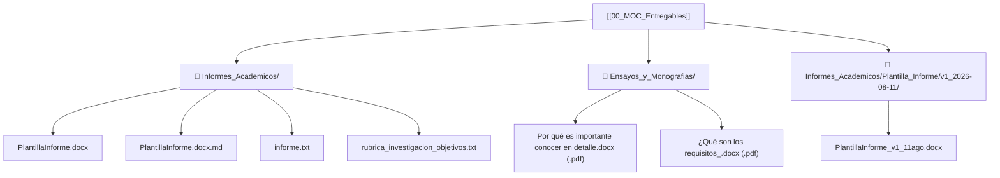

# 📑 00 MOC — Entregables e Informes de Formación

Este Mapa de Contenido (MOC) centraliza los informes académicos, ensayos formativos, rúbricas de evaluación y monografías institucionales desarrolladas en el marco del programa Tecnólogo en Análisis y Desarrollo de Software (SENA ADSO, Ficha 3312824).

---

## 🧭 Estructura del Módulo

---

## 📝 1. Informes Académicos e Investigativos

Ubicación: `08_Entregables_e_Informes/Informes_Academicos/Plantilla_Informe/v2_2026-09-01/` (vigente) · `Plantilla_Informe/v1_2026-08-11/` (`.docx.md`, `informe.txt`) · `Rubrica_Investigacion/v1_2026-08-25/`

- **`PlantillaInforme.docx` / `PlantillaInforme.docx.md`**: Informe formal de práctica e investigación formativa del proyecto JackSoft.
- **`informe.txt`**: Resumen en texto plano de los resultados del informe.
- **`rubrica_investigacion_objetivos.txt`**: Criterios de evaluación y formulación de objetivos e hipótesis investigativas según lineamientos SENA.

---

## 📚 2. Ensayos y Monografías Técnicas

Ubicación: `08_Entregables_e_Informes/Ensayos_y_Monografias/<Ensayo>/v1_2026-06-16/`

- **`¿Qué son los requisitos_` (`.docx` / `.pdf`)**: Monografía conceptual sobre la ingeniería de requisitos, clasificación (funcionales y no funcionales), técnicas de elicitación y su valor en el ciclo de vida del software. (Ver también nota de Obsidian: `[[Que_Son_Los_Requisitos]]`).
- **`Por qué es importante conocer en detalle` (`.docx` / `.pdf`)**: Ensayo justificativo sobre la profundidad en el levantamiento de procesos, mitigación de riesgos de desarrollo y costos del retrabajo en software. (Ver también nota de Obsidian: `[[Importancia_Conocer_en_Detalle]]`).

---

## 📦 3. Versiones Anteriores y Respaldo

Ubicación: `08_Entregables_e_Informes/Informes_Academicos/Plantilla_Informe/v1_2026-08-11/`

- **`PlantillaInforme_v1_11ago.docx`**: Versión previa del informe de práctica (agosto 11), conservada con fines de trazabilidad histórica.
