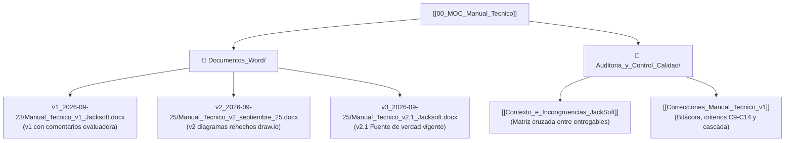

# 📖 00 MOC — Manual Técnico y Control de Calidad

Este Mapa de Contenido (MOC) centraliza las versiones oficiales, auditorías de calidad, bitácoras de cambios y trazabilidad en cascada del **Manual Técnico** de **JackSoft** para la empresa **La Coca de Jacks S.A.S.** (Proyecto formativo SENA ADSO, Ficha 3312824).

---

## 🧭 Estructura del Módulo

---

## 📑 1. Documentos Maestros (Versiones Word)

Ubicación: `10_Manual_Tecnico/Documentos_Word/` — v1 en `v1_2026-09-23/`, v2 en `v2_2026-09-25/`, v2.1 en `v3_2026-09-25/`, v2.2 (⭐ vigente, cambio de alcance del 2026-11-02) en `v4_2026-11-02/`

1. **`Manual_Tecnico_v1_Jacksoft.docx` (33.1 MB)**:
   - Versión original entregada con observaciones y comentarios directos de la instructora Liliana Galeano y la evaluadora técnica (`isabel0540`).
   - Contiene los comentarios clave:
     - **C4:** Arquitectura en 7mo trimestre.
     - **C9 a C14:** Observaciones sobre granularidad de Casos de Uso (campos vs objetivos de usuario).
     - **C40 y C41:** Anexos pendientes de actas y evidencias.

2. **`Manual_Tecnico_v2_septiembre_25.docx` (16.7 MB)**:
   - Versión con los 22 diagramas de casos de uso rehechos en Draw.io.
   - Mockups con descripciones y numeración formal de figuras (Figura 1–22).
   - Se removieron los comentarios C9–C14 del texto de Word.

3. **`Manual_Tecnico_v2.1_Jacksoft.docx` (16.7 MB) — ⭐ FUENTE DE VERDAD**:
   - Versión en curso y fuente de verdad del proyecto.
   - Conciliación de fichas de casos de uso y diagramas:
     - Eliminación de fichas redundantes de Permisos (HU_008 a HU_013), unificadas dentro de Roles.
     - Depuración de casos de uso de Servicios y Clientes conforme a las Reglas de Negocio.
     - Unificación de criterios de inclusión/extensión.

---

## 🔍 2. Auditoría y Control de Calidad

Ubicación: `10_Manual_Tecnico/Auditoria_y_Control_Calidad/`

* **[[Contexto_e_Incongruencias_JackSoft]]**:
  - Inventario comparativo exhaustivo entre la Ficha de Proyecto, Tablero Kanban / Story Mapping (13 de Septiembre), Matriz HU, Diagramas Draw.io, Modelo de Base de Datos relacional V2 y las Fichas de Casos de Uso.
  - Tabla comparativa de conteo de historias por módulo para detectar desalineaciones antes de la entrega final.

* **[[Correcciones_Manual_Tecnico_v1]]**:
  - Matriz de trazabilidad y respuesta a los comentarios de la evaluadora.
  - Criterio de validación: *¿El actor entraría al sistema solo para lograr esto y obtiene un resultado con valor?*
  - Plan de actualización en cascada para diagramas PUML, SVG, fichas de especificación, base de datos y tablero Kanban.
  - Bitácora de trabajo de la versión 2.1 y pendientes finales.

---

## 🔗 Relación con el Resto del Vault

- **Casos de Uso:** Las fichas individuales en [[00_MOC_Casos_de_Uso]] (`05_Casos_de_Uso/Especificaciones/` y `casos_de_uso_v3/`) alimentan la sección 4 del Manual Técnico.
- **Reglas de Negocio:** Cada validación o comportamiento del sistema referenciado en el manual se rige por [[00_MOC_Reglas_Negocio]] (`02_Reglas_de_Negocio/`).
- **Modelo de Datos:** El diccionario y diagramas relacionales de [[00_MOC_Modelo_DB]] (`04_Modelado_DB/`) sustentan las entidades del manual.
- **Gestión Scrum:** La correspondencia de identificadores `HU_xxx` proviene del backlog en [[00_MOC_Gestion_Proyecto]] (`06_Gestion_de_Proyecto_Scrum/`).
