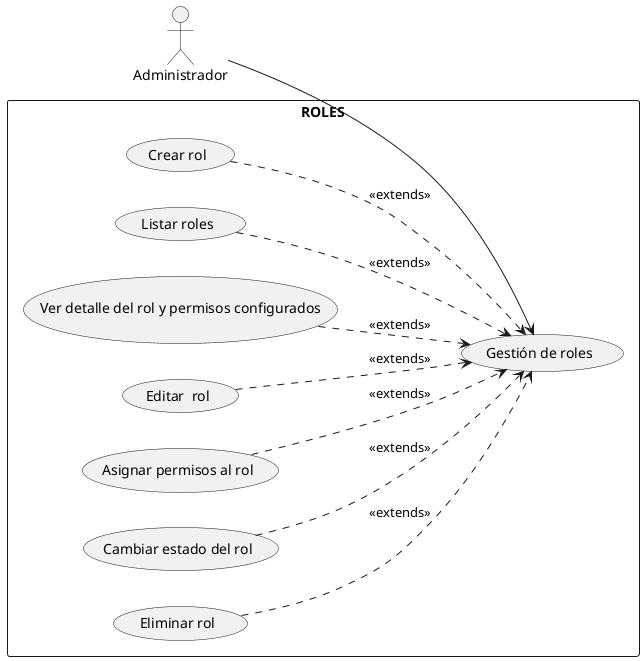
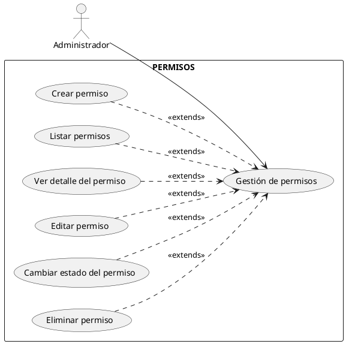
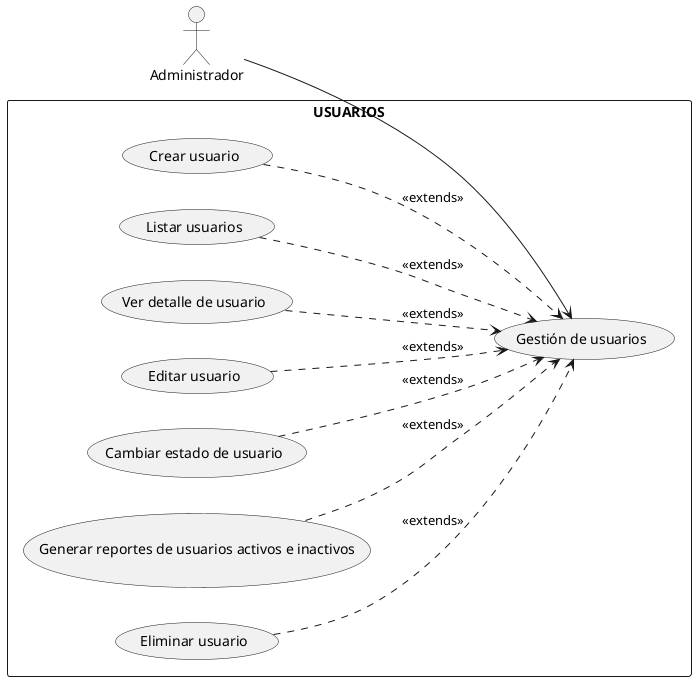
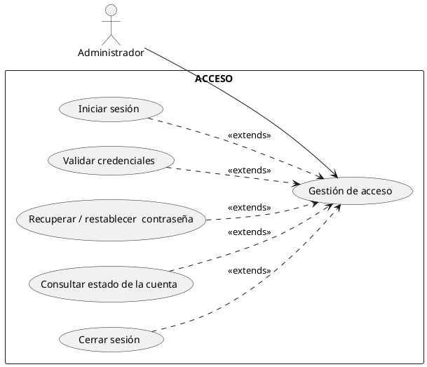

# Macro-Proceso: Configuración y Seguridad

Gestión de roles, permisos, usuarios y mecanismos de autenticación/acceso al sistema.

## Subprocesos Integrados

### Subproceso: ROLES
- **Total de Casos de Uso / Acciones:** 7
- **Actor Principal:** Administrador / Rol correspondiente

#### Listado de Casos de Uso
1. Crear rol
2. Listar roles
3. Ver detalle del rol y permisos configurados
4. Editar  rol
5. Asignar permisos al rol
6. Cambiar estado del rol
7. Eliminar rol

#### Diagrama PlantUML

---

### Subproceso: PERMISOS
- **Total de Casos de Uso / Acciones:** 6
- **Actor Principal:** Administrador / Rol correspondiente

#### Listado de Casos de Uso
1. Crear permiso
2. Listar permisos
3. Ver detalle del permiso
4. Editar permiso
5. Cambiar estado del permiso
6. Eliminar permiso

#### Diagrama PlantUML

---

### Subproceso: USUARIOS
- **Total de Casos de Uso / Acciones:** 7
- **Actor Principal:** Administrador / Rol correspondiente

#### Listado de Casos de Uso
1. Crear usuario
2. Listar usuarios
3. Ver detalle de usuario
4. Editar usuario
5. Cambiar estado de usuario
6. Generar reportes de usuarios activos e inactivos
7. Eliminar usuario

#### Diagrama PlantUML

---

### Subproceso: ACCESO
- **Total de Casos de Uso / Acciones:** 5
- **Actor Principal:** Administrador / Rol correspondiente

#### Listado de Casos de Uso
1. Iniciar sesión
2. Validar credenciales
3. Recuperar / restablecer  contraseña
4. Consultar estado de la cuenta
5. Cerrar sesión

#### Diagrama PlantUML

---
