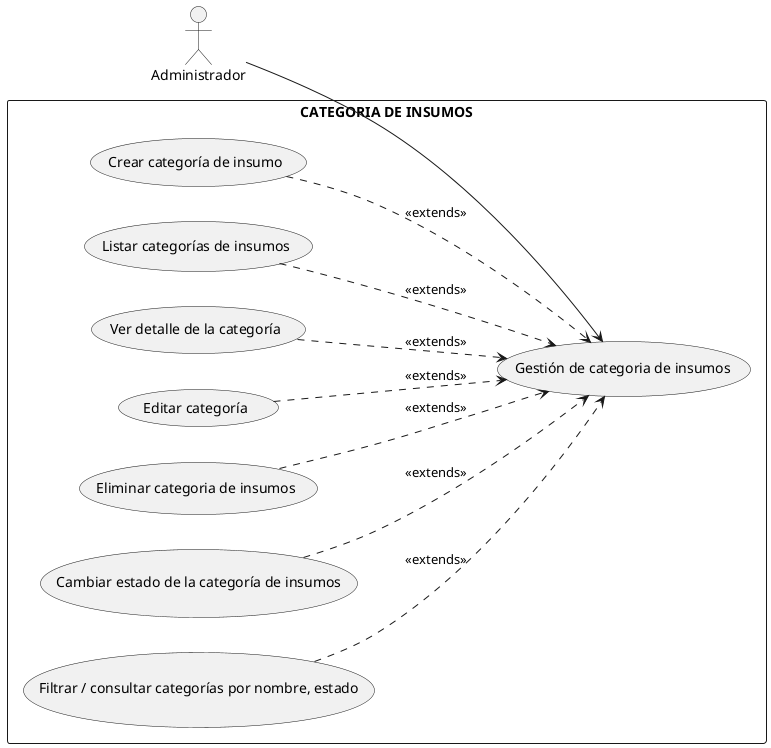
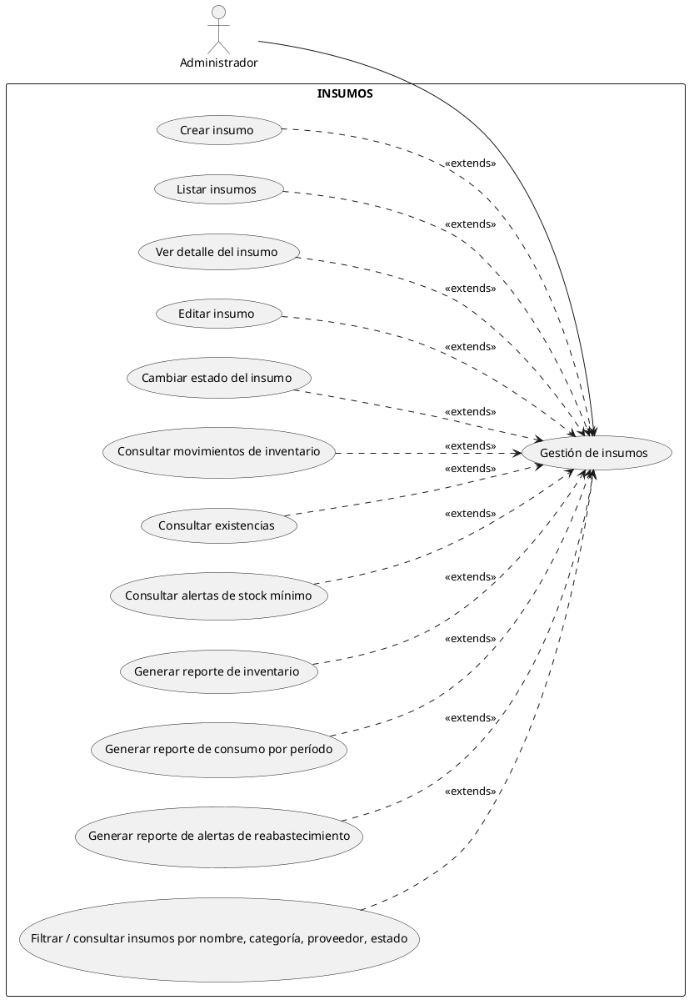
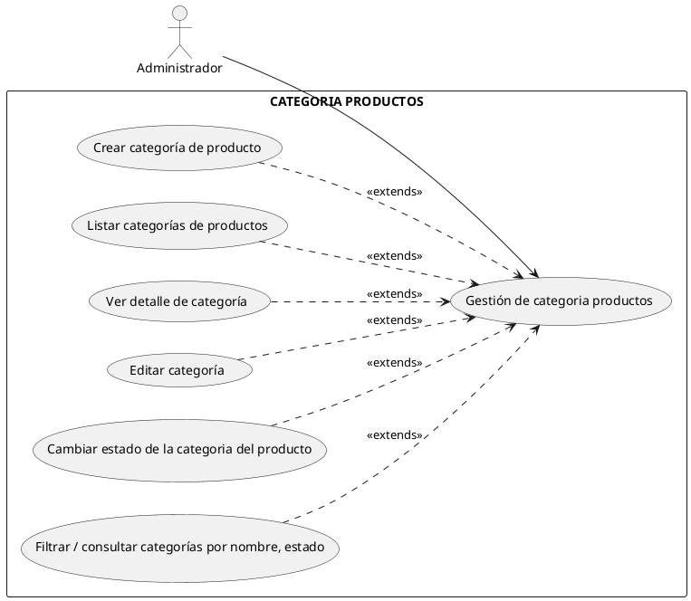
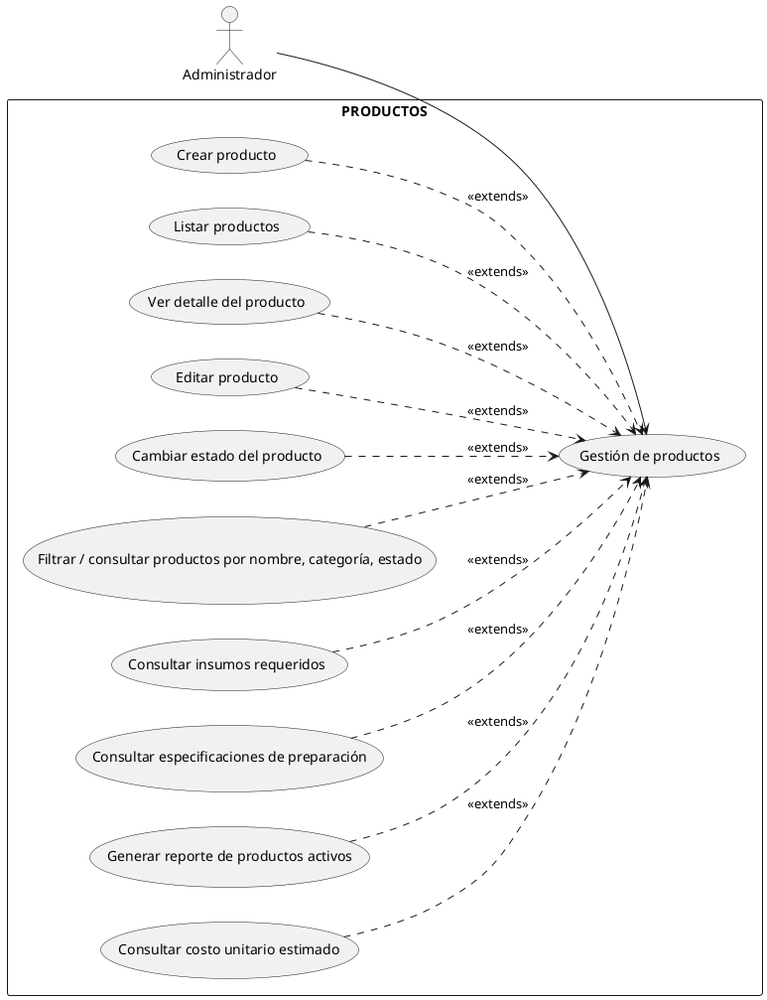
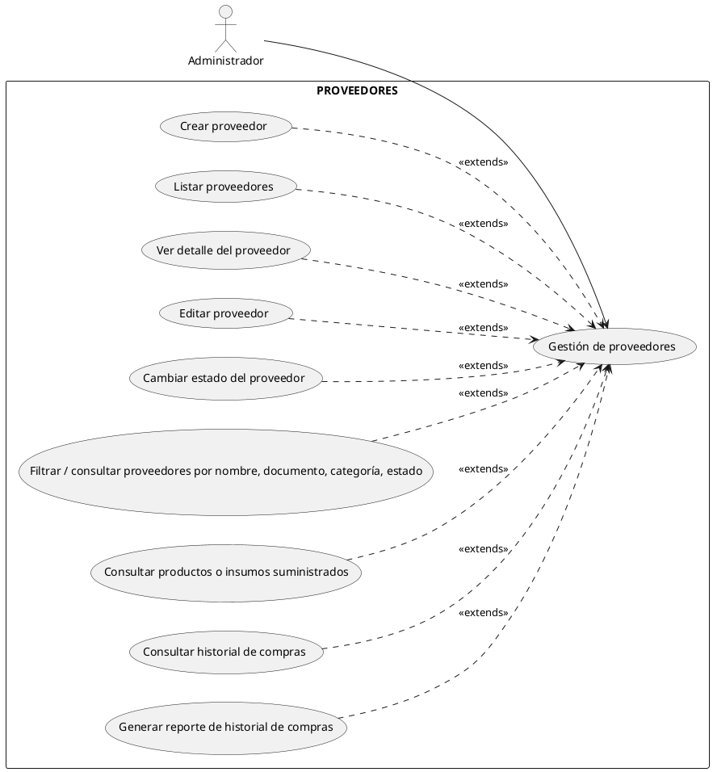
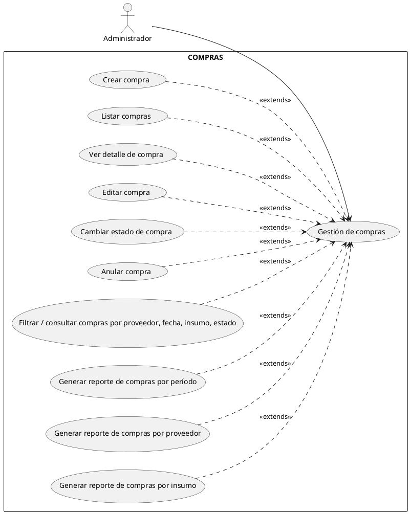

# Macro-Proceso: Compras e Inventario

Administración de insumos, categorías de insumos, productos, proveedores y órdenes de compra.

## Subprocesos Integrados

### Subproceso: CATEGORIA DE INSUMOS
- **Total de Casos de Uso / Acciones:** 7
- **Actor Principal:** Administrador / Rol correspondiente

#### Listado de Casos de Uso
1. Crear categoría de insumo
2. Listar categorías de insumos
3. Ver detalle de la categoría
4. Editar categoría
5. Eliminar categoria de insumos
6. Cambiar estado de la categoría de insumos
7. Filtrar / consultar categorías por nombre, estado

#### Diagrama PlantUML

---

### Subproceso: INSUMOS
- **Total de Casos de Uso / Acciones:** 12
- **Actor Principal:** Administrador / Rol correspondiente

#### Listado de Casos de Uso
1. Crear insumo
2. Listar insumos
3. Ver detalle del insumo
4. Editar insumo
5. Cambiar estado del insumo
6. Consultar movimientos de inventario
7. Consultar existencias
8. Consultar alertas de stock mínimo
9. Generar reporte de inventario
10. Generar reporte de consumo por período
11. Generar reporte de alertas de reabastecimiento
12. Filtrar / consultar insumos por nombre, categoría, proveedor, estado

#### Diagrama PlantUML

---

### Subproceso: CATEGORIA PRODUCTOS
- **Total de Casos de Uso / Acciones:** 6
- **Actor Principal:** Administrador / Rol correspondiente

#### Listado de Casos de Uso
1. Crear categoría de producto
2. Listar categorías de productos
3. Ver detalle de categoría
4. Editar categoría
5. Cambiar estado de la categoria del producto
6. Filtrar / consultar categorías por nombre, estado

#### Diagrama PlantUML

---

### Subproceso: PRODUCTOS
- **Total de Casos de Uso / Acciones:** 10
- **Actor Principal:** Administrador / Rol correspondiente

#### Listado de Casos de Uso
1. Crear producto
2. Listar productos
3. Ver detalle del producto
4. Editar producto
5. Cambiar estado del producto
6. Filtrar / consultar productos por nombre, categoría, estado
7. Consultar insumos requeridos
8. Consultar especificaciones de preparación
9. Generar reporte de productos activos
10. Consultar costo unitario estimado

#### Diagrama PlantUML

---

### Subproceso: PROVEEDORES
- **Total de Casos de Uso / Acciones:** 9
- **Actor Principal:** Administrador / Rol correspondiente

#### Listado de Casos de Uso
1. Crear proveedor
2. Listar proveedores
3. Ver detalle del proveedor
4. Editar proveedor
5. Cambiar estado del proveedor
6. Filtrar / consultar proveedores por nombre, documento, categoría, estado
7. Consultar productos o insumos suministrados
8. Consultar historial de compras
9. Generar reporte de historial de compras

#### Diagrama PlantUML

---

### Subproceso: COMPRAS
- **Total de Casos de Uso / Acciones:** 10
- **Actor Principal:** Administrador / Rol correspondiente

#### Listado de Casos de Uso
1. Crear compra
2. Listar compras
3. Ver detalle de compra
4. Editar compra
5. Cambiar estado de compra
6. Anular compra
7. Filtrar / consultar compras por proveedor, fecha, insumo, estado
8. Generar reporte de compras por período
9. Generar reporte de compras por proveedor
10. Generar reporte de compras por insumo

#### Diagrama PlantUML

---
