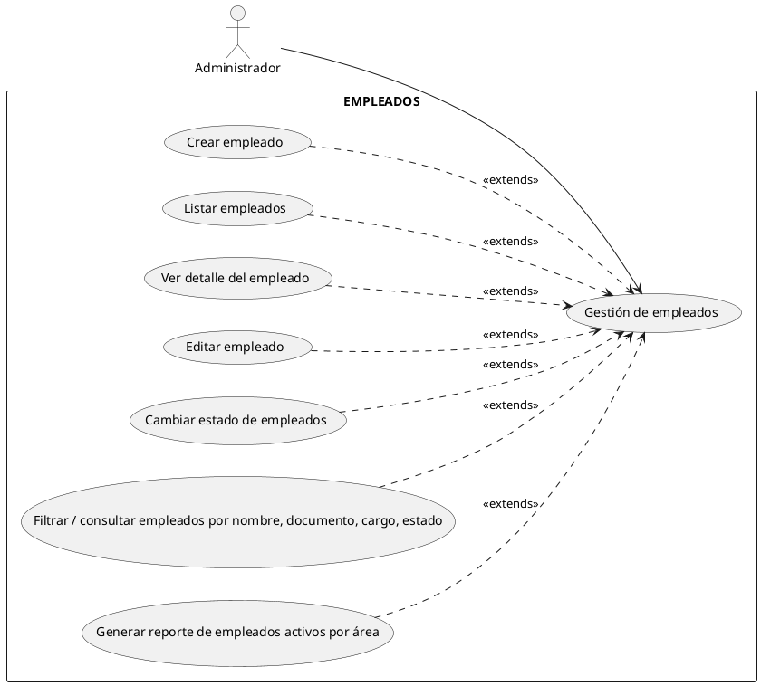
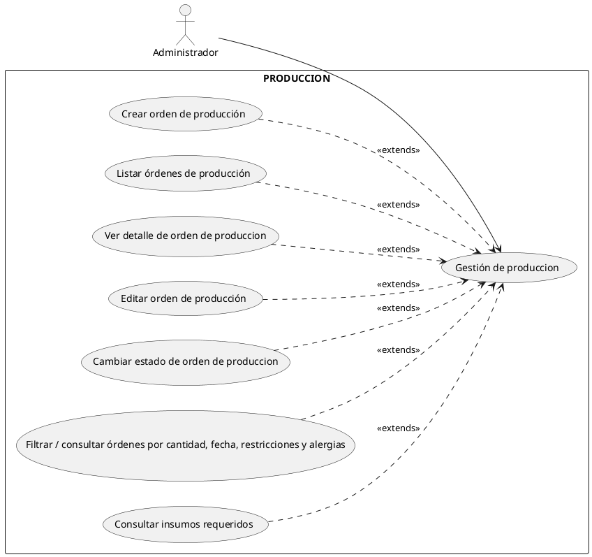
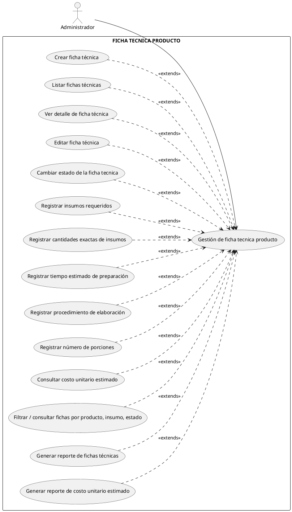
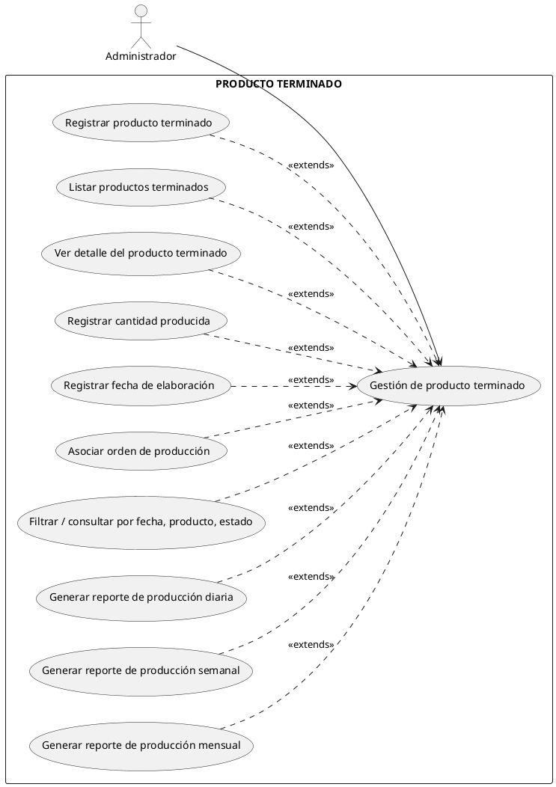

# Macro-Proceso: Producción y Recetas

Gestión de personal de producción, órdenes de producción, fichas técnicas y producto terminado.

## Subprocesos Integrados

### Subproceso: EMPLEADOS
- **Total de Casos de Uso / Acciones:** 7
- **Actor Principal:** Administrador / Rol correspondiente

#### Listado de Casos de Uso
1. Crear empleado
2. Listar empleados
3. Ver detalle del empleado
4. Editar empleado
5. Cambiar estado de empleados
6. Filtrar / consultar empleados por nombre, documento, cargo, estado
7. Generar reporte de empleados activos por área

#### Diagrama PlantUML

---

### Subproceso: PRODUCCION
- **Total de Casos de Uso / Acciones:** 7
- **Actor Principal:** Administrador / Rol correspondiente

#### Listado de Casos de Uso
1. Crear orden de producción
2. Listar órdenes de producción
3. Ver detalle de orden de produccion
4. Editar orden de producción
5. Cambiar estado de orden de produccion
6. Filtrar / consultar órdenes por cantidad, fecha, restricciones y alergias
7. Consultar insumos requeridos

#### Diagrama PlantUML

---

### Subproceso: FICHA TECNICA PRODUCTO
- **Total de Casos de Uso / Acciones:** 14
- **Actor Principal:** Administrador / Rol correspondiente

#### Listado de Casos de Uso
1. Crear ficha técnica
2. Listar fichas técnicas
3. Ver detalle de ficha técnica
4. Editar ficha técnica
5. Cambiar estado de la ficha tecnica
6. Registrar insumos requeridos
7. Registrar cantidades exactas de insumos
8. Registrar tiempo estimado de preparación
9. Registrar procedimiento de elaboración
10. Registrar número de porciones
11. Consultar costo unitario estimado
12. Filtrar / consultar fichas por producto, insumo, estado
13. Generar reporte de fichas técnicas
14. Generar reporte de costo unitario estimado

#### Diagrama PlantUML

---

### Subproceso: PRODUCTO TERMINADO
- **Total de Casos de Uso / Acciones:** 10
- **Actor Principal:** Administrador / Rol correspondiente

#### Listado de Casos de Uso
1. Registrar producto terminado
2. Listar productos terminados
3. Ver detalle del producto terminado
4. Registrar cantidad producida
5. Registrar fecha de elaboración
6. Asociar orden de producción
7. Filtrar / consultar por fecha, producto, estado
8. Generar reporte de producción diaria
9. Generar reporte de producción semanal
10. Generar reporte de producción mensual

#### Diagrama PlantUML

---
