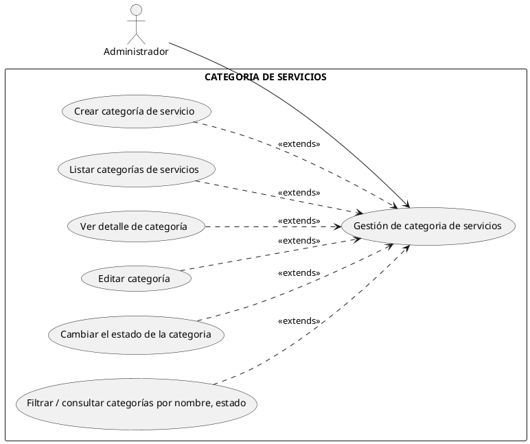
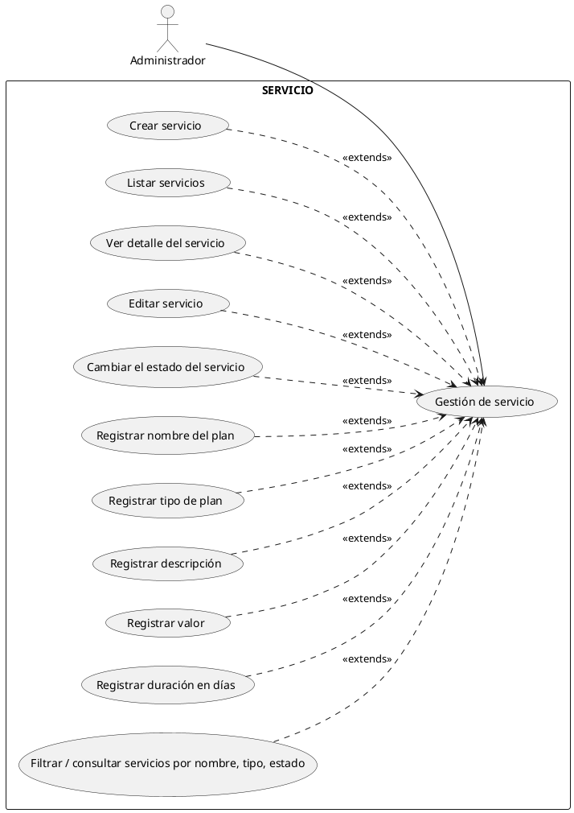
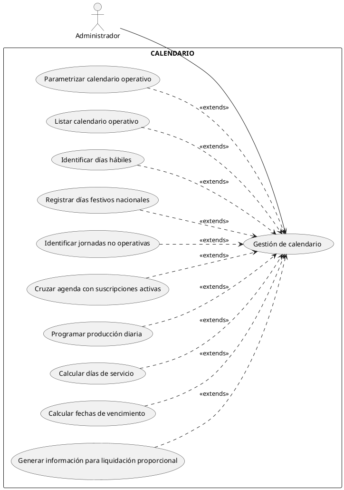

# Macro-Proceso: Servicios y Operación

Definición de servicios, categorías de servicios y programación de calendario operativo.

## Subprocesos Integrados

### Subproceso: CATEGORIA DE SERVICIOS
- **Total de Casos de Uso / Acciones:** 6
- **Actor Principal:** Administrador / Rol correspondiente

#### Listado de Casos de Uso
1. Crear categoría de servicio
2. Listar categorías de servicios
3. Ver detalle de categoría
4. Editar categoría
5. Cambiar el estado de la categoria
6. Filtrar / consultar categorías por nombre, estado

#### Diagrama PlantUML

---

### Subproceso: SERVICIO
- **Total de Casos de Uso / Acciones:** 11
- **Actor Principal:** Administrador / Rol correspondiente

#### Listado de Casos de Uso
1. Crear servicio
2. Listar servicios
3. Ver detalle del servicio
4. Editar servicio
5. Cambiar el estado del servicio
6. Registrar nombre del plan
7. Registrar tipo de plan
8. Registrar descripción
9. Registrar valor
10. Registrar duración en días
11. Filtrar / consultar servicios por nombre, tipo, estado

#### Diagrama PlantUML

---

### Subproceso: CALENDARIO
- **Total de Casos de Uso / Acciones:** 10
- **Actor Principal:** Administrador / Rol correspondiente

#### Listado de Casos de Uso
1. Parametrizar calendario operativo
2. Listar calendario operativo
3. Identificar días hábiles
4. Registrar días festivos nacionales
5. Identificar jornadas no operativas
6. Cruzar agenda con suscripciones activas
7. Programar producción diaria
8. Calcular días de servicio
9. Calcular fechas de vencimiento
10. Generar información para liquidación proporcional

#### Diagrama PlantUML

---
