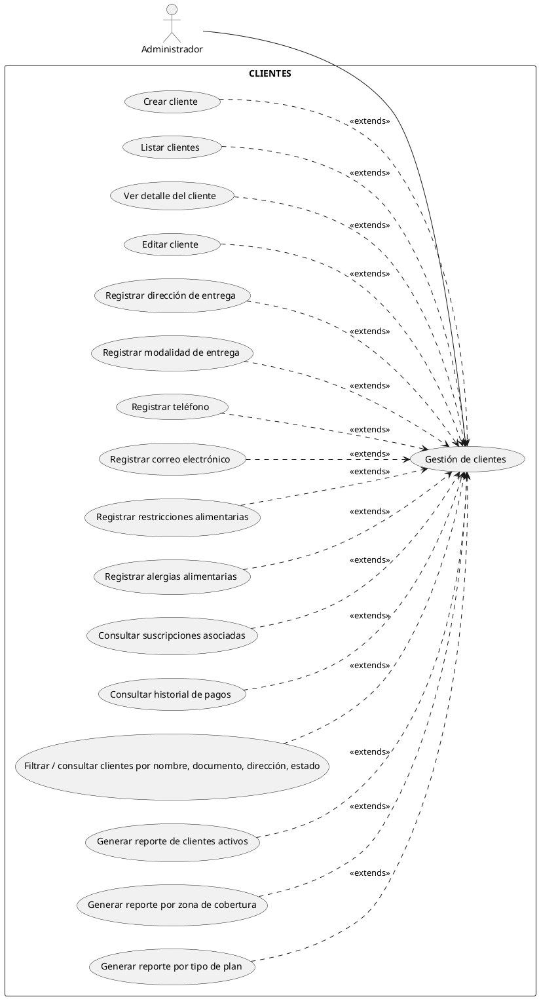

```plantuml
@startuml
left to right direction
skinparam packageStyle rectangle
actor "Administrador" as admin
package "SUSCRIPCIONES" {
  usecase "Gestión de suscripciones" as UC_Main
  usecase "Cotizar suscripción" as UC_1
  usecase "Registrar suscripción" as UC_2
  usecase "Listar suscripciones" as UC_3
  usecase "Ver detalle de suscripción" as UC_4
  usecase "Editar suscripción" as UC_5
  usecase "Administrar estado de suscripción" as UC_6
  usecase "Registrar plan semanal" as UC_7
  usecase "Registrar plan quincenal" as UC_8
  usecase "Registrar plan mensual" as UC_9
  usecase "Seleccionar menú estándar" as UC_10
  usecase "Seleccionar menú personalizado" as UC_11
  usecase "Aplicar recargo por menú personalizado" as UC_12
  usecase "Calcular fecha de inicio" as UC_13
  usecase "Calcular fecha de vencimiento" as UC_14
  usecase "Registrar comprobante de transferencia" as UC_15
  usecase "Consultar comprobante de pago" as UC_16
  usecase "Gestionar estado Pendiente" as UC_17
  usecase "Gestionar estado Activa" as UC_18
  usecase "Gestionar estado Cancelada" as UC_19
  usecase "Gestionar estado Vencida" as UC_20
  usecase "Registrar venta nueva" as UC_21
  usecase "Aplicar cobro de cocas en venta nueva" as UC_22
  usecase "Registrar renovación" as UC_23
  usecase "Registrar reingreso" as UC_24
  usecase "Recuperar historial del cliente" as UC_25
  usecase "Recuperar restricciones alimentarias" as UC_26
  usecase "Exonerar cobro de cocas en renovación" as UC_27
  usecase "Exonerar cobro de cocas en reingreso" as UC_28
  usecase "Validar cobertura de la dirección" as UC_29
  usecase "Validar capacidad de producción" as UC_30
}
admin --> UC_Main
UC_1 ..> UC_Main : <<extends>>
UC_2 ..> UC_Main : <<extends>>
UC_3 ..> UC_Main : <<extends>>
UC_4 ..> UC_Main : <<extends>>
UC_5 ..> UC_Main : <<extends>>
UC_6 ..> UC_Main : <<extends>>
UC_7 ..> UC_Main : <<extends>>
UC_8 ..> UC_Main : <<extends>>
UC_9 ..> UC_Main : <<extends>>
UC_10 ..> UC_Main : <<extends>>
UC_11 ..> UC_Main : <<extends>>
UC_12 ..> UC_Main : <<extends>>
UC_13 ..> UC_Main : <<extends>>
UC_14 ..> UC_Main : <<extends>>
UC_15 ..> UC_Main : <<extends>>
UC_16 ..> UC_Main : <<extends>>
UC_17 ..> UC_Main : <<extends>>
UC_18 ..> UC_Main : <<extends>>
UC_19 ..> UC_Main : <<extends>>
UC_20 ..> UC_Main : <<extends>>
UC_21 ..> UC_Main : <<extends>>
UC_22 ..> UC_Main : <<extends>>
UC_23 ..> UC_Main : <<extends>>
UC_24 ..> UC_Main : <<extends>>
UC_25 ..> UC_Main : <<extends>>
UC_26 ..> UC_Main : <<extends>>
UC_27 ..> UC_Main : <<extends>>
UC_28 ..> UC_Main : <<extends>>
UC_29 ..> UC_Main : <<extends>>
UC_30 ..> UC_Main : <<extends>>
@enduml
```

# Macro-Proceso: Clientes y Ventas

Gestión de clientes y ciclo de vida completo de suscripciones y ventas.

## Subprocesos Integrados

### Subproceso: CLIENTES
- **Total de Casos de Uso / Acciones:** 16
- **Actor Principal:** Administrador / Rol correspondiente

#### Listado de Casos de Uso
1. Crear cliente
2. Listar clientes
3. Ver detalle del cliente
4. Editar cliente
5. Registrar dirección de entrega
6. Registrar modalidad de entrega
7. Registrar teléfono
8. Registrar correo electrónico
9. Registrar restricciones alimentarias
10. Registrar alergias alimentarias
11. Consultar suscripciones asociadas
12. Consultar historial de pagos
13. Filtrar / consultar clientes por nombre, documento, dirección, estado
14. Generar reporte de clientes activos
15. Generar reporte por zona de cobertura
16. Generar reporte por tipo de plan

#### Diagrama PlantUML

---

### Subproceso: SUSCRIPCIONES
- **Total de Casos de Uso / Acciones:** 30
- **Actor Principal:** Administrador / Rol correspondiente

#### Listado de Casos de Uso
1. Cotizar suscripción
2. Registrar suscripción
3. Listar suscripciones
4. Ver detalle de suscripción
5. Editar suscripción
6. Administrar estado de suscripción
7. Registrar plan semanal
8. Registrar plan quincenal
9. Registrar plan mensual
10. Seleccionar menú estándar
11. Seleccionar menú personalizado
12. Aplicar recargo por menú personalizado
13. Calcular fecha de inicio
14. Calcular fecha de vencimiento
15. Registrar comprobante de transferencia
16. Consultar comprobante de pago
17. Gestionar estado Pendiente
18. Gestionar estado Activa
19. Gestionar estado Cancelada
20. Gestionar estado Vencida
21. Registrar venta nueva
22. Aplicar cobro de cocas en venta nueva
23. Registrar renovación
24. Registrar reingreso
25. Recuperar historial del cliente
26. Recuperar restricciones alimentarias
27. Exonerar cobro de cocas en renovación
28. Exonerar cobro de cocas en reingreso
29. Validar cobertura de la dirección
30. Validar capacidad de producción

#### Diagrama PlantUML

---
