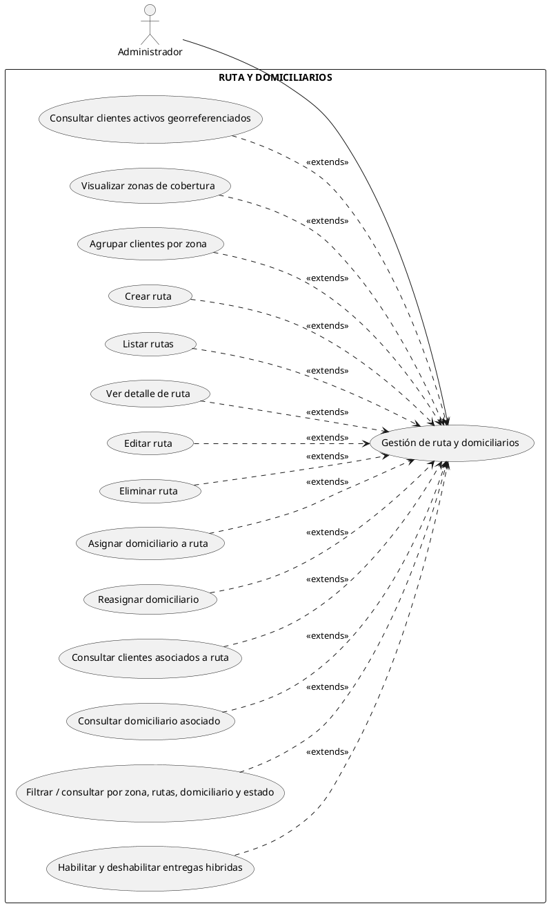
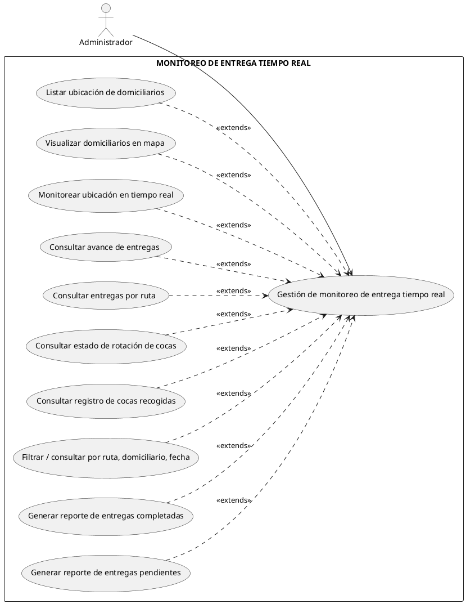
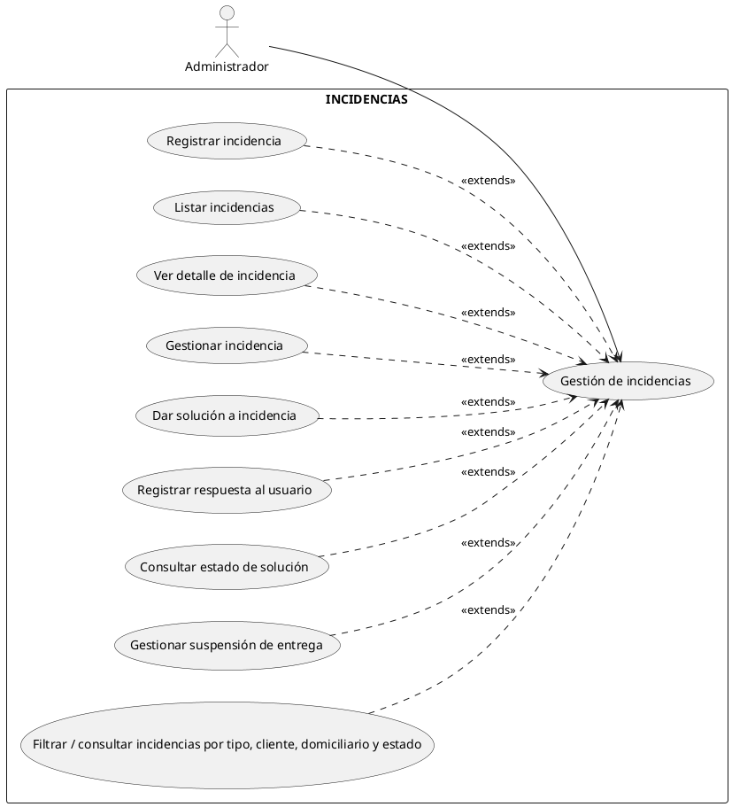

# Macro-Proceso: Logística y Domicilios

Asignación de rutas y domiciliarios, rastreo en tiempo real y gestión de incidencias.

## Subprocesos Integrados

### Subproceso: RUTA Y DOMICILIARIOS
- **Total de Casos de Uso / Acciones:** 14
- **Actor Principal:** Administrador / Rol correspondiente

#### Listado de Casos de Uso
1. Consultar clientes activos georreferenciados
2. Visualizar zonas de cobertura
3. Agrupar clientes por zona
4. Crear ruta
5. Listar rutas
6. Ver detalle de ruta
7. Editar ruta
8. Eliminar ruta
9. Asignar domiciliario a ruta
10. Reasignar domiciliario
11. Consultar clientes asociados a ruta
12. Consultar domiciliario asociado
13. Filtrar / consultar por zona, rutas, domiciliario y estado
14. Habilitar y deshabilitar entregas hibridas

#### Diagrama PlantUML

---

### Subproceso: MONITOREO DE ENTREGA TIEMPO REAL
- **Total de Casos de Uso / Acciones:** 10
- **Actor Principal:** Administrador / Rol correspondiente

#### Listado de Casos de Uso
1. Listar ubicación de domiciliarios
2. Visualizar domiciliarios en mapa
3. Monitorear ubicación en tiempo real
4. Consultar avance de entregas
5. Consultar entregas por ruta
6. Consultar estado de rotación de cocas
7. Consultar registro de cocas recogidas
8. Filtrar / consultar por ruta, domiciliario, fecha
9. Generar reporte de entregas completadas
10. Generar reporte de entregas pendientes

#### Diagrama PlantUML

---

### Subproceso: INCIDENCIAS
- **Total de Casos de Uso / Acciones:** 9
- **Actor Principal:** Administrador / Rol correspondiente

#### Listado de Casos de Uso
1. Registrar incidencia
2. Listar incidencias
3. Ver detalle de incidencia
4. Gestionar incidencia
5. Dar solución a incidencia
6. Registrar respuesta al usuario
7. Consultar estado de solución
8. Gestionar suspensión de entrega
9. Filtrar / consultar incidencias por tipo, cliente, domiciliario y estado

#### Diagrama PlantUML

---
