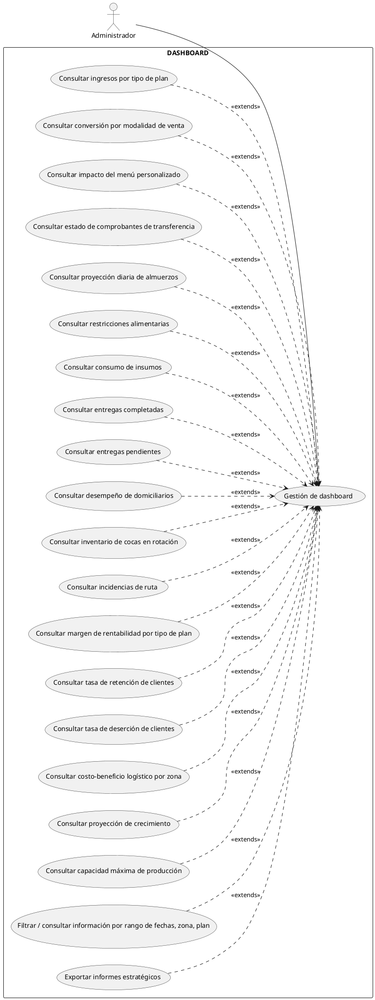

# Macro-Proceso: Analítica y Métricas

Tablero de control (Dashboard), consulta de KPIs, métricas e indicadores de rendimiento.

## Subprocesos Integrados

### Subproceso: DASHBOARD
- **Total de Casos de Uso / Acciones:** 20
- **Actor Principal:** Administrador / Rol correspondiente

#### Listado de Casos de Uso
1. Consultar ingresos por tipo de plan
2. Consultar conversión por modalidad de venta
3. Consultar impacto del menú personalizado
4. Consultar estado de comprobantes de transferencia
5. Consultar proyección diaria de almuerzos
6. Consultar restricciones alimentarias
7. Consultar consumo de insumos
8. Consultar entregas completadas
9. Consultar entregas pendientes
10. Consultar desempeño de domiciliarios
11. Consultar inventario de cocas en rotación
12. Consultar incidencias de ruta
13. Consultar margen de rentabilidad por tipo de plan
14. Consultar tasa de retención de clientes
15. Consultar tasa de deserción de clientes
16. Consultar costo-beneficio logístico por zona
17. Consultar proyección de crecimiento
18. Consultar capacidad máxima de producción
19. Filtrar / consultar información por rango de fechas, zona, plan
20. Exportar informes estratégicos

#### Diagrama PlantUML

---
