# Documentación Completa de Casos de Uso (Versión 3)

> **Proyecto:** Mapa Mental y Matriz de Historias de Usuario / Casos de Uso
> **Fuente:** `mapa_interactivo.svg` & `Tablero Kanban + Matriz HU.csv`
> **Total de Subprocesos:** 23 | **Total de Acciones/Historias:** 265

---

## 📌 Estructura General del Mapa Interactivo

El mapa interactivo se divide en **3 Fases clave**:
1. **Fase 1: Procesos Principales del Proyecto (Macro-Procesos)**: Visión de alto nivel de los 8 módulos del sistema.
2. **Fase 2: Subprocesos por Proceso**: Agrupación funcional de los 23 subprocesos en sus respectivos macro-procesos.
3. **Fase 3: Diagramas de Casos de Uso por Subproceso**: Detalle exhaustivo de cada subproceso con sus relaciones y flujos.

---

## 🗂️ Resumen de Macro-Procesos y Subprocesos

| Macro-Proceso | Subprocesos Incluidos | Total Casos de Uso | Archivo Markdown Detallado |
| :--- | :--- | :---: | :--- |
| **Configuración y Seguridad** | `ROLES`, `PERMISOS`, `USUARIOS`, `ACCESO` | 25 | [01_configuracion_y_seguridad.md](./01_configuracion_y_seguridad.md) |
| **Compras e Inventario** | `CATEGORIA DE INSUMOS`, `INSUMOS`, `CATEGORIA PRODUCTOS`, `PRODUCTOS`, `PROVEEDORES`, `COMPRAS` | 54 | [02_compras_e_inventario.md](./02_compras_e_inventario.md) |
| **Producción y Recetas** | `EMPLEADOS`, `PRODUCCION`, `FICHA TECNICA PRODUCTO`, `PRODUCTO TERMINADO` | 38 | [03_produccion_y_recetas.md](./03_produccion_y_recetas.md) |
| **Servicios y Operación** | `CATEGORIA DE SERVICIOS`, `SERVICIO`, `CALENDARIO` | 27 | [04_servicios_y_operacion.md](./04_servicios_y_operacion.md) |
| **Clientes y Ventas** | `CLIENTES`, `SUSCRIPCIONES` | 46 | [05_clientes_y_ventas.md](./05_clientes_y_ventas.md) |
| **Logística y Domicilios** | `RUTA Y DOMICILIARIOS`, `MONITOREO DE ENTREGA TIEMPO REAL`, `INCIDENCIAS` | 33 | [06_logistica_y_domicilios.md](./06_logistica_y_domicilios.md) |
| **Analítica y Métricas** | `DASHBOARD` | 20 | [07_analitica_y_metricas.md](./07_analitica_y_metricas.md) |
| **TOTAL** | **23 Subprocesos** | **243** | - | 

---

## 🚀 Macro-Proceso: Configuración y Seguridad
Gestión de roles, permisos, usuarios y mecanismos de autenticación/acceso al sistema.

### 🔹 Subproceso: ROLES
- **Cantidad de Acciones:** 7
- **Actor:** Administrador / Usuario Registrado

**Acciones / Casos de Uso:**
  1. Crear rol
  2. Listar roles
  3. Ver detalle del rol y permisos configurados
  4. Editar  rol
  5. Asignar permisos al rol
  6. Cambiar estado del rol
  7. Eliminar rol

**Diagrama PlantUML:**
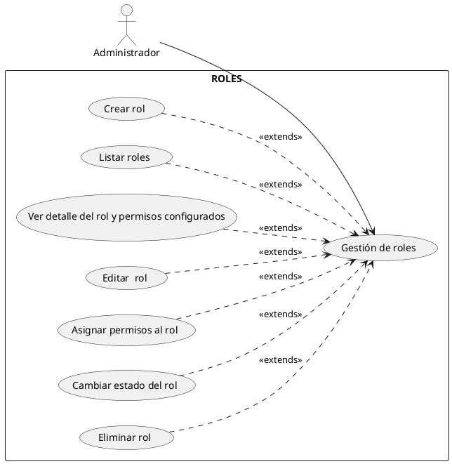

### 🔹 Subproceso: PERMISOS
- **Cantidad de Acciones:** 6
- **Actor:** Administrador / Usuario Registrado

**Acciones / Casos de Uso:**
  1. Crear permiso
  2. Listar permisos
  3. Ver detalle del permiso
  4. Editar permiso
  5. Cambiar estado del permiso
  6. Eliminar permiso

**Diagrama PlantUML:**
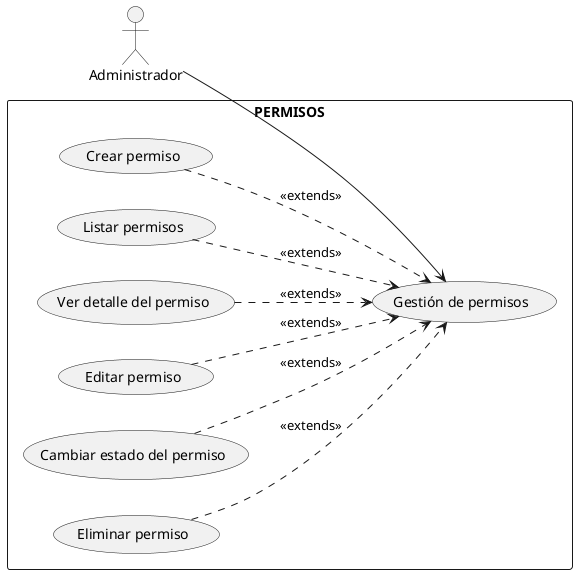

### 🔹 Subproceso: USUARIOS
- **Cantidad de Acciones:** 7
- **Actor:** Administrador / Usuario Registrado

**Acciones / Casos de Uso:**
  1. Crear usuario
  2. Listar usuarios
  3. Ver detalle de usuario
  4. Editar usuario
  5. Cambiar estado de usuario
  6. Generar reportes de usuarios activos e inactivos
  7. Eliminar usuario

**Diagrama PlantUML:**
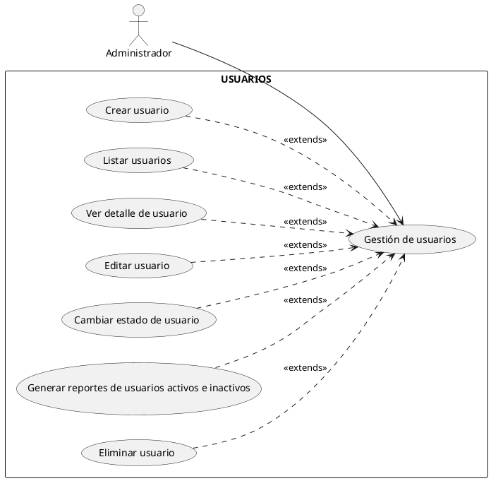

### 🔹 Subproceso: ACCESO
- **Cantidad de Acciones:** 5
- **Actor:** Administrador / Usuario Registrado

**Acciones / Casos de Uso:**
  1. Iniciar sesión
  2. Validar credenciales
  3. Recuperar / restablecer  contraseña
  4. Consultar estado de la cuenta
  5. Cerrar sesión

**Diagrama PlantUML:**
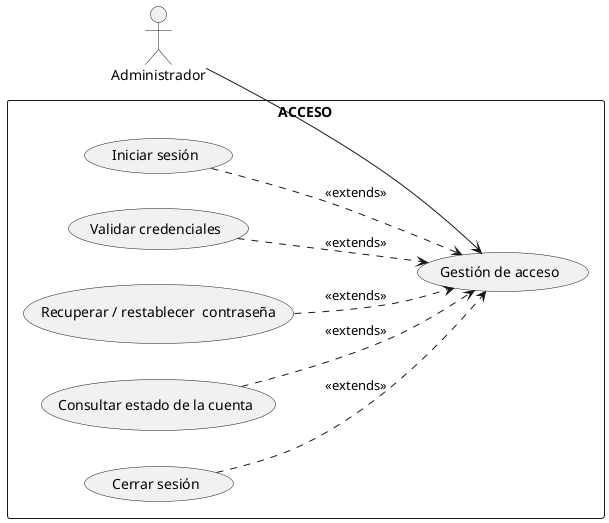

---

## 🚀 Macro-Proceso: Compras e Inventario
Administración de insumos, categorías de insumos, productos, proveedores y órdenes de compra.

### 🔹 Subproceso: CATEGORIA DE INSUMOS
- **Cantidad de Acciones:** 7
- **Actor:** Administrador / Usuario Registrado

**Acciones / Casos de Uso:**
  1. Crear categoría de insumo
  2. Listar categorías de insumos
  3. Ver detalle de la categoría
  4. Editar categoría
  5. Eliminar categoria de insumos
  6. Cambiar estado de la categoría de insumos
  7. Filtrar / consultar categorías por nombre, estado

**Diagrama PlantUML:**
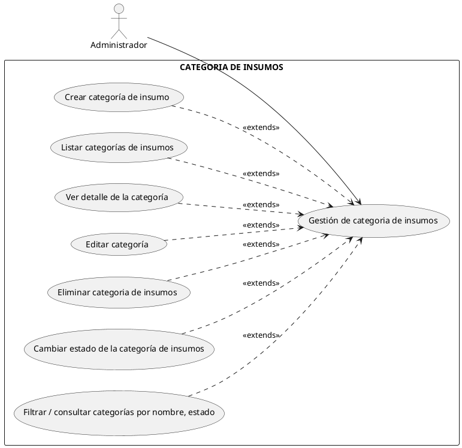

### 🔹 Subproceso: INSUMOS
- **Cantidad de Acciones:** 12
- **Actor:** Administrador / Usuario Registrado

**Acciones / Casos de Uso:**
  1. Crear insumo
  2. Listar insumos
  3. Ver detalle del insumo
  4. Editar insumo
  5. Cambiar estado del insumo
  6. Consultar movimientos de inventario
  7. Consultar existencias
  8. Consultar alertas de stock mínimo
  9. Generar reporte de inventario
  10. Generar reporte de consumo por período
  11. Generar reporte de alertas de reabastecimiento
  12. Filtrar / consultar insumos por nombre, categoría, proveedor, estado

**Diagrama PlantUML:**
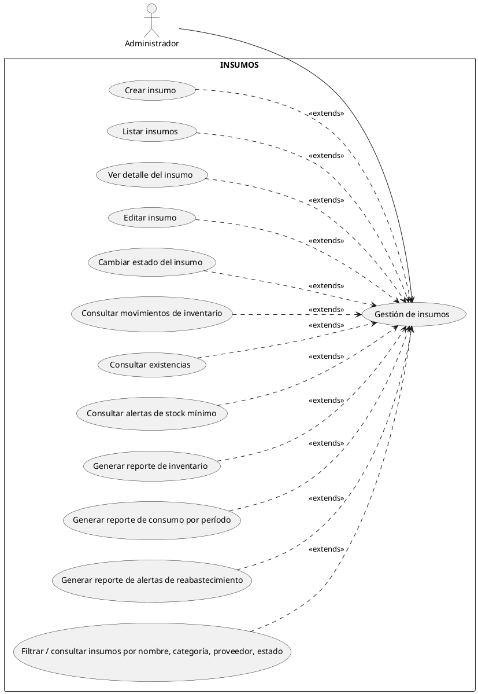

### 🔹 Subproceso: CATEGORIA PRODUCTOS
- **Cantidad de Acciones:** 6
- **Actor:** Administrador / Usuario Registrado

**Acciones / Casos de Uso:**
  1. Crear categoría de producto
  2. Listar categorías de productos
  3. Ver detalle de categoría
  4. Editar categoría
  5. Cambiar estado de la categoria del producto
  6. Filtrar / consultar categorías por nombre, estado

**Diagrama PlantUML:**
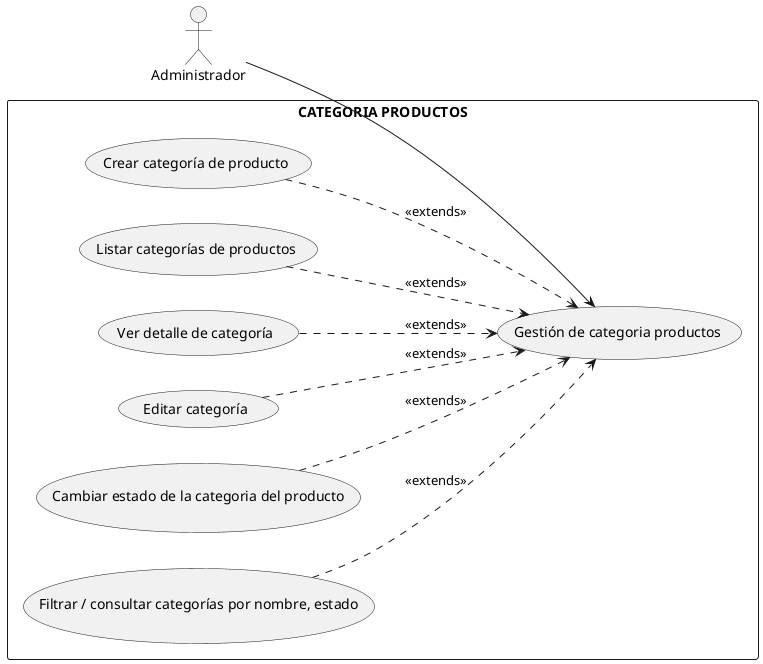

### 🔹 Subproceso: PRODUCTOS
- **Cantidad de Acciones:** 10
- **Actor:** Administrador / Usuario Registrado

**Acciones / Casos de Uso:**
  1. Crear producto
  2. Listar productos
  3. Ver detalle del producto
  4. Editar producto
  5. Cambiar estado del producto
  6. Filtrar / consultar productos por nombre, categoría, estado
  7. Consultar insumos requeridos
  8. Consultar especificaciones de preparación
  9. Generar reporte de productos activos
  10. Consultar costo unitario estimado

**Diagrama PlantUML:**
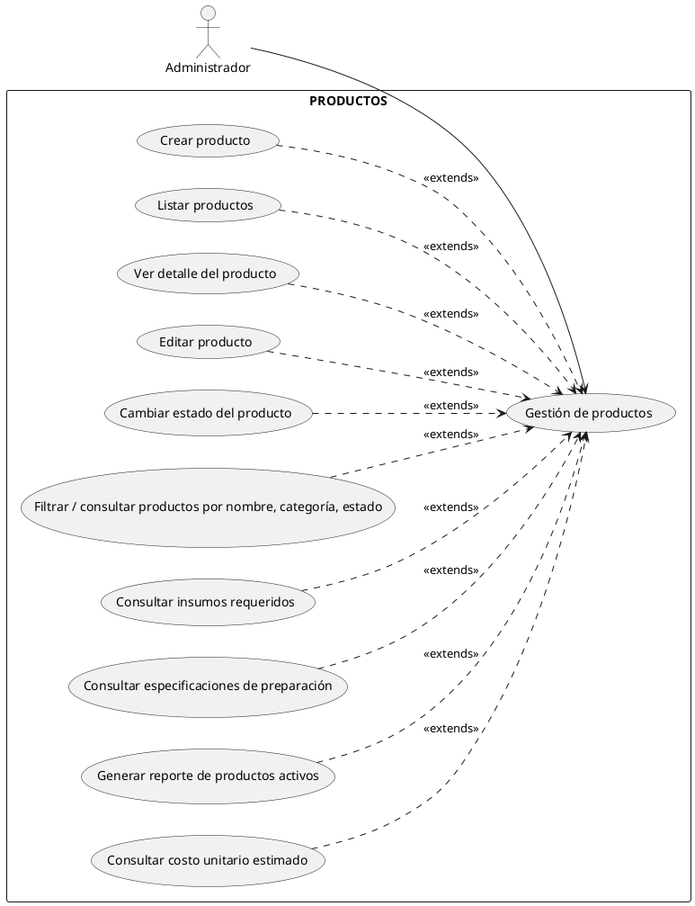

### 🔹 Subproceso: PROVEEDORES
- **Cantidad de Acciones:** 9
- **Actor:** Administrador / Usuario Registrado

**Acciones / Casos de Uso:**
  1. Crear proveedor
  2. Listar proveedores
  3. Ver detalle del proveedor
  4. Editar proveedor
  5. Cambiar estado del proveedor
  6. Filtrar / consultar proveedores por nombre, documento, categoría, estado
  7. Consultar productos o insumos suministrados
  8. Consultar historial de compras
  9. Generar reporte de historial de compras

**Diagrama PlantUML:**
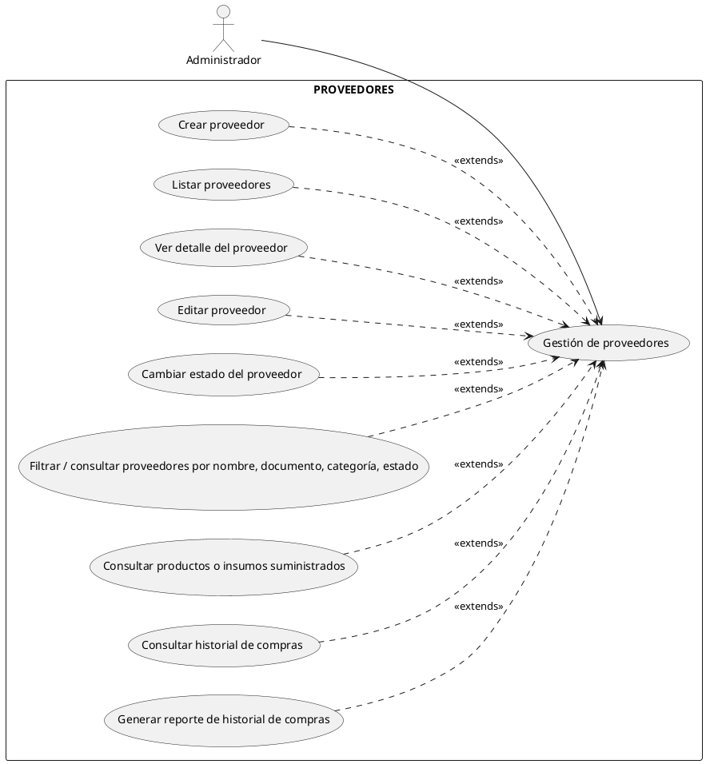

### 🔹 Subproceso: COMPRAS
- **Cantidad de Acciones:** 10
- **Actor:** Administrador / Usuario Registrado

**Acciones / Casos de Uso:**
  1. Crear compra
  2. Listar compras
  3. Ver detalle de compra
  4. Editar compra
  5. Cambiar estado de compra
  6. Anular compra
  7. Filtrar / consultar compras por proveedor, fecha, insumo, estado
  8. Generar reporte de compras por período
  9. Generar reporte de compras por proveedor
  10. Generar reporte de compras por insumo

**Diagrama PlantUML:**
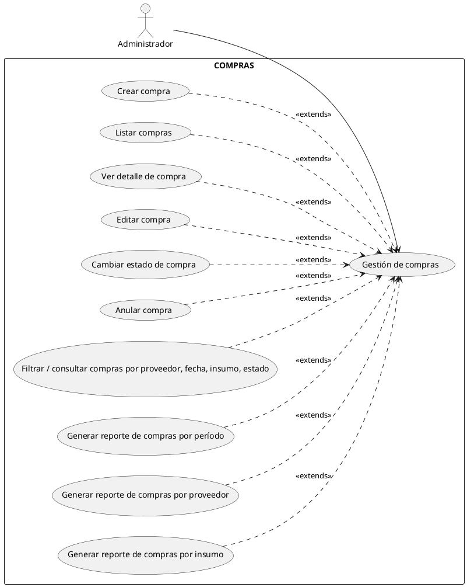

---

## 🚀 Macro-Proceso: Producción y Recetas
Gestión de personal de producción, órdenes de producción, fichas técnicas y producto terminado.

### 🔹 Subproceso: EMPLEADOS
- **Cantidad de Acciones:** 7
- **Actor:** Administrador / Usuario Registrado

**Acciones / Casos de Uso:**
  1. Crear empleado
  2. Listar empleados
  3. Ver detalle del empleado
  4. Editar empleado
  5. Cambiar estado de empleados
  6. Filtrar / consultar empleados por nombre, documento, cargo, estado
  7. Generar reporte de empleados activos por área

**Diagrama PlantUML:**
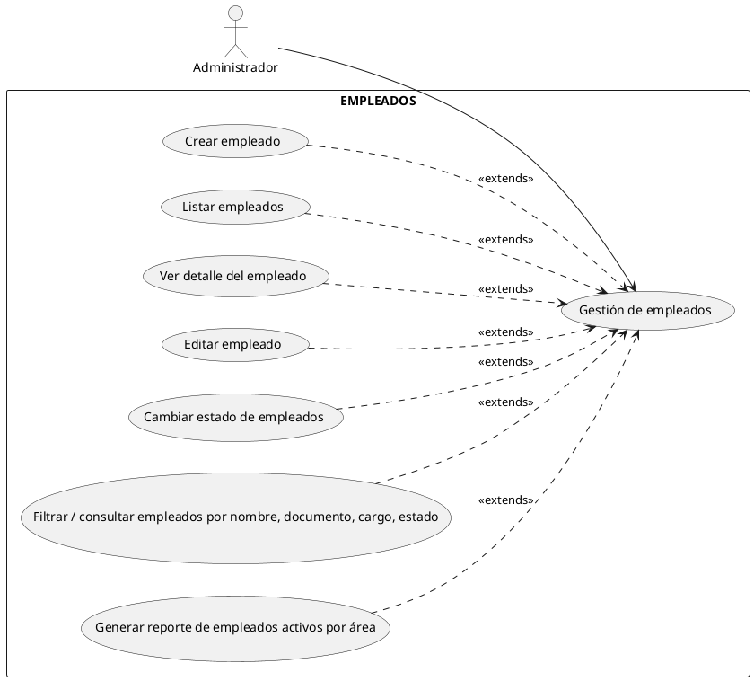

### 🔹 Subproceso: PRODUCCION
- **Cantidad de Acciones:** 7
- **Actor:** Administrador / Usuario Registrado

**Acciones / Casos de Uso:**
  1. Crear orden de producción
  2. Listar órdenes de producción
  3. Ver detalle de orden de produccion
  4. Editar orden de producción
  5. Cambiar estado de orden de produccion
  6. Filtrar / consultar órdenes por cantidad, fecha, restricciones y alergias
  7. Consultar insumos requeridos

**Diagrama PlantUML:**
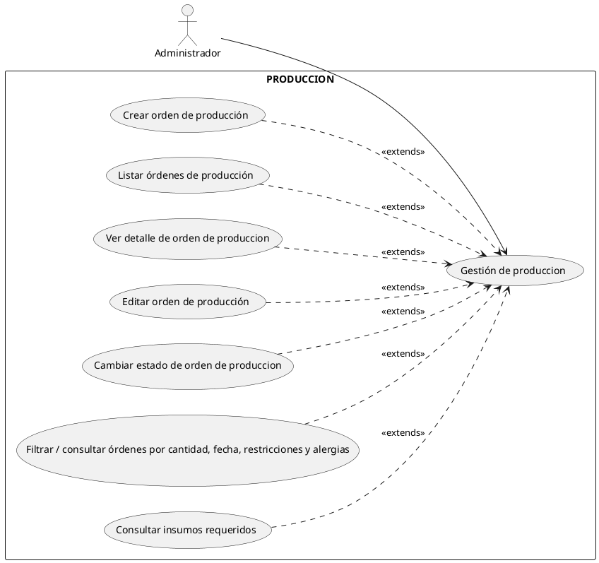

### 🔹 Subproceso: FICHA TECNICA PRODUCTO
- **Cantidad de Acciones:** 14
- **Actor:** Administrador / Usuario Registrado

**Acciones / Casos de Uso:**
  1. Crear ficha técnica
  2. Listar fichas técnicas
  3. Ver detalle de ficha técnica
  4. Editar ficha técnica
  5. Cambiar estado de la ficha tecnica
  6. Registrar insumos requeridos
  7. Registrar cantidades exactas de insumos
  8. Registrar tiempo estimado de preparación
  9. Registrar procedimiento de elaboración
  10. Registrar número de porciones
  11. Consultar costo unitario estimado
  12. Filtrar / consultar fichas por producto, insumo, estado
  13. Generar reporte de fichas técnicas
  14. Generar reporte de costo unitario estimado

**Diagrama PlantUML:**
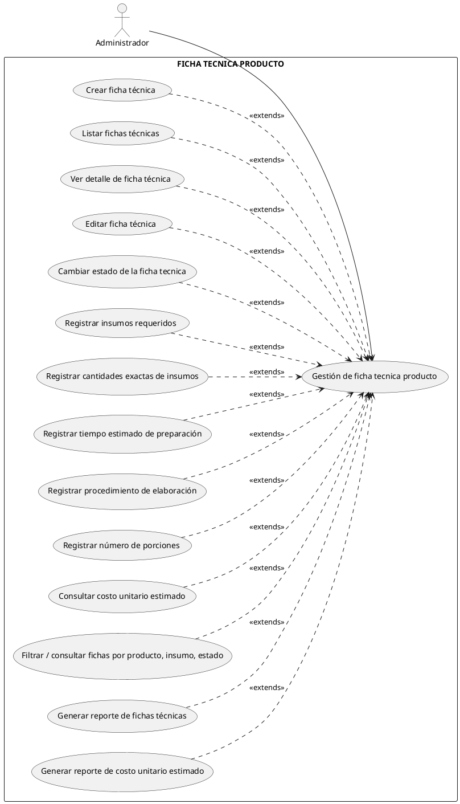

### 🔹 Subproceso: PRODUCTO TERMINADO
- **Cantidad de Acciones:** 10
- **Actor:** Administrador / Usuario Registrado

**Acciones / Casos de Uso:**
  1. Registrar producto terminado
  2. Listar productos terminados
  3. Ver detalle del producto terminado
  4. Registrar cantidad producida
  5. Registrar fecha de elaboración
  6. Asociar orden de producción
  7. Filtrar / consultar por fecha, producto, estado
  8. Generar reporte de producción diaria
  9. Generar reporte de producción semanal
  10. Generar reporte de producción mensual

**Diagrama PlantUML:**
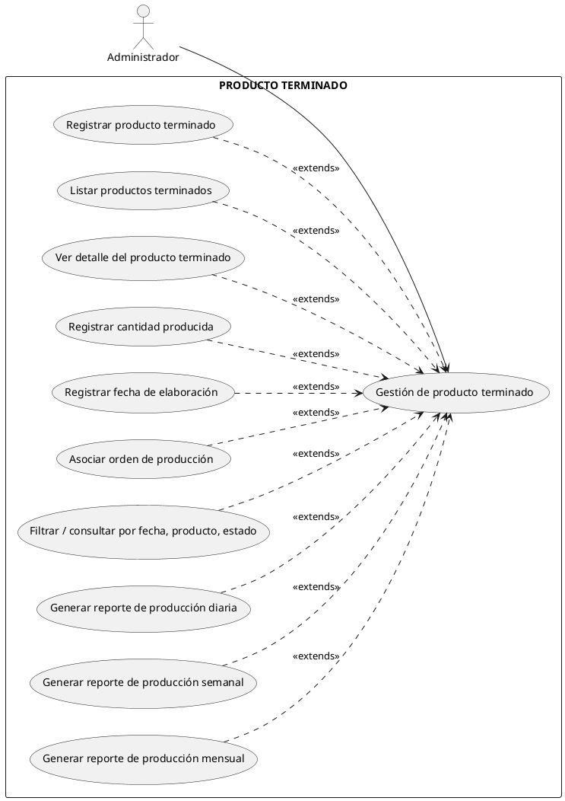

---

## 🚀 Macro-Proceso: Servicios y Operación
Definición de servicios, categorías de servicios y programación de calendario operativo.

### 🔹 Subproceso: CATEGORIA DE SERVICIOS
- **Cantidad de Acciones:** 6
- **Actor:** Administrador / Usuario Registrado

**Acciones / Casos de Uso:**
  1. Crear categoría de servicio
  2. Listar categorías de servicios
  3. Ver detalle de categoría
  4. Editar categoría
  5. Cambiar el estado de la categoria
  6. Filtrar / consultar categorías por nombre, estado

**Diagrama PlantUML:**
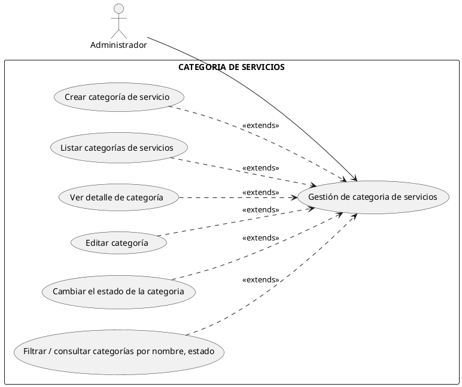

### 🔹 Subproceso: SERVICIO
- **Cantidad de Acciones:** 11
- **Actor:** Administrador / Usuario Registrado

**Acciones / Casos de Uso:**
  1. Crear servicio
  2. Listar servicios
  3. Ver detalle del servicio
  4. Editar servicio
  5. Cambiar el estado del servicio
  6. Registrar nombre del plan
  7. Registrar tipo de plan
  8. Registrar descripción
  9. Registrar valor
  10. Registrar duración en días
  11. Filtrar / consultar servicios por nombre, tipo, estado

**Diagrama PlantUML:**
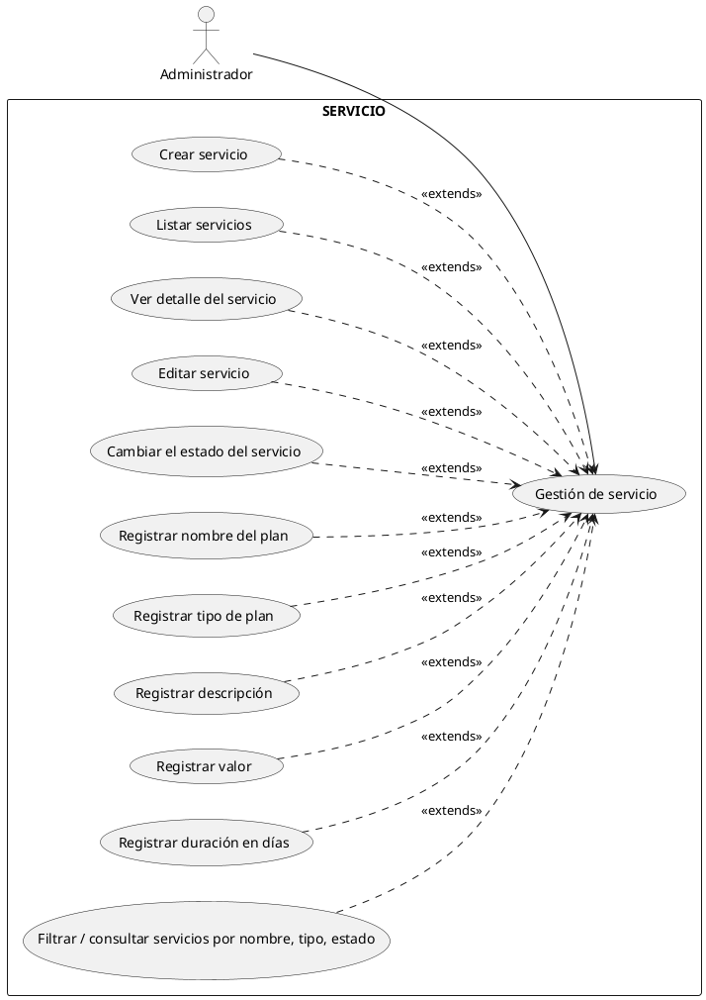

### 🔹 Subproceso: CALENDARIO
- **Cantidad de Acciones:** 10
- **Actor:** Administrador / Usuario Registrado

**Acciones / Casos de Uso:**
  1. Parametrizar calendario operativo
  2. Listar calendario operativo
  3. Identificar días hábiles
  4. Registrar días festivos nacionales
  5. Identificar jornadas no operativas
  6. Cruzar agenda con suscripciones activas
  7. Programar producción diaria
  8. Calcular días de servicio
  9. Calcular fechas de vencimiento
  10. Generar información para liquidación proporcional

**Diagrama PlantUML:**
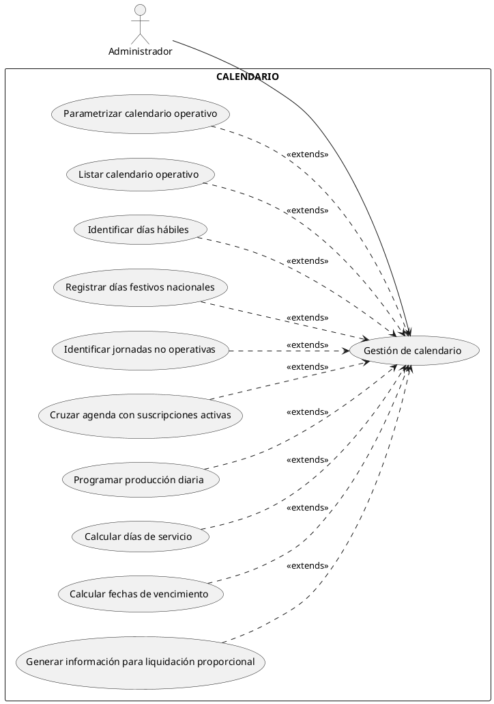

---

## 🚀 Macro-Proceso: Clientes y Ventas
Gestión de clientes y ciclo de vida completo de suscripciones y ventas.

### 🔹 Subproceso: CLIENTES
- **Cantidad de Acciones:** 16
- **Actor:** Administrador / Usuario Registrado

**Acciones / Casos de Uso:**
  1. Crear cliente
  2. Listar clientes
  3. Ver detalle del cliente
  4. Editar cliente
  5. Registrar dirección de entrega
  6. Registrar modalidad de entrega
  7. Registrar teléfono
  8. Registrar correo electrónico
  9. Registrar restricciones alimentarias
  10. Registrar alergias alimentarias
  11. Consultar suscripciones asociadas
  12. Consultar historial de pagos
  13. Filtrar / consultar clientes por nombre, documento, dirección, estado
  14. Generar reporte de clientes activos
  15. Generar reporte por zona de cobertura
  16. Generar reporte por tipo de plan

**Diagrama PlantUML:**
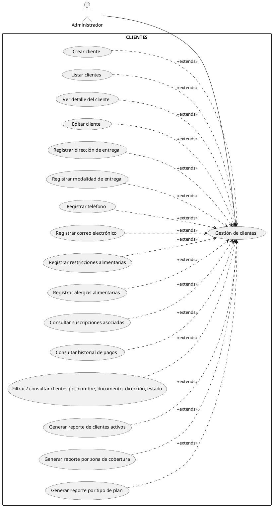

### 🔹 Subproceso: SUSCRIPCIONES
- **Cantidad de Acciones:** 30
- **Actor:** Administrador / Usuario Registrado

**Acciones / Casos de Uso:**
  1. Cotizar suscripción
  2. Registrar suscripción
  3. Listar suscripciones
  4. Ver detalle de suscripción
  5. Editar suscripción
  6. Administrar estado de suscripción
  7. Registrar plan semanal
  8. Registrar plan quincenal
  9. Registrar plan mensual
  10. Seleccionar menú estándar
  11. Seleccionar menú personalizado
  12. Aplicar recargo por menú personalizado
  13. Calcular fecha de inicio
  14. Calcular fecha de vencimiento
  15. Registrar comprobante de transferencia
  16. Consultar comprobante de pago
  17. Gestionar estado Pendiente
  18. Gestionar estado Activa
  19. Gestionar estado Cancelada
  20. Gestionar estado Vencida
  21. Registrar venta nueva
  22. Aplicar cobro de cocas en venta nueva
  23. Registrar renovación
  24. Registrar reingreso
  25. Recuperar historial del cliente
  26. Recuperar restricciones alimentarias
  27. Exonerar cobro de cocas en renovación
  28. Exonerar cobro de cocas en reingreso
  29. Validar cobertura de la dirección
  30. Validar capacidad de producción

**Diagrama PlantUML:**
```plantuml
@startuml
left to right direction
skinparam packageStyle rectangle
actor "Administrador" as admin
package "SUSCRIPCIONES" {
  usecase "Gestión de suscripciones" as UC_Main
  usecase "Cotizar suscripción" as UC_1
  usecase "Registrar suscripción" as UC_2
  usecase "Listar suscripciones" as UC_3
  usecase "Ver detalle de suscripción" as UC_4
  usecase "Editar suscripción" as UC_5
  usecase "Administrar estado de suscripción" as UC_6
  usecase "Registrar plan semanal" as UC_7
  usecase "Registrar plan quincenal" as UC_8
  usecase "Registrar plan mensual" as UC_9
  usecase "Seleccionar menú estándar" as UC_10
  usecase "Seleccionar menú personalizado" as UC_11
  usecase "Aplicar recargo por menú personalizado" as UC_12
  usecase "Calcular fecha de inicio" as UC_13
  usecase "Calcular fecha de vencimiento" as UC_14
  usecase "Registrar comprobante de transferencia" as UC_15
  usecase "Consultar comprobante de pago" as UC_16
  usecase "Gestionar estado Pendiente" as UC_17
  usecase "Gestionar estado Activa" as UC_18
  usecase "Gestionar estado Cancelada" as UC_19
  usecase "Gestionar estado Vencida" as UC_20
  usecase "Registrar venta nueva" as UC_21
  usecase "Aplicar cobro de cocas en venta nueva" as UC_22
  usecase "Registrar renovación" as UC_23
  usecase "Registrar reingreso" as UC_24
  usecase "Recuperar historial del cliente" as UC_25
  usecase "Recuperar restricciones alimentarias" as UC_26
  usecase "Exonerar cobro de cocas en renovación" as UC_27
  usecase "Exonerar cobro de cocas en reingreso" as UC_28
  usecase "Validar cobertura de la dirección" as UC_29
  usecase "Validar capacidad de producción" as UC_30
}
admin --> UC_Main
UC_1 ..> UC_Main : <<extends>>
UC_2 ..> UC_Main : <<extends>>
UC_3 ..> UC_Main : <<extends>>
UC_4 ..> UC_Main : <<extends>>
UC_5 ..> UC_Main : <<extends>>
UC_6 ..> UC_Main : <<extends>>
UC_7 ..> UC_Main : <<extends>>
UC_8 ..> UC_Main : <<extends>>
UC_9 ..> UC_Main : <<extends>>
UC_10 ..> UC_Main : <<extends>>
UC_11 ..> UC_Main : <<extends>>
UC_12 ..> UC_Main : <<extends>>
UC_13 ..> UC_Main : <<extends>>
UC_14 ..> UC_Main : <<extends>>
UC_15 ..> UC_Main : <<extends>>
UC_16 ..> UC_Main : <<extends>>
UC_17 ..> UC_Main : <<extends>>
UC_18 ..> UC_Main : <<extends>>
UC_19 ..> UC_Main : <<extends>>
UC_20 ..> UC_Main : <<extends>>
UC_21 ..> UC_Main : <<extends>>
UC_22 ..> UC_Main : <<extends>>
UC_23 ..> UC_Main : <<extends>>
UC_24 ..> UC_Main : <<extends>>
UC_25 ..> UC_Main : <<extends>>
UC_26 ..> UC_Main : <<extends>>
UC_27 ..> UC_Main : <<extends>>
UC_28 ..> UC_Main : <<extends>>
UC_29 ..> UC_Main : <<extends>>
UC_30 ..> UC_Main : <<extends>>
@enduml
```

---

## 🚀 Macro-Proceso: Logística y Domicilios
Asignación de rutas y domiciliarios, rastreo en tiempo real y gestión de incidencias.

### 🔹 Subproceso: RUTA Y DOMICILIARIOS
- **Cantidad de Acciones:** 14
- **Actor:** Administrador / Usuario Registrado

**Acciones / Casos de Uso:**
  1. Consultar clientes activos georreferenciados
  2. Visualizar zonas de cobertura
  3. Agrupar clientes por zona
  4. Crear ruta
  5. Listar rutas
  6. Ver detalle de ruta
  7. Editar ruta
  8. Eliminar ruta
  9. Asignar domiciliario a ruta
  10. Reasignar domiciliario
  11. Consultar clientes asociados a ruta
  12. Consultar domiciliario asociado
  13. Filtrar / consultar por zona, rutas, domiciliario y estado
  14. Habilitar y deshabilitar entregas hibridas

**Diagrama PlantUML:**
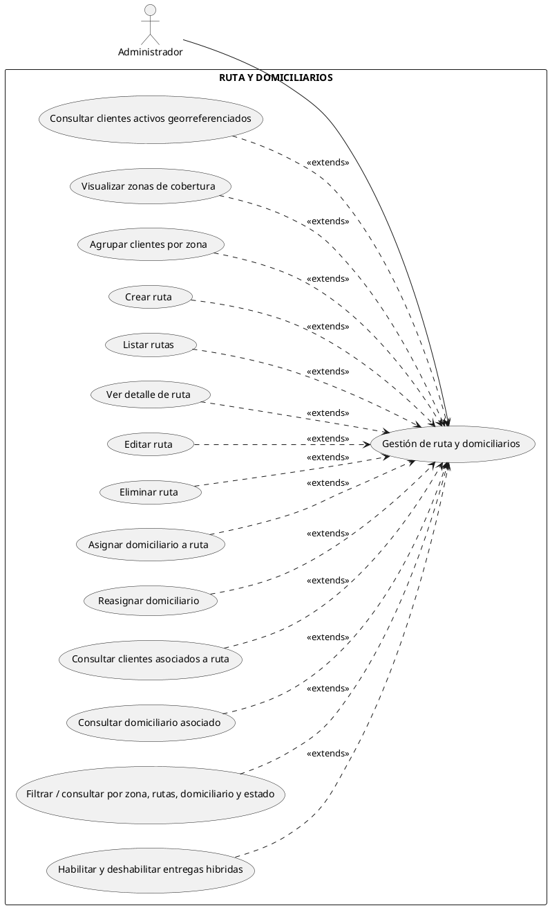

### 🔹 Subproceso: MONITOREO DE ENTREGA TIEMPO REAL
- **Cantidad de Acciones:** 10
- **Actor:** Administrador / Usuario Registrado

**Acciones / Casos de Uso:**
  1. Listar ubicación de domiciliarios
  2. Visualizar domiciliarios en mapa
  3. Monitorear ubicación en tiempo real
  4. Consultar avance de entregas
  5. Consultar entregas por ruta
  6. Consultar estado de rotación de cocas
  7. Consultar registro de cocas recogidas
  8. Filtrar / consultar por ruta, domiciliario, fecha
  9. Generar reporte de entregas completadas
  10. Generar reporte de entregas pendientes

**Diagrama PlantUML:**
```plantuml
@startuml
left to right direction
skinparam packageStyle rectangle
actor "Administrador" as admin
package "MONITOREO DE ENTREGA TIEMPO REAL" {
  usecase "Gestión de monitoreo de entrega tiempo real" as UC_Main
  usecase "Listar ubicación de domiciliarios" as UC_1
  usecase "Visualizar domiciliarios en mapa" as UC_2
  usecase "Monitorear ubicación en tiempo real" as UC_3
  usecase "Consultar avance de entregas" as UC_4
  usecase "Consultar entregas por ruta" as UC_5
  usecase "Consultar estado de rotación de cocas" as UC_6
  usecase "Consultar registro de cocas recogidas" as UC_7
  usecase "Filtrar / consultar por ruta, domiciliario, fecha" as UC_8
  usecase "Generar reporte de entregas completadas" as UC_9
  usecase "Generar reporte de entregas pendientes" as UC_10
}
admin --> UC_Main
UC_1 ..> UC_Main : <<extends>>
UC_2 ..> UC_Main : <<extends>>
UC_3 ..> UC_Main : <<extends>>
UC_4 ..> UC_Main : <<extends>>
UC_5 ..> UC_Main : <<extends>>
UC_6 ..> UC_Main : <<extends>>
UC_7 ..> UC_Main : <<extends>>
UC_8 ..> UC_Main : <<extends>>
UC_9 ..> UC_Main : <<extends>>
UC_10 ..> UC_Main : <<extends>>
@enduml
```

### 🔹 Subproceso: INCIDENCIAS
- **Cantidad de Acciones:** 9
- **Actor:** Administrador / Usuario Registrado

**Acciones / Casos de Uso:**
  1. Registrar incidencia
  2. Listar incidencias
  3. Ver detalle de incidencia
  4. Gestionar incidencia
  5. Dar solución a incidencia
  6. Registrar respuesta al usuario
  7. Consultar estado de solución
  8. Gestionar suspensión de entrega
  9. Filtrar / consultar incidencias por tipo, cliente, domiciliario y estado

**Diagrama PlantUML:**
```plantuml
@startuml
left to right direction
skinparam packageStyle rectangle
actor "Administrador" as admin
package "INCIDENCIAS" {
  usecase "Gestión de incidencias" as UC_Main
  usecase "Registrar incidencia" as UC_1
  usecase "Listar incidencias" as UC_2
  usecase "Ver detalle de incidencia" as UC_3
  usecase "Gestionar incidencia" as UC_4
  usecase "Dar solución a incidencia" as UC_5
  usecase "Registrar respuesta al usuario" as UC_6
  usecase "Consultar estado de solución" as UC_7
  usecase "Gestionar suspensión de entrega" as UC_8
  usecase "Filtrar / consultar incidencias por tipo, cliente, domiciliario y estado" as UC_9
}
admin --> UC_Main
UC_1 ..> UC_Main : <<extends>>
UC_2 ..> UC_Main : <<extends>>
UC_3 ..> UC_Main : <<extends>>
UC_4 ..> UC_Main : <<extends>>
UC_5 ..> UC_Main : <<extends>>
UC_6 ..> UC_Main : <<extends>>
UC_7 ..> UC_Main : <<extends>>
UC_8 ..> UC_Main : <<extends>>
UC_9 ..> UC_Main : <<extends>>
@enduml
```

---

## 🚀 Macro-Proceso: Analítica y Métricas
Tablero de control (Dashboard), consulta de KPIs, métricas e indicadores de rendimiento.

### 🔹 Subproceso: DASHBOARD
- **Cantidad de Acciones:** 20
- **Actor:** Administrador / Usuario Registrado

**Acciones / Casos de Uso:**
  1. Consultar ingresos por tipo de plan
  2. Consultar conversión por modalidad de venta
  3. Consultar impacto del menú personalizado
  4. Consultar estado de comprobantes de transferencia
  5. Consultar proyección diaria de almuerzos
  6. Consultar restricciones alimentarias
  7. Consultar consumo de insumos
  8. Consultar entregas completadas
  9. Consultar entregas pendientes
  10. Consultar desempeño de domiciliarios
  11. Consultar inventario de cocas en rotación
  12. Consultar incidencias de ruta
  13. Consultar margen de rentabilidad por tipo de plan
  14. Consultar tasa de retención de clientes
  15. Consultar tasa de deserción de clientes
  16. Consultar costo-beneficio logístico por zona
  17. Consultar proyección de crecimiento
  18. Consultar capacidad máxima de producción
  19. Filtrar / consultar información por rango de fechas, zona, plan
  20. Exportar informes estratégicos

**Diagrama PlantUML:**
```plantuml
@startuml
left to right direction
skinparam packageStyle rectangle
actor "Administrador" as admin
package "DASHBOARD" {
  usecase "Gestión de dashboard" as UC_Main
  usecase "Consultar ingresos por tipo de plan" as UC_1
  usecase "Consultar conversión por modalidad de venta" as UC_2
  usecase "Consultar impacto del menú personalizado" as UC_3
  usecase "Consultar estado de comprobantes de transferencia" as UC_4
  usecase "Consultar proyección diaria de almuerzos" as UC_5
  usecase "Consultar restricciones alimentarias" as UC_6
  usecase "Consultar consumo de insumos" as UC_7
  usecase "Consultar entregas completadas" as UC_8
  usecase "Consultar entregas pendientes" as UC_9
  usecase "Consultar desempeño de domiciliarios" as UC_10
  usecase "Consultar inventario de cocas en rotación" as UC_11
  usecase "Consultar incidencias de ruta" as UC_12
  usecase "Consultar margen de rentabilidad por tipo de plan" as UC_13
  usecase "Consultar tasa de retención de clientes" as UC_14
  usecase "Consultar tasa de deserción de clientes" as UC_15
  usecase "Consultar costo-beneficio logístico por zona" as UC_16
  usecase "Consultar proyección de crecimiento" as UC_17
  usecase "Consultar capacidad máxima de producción" as UC_18
  usecase "Filtrar / consultar información por rango de fechas, zona, plan" as UC_19
  usecase "Exportar informes estratégicos" as UC_20
}
admin --> UC_Main
UC_1 ..> UC_Main : <<extends>>
UC_2 ..> UC_Main : <<extends>>
UC_3 ..> UC_Main : <<extends>>
UC_4 ..> UC_Main : <<extends>>
UC_5 ..> UC_Main : <<extends>>
UC_6 ..> UC_Main : <<extends>>
UC_7 ..> UC_Main : <<extends>>
UC_8 ..> UC_Main : <<extends>>
UC_9 ..> UC_Main : <<extends>>
UC_10 ..> UC_Main : <<extends>>
UC_11 ..> UC_Main : <<extends>>
UC_12 ..> UC_Main : <<extends>>
UC_13 ..> UC_Main : <<extends>>
UC_14 ..> UC_Main : <<extends>>
UC_15 ..> UC_Main : <<extends>>
UC_16 ..> UC_Main : <<extends>>
UC_17 ..> UC_Main : <<extends>>
UC_18 ..> UC_Main : <<extends>>
UC_19 ..> UC_Main : <<extends>>
UC_20 ..> UC_Main : <<extends>>
@enduml
```

---

## 🎨 Código Vectorial SVG Completo (`mapa_interactivo.svg`)
El mapa gráfico SVG interactivo completo se encuentra disponible en [mapa_interactivo_svg.md](./mapa_interactivo_svg.md).

```xml
<svg width="1050" height="1820" viewBox="0 0 1050 1820" xmlns="http://www.w3.org/2000/svg">

  <defs>
    <marker id="arrow-master" viewBox="0 0 10 10" refX="8" refY="5" markerWidth="6" markerHeight="6" orient="auto-start-reverse">
      <path d="M 0 1 L 10 5 L 0 9 z" fill="#333333" />
    </marker>
    <filter id="card-shadow" x="-5%" y="-5%" width="110%" height="110%">
      <feDropShadow dx="0" dy="4" stdDeviation="4" flood-color="#000000" flood-opacity="0.12"/>
    </filter>
  </defs>

  <style>
    .bg { fill: #f8fafc; }
    .title-main { font-family: Arial, sans-serif; font-size: 17px; font-weight: bold; fill: #0f172a; text-anchor: middle; }
    .subtitle-main { font-family: Arial, sans-serif; font-size: 12px; fill: #64748b; text-anchor: middle; }
    .boundary { fill: #ffffff; stroke: #cbd5e1; stroke-width: 2; rx: 12; }
    
    .actor { fill: none; stroke: #1e293b; stroke-width: 2.5; }
    .actor-text { font-family: Arial, sans-serif; font-size: 14px; font-weight: bold; fill: #0f172a; text-anchor: middle; }
    
    .btn-proc { fill: #ffffff; stroke: #2563eb; stroke-width: 2; rx: 8; cursor: pointer; }
    .btn-proc:hover { fill: #eff6ff; stroke: #1d4ed8; }
    .btn-proc-text { font-family: Arial, sans-serif; font-size: 12.5px; font-weight: bold; fill: #1e40af; text-anchor: middle; dominant-baseline: middle; cursor: pointer; }
    
    .btn-sub { fill: #ffffff; stroke: #7c3aed; stroke-width: 2; rx: 8; cursor: pointer; }
    .btn-sub:hover { fill: #f5f3ff; stroke: #6d28d9; }
    .btn-sub-text { font-family: Arial, sans-serif; font-size: 13px; font-weight: bold; fill: #5b21b6; text-anchor: middle; dominant-baseline: middle; cursor: pointer; }
    
    .nav-btn { fill: #0f172a; rx: 6; cursor: pointer; }
    .nav-btn:hover { fill: #1e293b; }
    .nav-btn-text { font-family: Arial, sans-serif; font-size: 12px; font-weight: bold; fill: #ffffff; text-anchor: middle; dominant-baseline: middle; cursor: pointer; }
    
    .solid-line { stroke: #64748b; stroke-width: 2; }
    .dashed-line { stroke: #64748b; stroke-width: 1.5; stroke-dasharray: 4,4; marker-end: url(#arrow-master); }
    .rel-text { font-family: Arial, sans-serif; font-size: 11px; fill: #475569; text-anchor: middle; dominant-baseline: middle; }
  </style>

  <script type="text/javascript">
    <![CDATA[
    function showPhase(phaseId) {
      var groups = document.querySelectorAll('.phase-group');
      for (var i = 0; i < groups.length; i++) {
        groups[i].style.display = 'none';
      }
      var target = document.getElementById(phaseId);
      if (target) {
        target.style.display = 'inline';
      }
    }
    ]]>
  </script>

  <rect width="100%" height="100%" class="bg" />

  <!-- FASE 1: PROCESOS PRINCIPALES -->
  <g id="phase1" class="phase-group" style="display: inline;">
    <rect x="170" y="50" width="840" height="680" class="boundary" filter="url(#card-shadow)" />
    <text x="590" y="85" class="title-main">FASE 1: PROCESOS DEL PROYECTO (FICHA TÉCNICA)</text>
    <text x="590" y="105" class="subtitle-main">(Haz clic en cualquiera de los procesos para ver sus subprocesos asociadas)</text>
    <circle cx="80" cy="355" r="18" class="actor" />
    <line x1="80" y1="373" x2="80" y2="415" class="actor" />
    <line x1="55" y1="385" x2="105" y2="385" class="actor" />
    <line x1="80" y1="415" x2="60" y2="450" class="actor" />
    <line x1="80" y1="415" x2="100" y2="450" class="actor" />
    <text x="80" y="475" class="actor-text">Admin</text>
    <line x1="115" y1="390" x2="230" y2="155" class="solid-line" />
    <g onclick="showPhase('phase2_configuracion')">
      <rect x="230" y="135" width="440" height="42" class="btn-proc" filter="url(#card-shadow)" />
      <text x="450" y="156" class="btn-proc-text">Proceso de Configuración</text>
    </g>
    <line x1="115" y1="390" x2="230" y2="223" class="solid-line" />
    <g onclick="showPhase('phase2_usuarios')">
      <rect x="230" y="203" width="440" height="42" class="btn-proc" filter="url(#card-shadow)" />
      <text x="450" y="224" class="btn-proc-text">Proceso de Usuarios</text>
    </g>
    <line x1="115" y1="390" x2="230" y2="291" class="solid-line" />
    <g onclick="showPhase('phase2_compras')">
      <rect x="230" y="271" width="440" height="42" class="btn-proc" filter="url(#card-shadow)" />
      <text x="450" y="292" class="btn-proc-text">Proceso de Compras</text>
    </g>
    <line x1="115" y1="390" x2="230" y2="359" class="solid-line" />
    <g onclick="showPhase('phase2_produccion')">
      <rect x="230" y="339" width="440" height="42" class="btn-proc" filter="url(#card-shadow)" />
      <text x="450" y="360" class="btn-proc-text">Proceso de Producción</text>
    </g>
    <line x1="115" y1="390" x2="230" y2="427" class="solid-line" />
    <g onclick="showPhase('phase2_servicios')">
      <rect x="230" y="407" width="440" height="42" class="btn-proc" filter="url(#card-shadow)" />
      <text x="450" y="428" class="btn-proc-text">Proceso de Servicios</text>
    </g>
    <line x1="115" y1="390" x2="230" y2="495" class="solid-line" />
    <g onclick="showPhase('phase2_ventas')">
      <rect x="230" y="475" width="440" height="42" class="btn-proc" filter="url(#card-shadow)" />
      <text x="450" y="496" class="btn-proc-text">Proceso de Ventas</text>
    </g>
    <line x1="115" y1="390" x2="230" y2="563" class="solid-line" />
    <g onclick="showPhase('phase2_logistica')">
      <rect x="230" y="543" width="440" height="42" class="btn-proc" filter="url(#card-shadow)" />
      <text x="450" y="564" class="btn-proc-text">Proceso de Logística (Servicios Web)</text>
    </g>
    <line x1="115" y1="390" x2="230" y2="631" class="solid-line" />
    <g onclick="showPhase('phase2_analitica')">
      <rect x="230" y="611" width="440" height="42" class="btn-proc" filter="url(#card-shadow)" />
      <text x="450" y="632" class="btn-proc-text">Proceso de medición y desempeño de los procesos (dashboard)</text>
    </g>
  </g>
  <!-- FASE 2: SUBPROCESOS POR PROCESO -->
  <g id="phase2_configuracion" class="phase-group" style="display: none;">
    <rect x="170" y="80" width="840" height="650" class="boundary" filter="url(#card-shadow)" />
    <text x="590" y="115" class="title-main">FASE 2: SUBPROCESOS DE PROCESO DE CONFIGURACIÓN</text>
    <text x="590" y="135" class="subtitle-main">(Haz clic en un subproceso para abrir su diagrama de Casos de Uso completo)</text>
    <g onclick="showPhase('phase1')">
      <rect x="25" y="25" width="160" height="36" class="nav-btn" />
      <text x="105" y="43" class="nav-btn-text">&#8592; Volver a Procesos</text>
    </g>
    <circle cx="80" cy="355" r="18" class="actor" />
    <line x1="80" y1="373" x2="80" y2="415" class="actor" />
    <line x1="55" y1="385" x2="105" y2="385" class="actor" />
    <line x1="80" y1="415" x2="60" y2="450" class="actor" />
    <line x1="80" y1="415" x2="100" y2="450" class="actor" />
    <text x="80" y="475" class="actor-text">Admin</text>
    <line x1="115" y1="390" x2="250" y2="200" class="solid-line" />
    <g onclick="showPhase('phase3_ROLES')">
      <rect x="250" y="180" width="340" height="42" class="btn-sub" filter="url(#card-shadow)" />
      <text x="420" y="201" class="btn-sub-text">ROLES</text>
    </g>
    <line x1="115" y1="390" x2="250" y2="275" class="solid-line" />
    <g onclick="showPhase('phase3_PERMISOS')">
      <rect x="250" y="255" width="340" height="42" class="btn-sub" filter="url(#card-shadow)" />
      <text x="420" y="276" class="btn-sub-text">PERMISOS</text>
    </g>
  </g>
  <g id="phase2_usuarios" class="phase-group" style="display: none;">
    <rect x="170" y="80" width="840" height="650" class="boundary" filter="url(#card-shadow)" />
    <text x="590" y="115" class="title-main">FASE 2: SUBPROCESOS DE PROCESO DE USUARIOS</text>
    <text x="590" y="135" class="subtitle-main">(Haz clic en un subproceso para abrir su diagrama de Casos de Uso completo)</text>
    <g onclick="showPhase('phase1')">
      <rect x="25" y="25" width="160" height="36" class="nav-btn" />
      <text x="105" y="43" class="nav-btn-text">&#8592; Volver a Procesos</text>
    </g>
    <circle cx="80" cy="355" r="18" class="actor" />
    <line x1="80" y1="373" x2="80" y2="415" class="actor" />
    <line x1="55" y1="385" x2="105" y2="385" class="actor" />
    <line x1="80" y1="415" x2="60" y2="450" class="actor" />
    <line x1="80" y1="415" x2="100" y2="450" class="actor" />
    <text x="80" y="475" class="actor-text">Admin</text>
    <line x1="115" y1="390" x2="250" y2="200" class="solid-line" />
    <g onclick="showPhase('phase3_USUARIOS')">
      <rect x="250" y="180" width="340" height="42" class="btn-sub" filter="url(#card-shadow)" />
      <text x="420" y="201" class="btn-sub-text">USUARIOS</text>
    </g>
    <line x1="115" y1="390" x2="250" y2="275" class="solid-line" />
    <g onclick="showPhase('phase3_ACCESO')">
      <rect x="250" y="255" width="340" height="42" class="btn-sub" filter="url(#card-shadow)" />
      <text x="420" y="276" class="btn-sub-text">ACCESO</text>
    </g>
  </g>
  <g id="phase2_compras" class="phase-group" style="display: none;">
    <rect x="170" y="80" width="840" height="650" class="boundary" filter="url(#card-shadow)" />
    <text x="590" y="115" class="title-main">FASE 2: SUBPROCESOS DE PROCESO DE COMPRAS</text>
    <text x="590" y="135" class="subtitle-main">(Haz clic en un subproceso para abrir su diagrama de Casos de Uso completo)</text>
    <g onclick="showPhase('phase1')">
      <rect x="25" y="25" width="160" height="36" class="nav-btn" />
      <text x="105" y="43" class="nav-btn-text">&#8592; Volver a Procesos</text>
    </g>
    <circle cx="80" cy="355" r="18" class="actor" />
    <line x1="80" y1="373" x2="80" y2="415" class="actor" />
    <line x1="55" y1="385" x2="105" y2="385" class="actor" />
    <line x1="80" y1="415" x2="60" y2="450" class="actor" />
    <line x1="80" y1="415" x2="100" y2="450" class="actor" />
    <text x="80" y="475" class="actor-text">Admin</text>
    <line x1="115" y1="390" x2="250" y2="200.0" class="solid-line" />
    <g onclick="showPhase('phase3_CATEGORIA_DE_INSUMOS')">
      <rect x="250" y="180.0" width="340" height="42" class="btn-sub" filter="url(#card-shadow)" />
      <text x="420" y="201.0" class="btn-sub-text">CATEGORIA DE INSUMOS</text>
    </g>
    <line x1="115" y1="390" x2="250" y2="275.0" class="solid-line" />
    <g onclick="showPhase('phase3_INSUMOS')">
      <rect x="250" y="255.0" width="340" height="42" class="btn-sub" filter="url(#card-shadow)" />
      <text x="420" y="276.0" class="btn-sub-text">INSUMOS</text>
    </g>
    <line x1="115" y1="390" x2="250" y2="350.0" class="solid-line" />
    <g onclick="showPhase('phase3_CATEGORIA_PRODUCTOS')">
      <rect x="250" y="330.0" width="340" height="42" class="btn-sub" filter="url(#card-shadow)" />
      <text x="420" y="351.0" class="btn-sub-text">CATEGORIA PRODUCTOS</text>
    </g>
    <line x1="115" y1="390" x2="250" y2="425.0" class="solid-line" />
    <g onclick="showPhase('phase3_PRODUCTOS')">
      <rect x="250" y="405.0" width="340" height="42" class="btn-sub" filter="url(#card-shadow)" />
      <text x="420" y="426.0" class="btn-sub-text">PRODUCTOS</text>
    </g>
    <line x1="115" y1="390" x2="250" y2="500.0" class="solid-line" />
    <g onclick="showPhase('phase3_PROVEEDORES')">
      <rect x="250" y="480.0" width="340" height="42" class="btn-sub" filter="url(#card-shadow)" />
      <text x="420" y="501.0" class="btn-sub-text">PROVEEDORES</text>
    </g>
    <line x1="115" y1="390" x2="250" y2="575.0" class="solid-line" />
    <g onclick="showPhase('phase3_COMPRAS')">
      <rect x="250" y="555.0" width="340" height="42" class="btn-sub" filter="url(#card-shadow)" />
      <text x="420" y="576.0" class="btn-sub-text">COMPRAS</text>
    </g>
  </g>
  <g id="phase2_produccion" class="phase-group" style="display: none;">
    <rect x="170" y="80" width="840" height="650" class="boundary" filter="url(#card-shadow)" />
    <text x="590" y="115" class="title-main">FASE 2: SUBPROCESOS DE PROCESO DE PRODUCCIÓN</text>
    <text x="590" y="135" class="subtitle-main">(Haz clic en un subproceso para abrir su diagrama de Casos de Uso completo)</text>
    <g onclick="showPhase('phase1')">
      <rect x="25" y="25" width="160" height="36" class="nav-btn" />
      <text x="105" y="43" class="nav-btn-text">&#8592; Volver a Procesos</text>
    </g>
    <circle cx="80" cy="355" r="18" class="actor" />
    <line x1="80" y1="373" x2="80" y2="415" class="actor" />
    <line x1="55" y1="385" x2="105" y2="385" class="actor" />
    <line x1="80" y1="415" x2="60" y2="450" class="actor" />
    <line x1="80" y1="415" x2="100" y2="450" class="actor" />
    <text x="80" y="475" class="actor-text">Admin</text>
    <line x1="115" y1="390" x2="250" y2="200" class="solid-line" />
    <g onclick="showPhase('phase3_EMPLEADOS')">
      <rect x="250" y="180" width="340" height="42" class="btn-sub" filter="url(#card-shadow)" />
      <text x="420" y="201" class="btn-sub-text">EMPLEADOS</text>
    </g>
    <line x1="115" y1="390" x2="250" y2="275" class="solid-line" />
    <g onclick="showPhase('phase3_PRODUCCION')">
      <rect x="250" y="255" width="340" height="42" class="btn-sub" filter="url(#card-shadow)" />
      <text x="420" y="276" class="btn-sub-text">PRODUCCION</text>
    </g>
    <line x1="115" y1="390" x2="250" y2="350" class="solid-line" />
    <g onclick="showPhase('phase3_FICHA_TECNICA_PRODUCTO')">
      <rect x="250" y="330" width="340" height="42" class="btn-sub" filter="url(#card-shadow)" />
      <text x="420" y="351" class="btn-sub-text">FICHA TECNICA PRODUCTO</text>
    </g>
    <line x1="115" y1="390" x2="250" y2="425" class="solid-line" />
    <g onclick="showPhase('phase3_PRODUCTO_TERMINADO')">
      <rect x="250" y="405" width="340" height="42" class="btn-sub" filter="url(#card-shadow)" />
      <text x="420" y="426" class="btn-sub-text">PRODUCTO TERMINADO</text>
    </g>
  </g>
  <g id="phase2_servicios" class="phase-group" style="display: none;">
    <rect x="170" y="80" width="840" height="650" class="boundary" filter="url(#card-shadow)" />
    <text x="590" y="115" class="title-main">FASE 2: SUBPROCESOS DE PROCESO DE SERVICIOS</text>
    <text x="590" y="135" class="subtitle-main">(Haz clic en un subproceso para abrir su diagrama de Casos de Uso completo)</text>
    <g onclick="showPhase('phase1')">
      <rect x="25" y="25" width="160" height="36" class="nav-btn" />
      <text x="105" y="43" class="nav-btn-text">&#8592; Volver a Procesos</text>
    </g>
    <circle cx="80" cy="355" r="18" class="actor" />
    <line x1="80" y1="373" x2="80" y2="415" class="actor" />
    <line x1="55" y1="385" x2="105" y2="385" class="actor" />
    <line x1="80" y1="415" x2="60" y2="450" class="actor" />
    <line x1="80" y1="415" x2="100" y2="450" class="actor" />
    <text x="80" y="475" class="actor-text">Admin</text>
    <line x1="115" y1="390" x2="250" y2="200" class="solid-line" />
    <g onclick="showPhase('phase3_CATEGORIA_DE_SERVICIOS')">
      <rect x="250" y="180" width="340" height="42" class="btn-sub" filter="url(#card-shadow)" />
      <text x="420" y="201" class="btn-sub-text">CATEGORIA DE SERVICIOS</text>
    </g>
    <line x1="115" y1="390" x2="250" y2="275" class="solid-line" />
    <g onclick="showPhase('phase3_SERVICIO')">
      <rect x="250" y="255" width="340" height="42" class="btn-sub" filter="url(#card-shadow)" />
      <text x="420" y="276" class="btn-sub-text">SERVICIO</text>
    </g>
    <line x1="115" y1="390" x2="250" y2="350" class="solid-line" />
    <g onclick="showPhase('phase3_CALENDARIO')">
      <rect x="250" y="330" width="340" height="42" class="btn-sub" filter="url(#card-shadow)" />
      <text x="420" y="351" class="btn-sub-text">CALENDARIO</text>
    </g>
  </g>
  <g id="phase2_ventas" class="phase-group" style="display: none;">
    <rect x="170" y="80" width="840" height="650" class="boundary" filter="url(#card-shadow)" />
    <text x="590" y="115" class="title-main">FASE 2: SUBPROCESOS DE PROCESO DE VENTAS</text>
    <text x="590" y="135" class="subtitle-main">(Haz clic en un subproceso para abrir su diagrama de Casos de Uso completo)</text>
    <g onclick="showPhase('phase1')">
      <rect x="25" y="25" width="160" height="36" class="nav-btn" />
      <text x="105" y="43" class="nav-btn-text">&#8592; Volver a Procesos</text>
    </g>
    <circle cx="80" cy="355" r="18" class="actor" />
    <line x1="80" y1="373" x2="80" y2="415" class="actor" />
    <line x1="55" y1="385" x2="105" y2="385" class="actor" />
    <line x1="80" y1="415" x2="60" y2="450" class="actor" />
    <line x1="80" y1="415" x2="100" y2="450" class="actor" />
    <text x="80" y="475" class="actor-text">Admin</text>
    <line x1="115" y1="390" x2="250" y2="200" class="solid-line" />
    <g onclick="showPhase('phase3_CLIENTES')">
      <rect x="250" y="180" width="340" height="42" class="btn-sub" filter="url(#card-shadow)" />
      <text x="420" y="201" class="btn-sub-text">CLIENTES</text>
    </g>
    <line x1="115" y1="390" x2="250" y2="275" class="solid-line" />
    <g onclick="showPhase('phase3_SUSCRIPCIONES')">
      <rect x="250" y="255" width="340" height="42" class="btn-sub" filter="url(#card-shadow)" />
      <text x="420" y="276" class="btn-sub-text">SUSCRIPCIONES</text>
    </g>
  </g>
  <g id="phase2_logistica" class="phase-group" style="display: none;">
    <rect x="170" y="80" width="840" height="650" class="boundary" filter="url(#card-shadow)" />
    <text x="590" y="115" class="title-main">FASE 2: SUBPROCESOS DE PROCESO DE LOGÍSTICA (SERVICIOS WEB)</text>
    <text x="590" y="135" class="subtitle-main">(Haz clic en un subproceso para abrir su diagrama de Casos de Uso completo)</text>
    <g onclick="showPhase('phase1')">
      <rect x="25" y="25" width="160" height="36" class="nav-btn" />
      <text x="105" y="43" class="nav-btn-text">&#8592; Volver a Procesos</text>
    </g>
    <circle cx="80" cy="355" r="18" class="actor" />
    <line x1="80" y1="373" x2="80" y2="415" class="actor" />
    <line x1="55" y1="385" x2="105" y2="385" class="actor" />
    <line x1="80" y1="415" x2="60" y2="450" class="actor" />
    <line x1="80" y1="415" x2="100" y2="450" class="actor" />
    <text x="80" y="475" class="actor-text">Admin</text>
    <line x1="115" y1="390" x2="250" y2="200" class="solid-line" />
    <g onclick="showPhase('phase3_RUTA_Y_DOMICILIARIOS')">
      <rect x="250" y="180" width="340" height="42" class="btn-sub" filter="url(#card-shadow)" />
      <text x="420" y="201" class="btn-sub-text">RUTA Y DOMICILIARIOS</text>
    </g>
    <line x1="115" y1="390" x2="250" y2="275" class="solid-line" />
    <g onclick="showPhase('phase3_MONITOREO_DE_ENTREGA_TIEMPO_REAL')">
      <rect x="250" y="255" width="340" height="42" class="btn-sub" filter="url(#card-shadow)" />
      <text x="420" y="276" class="btn-sub-text">MONITOREO DE ENTREGA TIEMPO REAL</text>
    </g>
    <line x1="115" y1="390" x2="250" y2="350" class="solid-line" />
    <g onclick="showPhase('phase3_INCIDENCIAS')">
      <rect x="250" y="330" width="340" height="42" class="btn-sub" filter="url(#card-shadow)" />
      <text x="420" y="351" class="btn-sub-text">INCIDENCIAS</text>
    </g>
  </g>
  <g id="phase2_analitica" class="phase-group" style="display: none;">
    <rect x="170" y="80" width="840" height="650" class="boundary" filter="url(#card-shadow)" />
    <text x="590" y="115" class="title-main">FASE 2: SUBPROCESOS DE PROCESO DE MEDICIÓN Y DESEMPEÑO DE LOS PROCESOS (DASHBOARD)</text>
    <text x="590" y="135" class="subtitle-main">(Haz clic en un subproceso para abrir su diagrama de Casos de Uso completo)</text>
    <g onclick="showPhase('phase1')">
      <rect x="25" y="25" width="160" height="36" class="nav-btn" />
      <text x="105" y="43" class="nav-btn-text">&#8592; Volver a Procesos</text>
    </g>
    <circle cx="80" cy="355" r="18" class="actor" />
    <line x1="80" y1="373" x2="80" y2="415" class="actor" />
    <line x1="55" y1="385" x2="105" y2="385" class="actor" />
    <line x1="80" y1="415" x2="60" y2="450" class="actor" />
    <line x1="80" y1="415" x2="100" y2="450" class="actor" />
    <text x="80" y="475" class="actor-text">Admin</text>
    <line x1="115" y1="390" x2="250" y2="200" class="solid-line" />
    <g onclick="showPhase('phase3_DASHBOARD')">
      <rect x="250" y="180" width="340" height="42" class="btn-sub" filter="url(#card-shadow)" />
      <text x="420" y="201" class="btn-sub-text">DASHBOARD</text>
    </g>
  </g>
  <!-- FASE 3: DIAGRAMA DE CASOS DE USO ESPECÍFICO -->
  <g id="phase3_ROLES" class="phase-group" style="display: none;">
    <g onclick="showPhase('phase2_configuracion')">
      <rect x="25" y="15" width="200" height="34" class="nav-btn" />
      <text x="125" y="32" class="nav-btn-text">&#8592; Volver a Subprocesos</text>
    </g>
    <g onclick="showPhase('phase1')">
      <rect x="240" y="15" width="160" height="34" class="nav-btn" />
      <text x="320" y="32" class="nav-btn-text">&#8962; Inicio (Procesos)</text>
    </g>
    <g transform="translate(10, 60)">


  <defs>
    <marker id="arrow" viewBox="0 0 10 10" refX="8" refY="5" markerWidth="6" markerHeight="6" orient="auto-start-reverse">
      <path d="M 0 1 L 10 5 L 0 9 z" fill="#333333" />
    </marker>
  </defs>
  <style>
    .bg { fill: #ffffff; }
    .box { fill: #ffffff; stroke: #333333; stroke-width: 1.5; }
    .actor { fill: none; stroke: #333333; stroke-width: 2; }
    .actor-text { font-family: Arial, sans-serif; font-size: 14px; font-weight: bold; fill: #333333; text-anchor: middle; }
    .title { font-family: Arial, sans-serif; font-size: 20px; font-weight: bold; fill: #111111; text-anchor: middle; }
    .oval { fill: #ffffff; stroke: #333333; stroke-width: 1.5; }
    .uc-text { font-family: Arial, sans-serif; font-size: 12px; fill: #222222; text-anchor: middle; dominant-baseline: middle; }
    .solid-line { stroke: #333333; stroke-width: 1.5; }
    .dashed-line { stroke: #555555; stroke-width: 1.2; stroke-dasharray: 4,4; marker-end: url(#arrow); }
    .rel-text { font-family: Arial, sans-serif; font-size: 11px; fill: #444444; text-anchor: middle; dominant-baseline: middle; }
  </style>
  <rect width="100%" height="100%" class="bg" />

  <rect x="160" y="30" width="760" height="590" class="box" />
  <text x="540.0" y="65" class="title">ROLES</text>
  <circle cx="70" cy="290.0" r="18" class="actor" />
  <line x1="70" y1="308.0" x2="70" y2="350.0" class="actor" />
  <line x1="45" y1="320.0" x2="95" y2="320.0" class="actor" />
  <line x1="70" y1="350.0" x2="50" y2="385.0" class="actor" />
  <line x1="70" y1="350.0" x2="90" y2="385.0" class="actor" />
  <text x="70" y="405.0" class="actor-text">Admin</text>
  <ellipse cx="280" cy="325.0" rx="80" ry="28" class="oval" />
  <text x="280" y="325.0" class="uc-text">Gestión de roles</text>
  <ellipse cx="520" cy="325.0" rx="90" ry="28" class="oval" />
  <text x="520" y="325.0" class="uc-text">Listar roles</text>
  <line x1="100" y1="325.0" x2="200" y2="325.0" class="solid-line" />
  <line x1="360" y1="325.0" x2="430" y2="325.0" class="dashed-line" />
  <text x="400.0" y="315.0" class="rel-text">&lt;&lt;include&gt;&gt;</text>
  <ellipse cx="520" cy="110" rx="85" ry="25" class="oval" />
  <text x="520" y="110.0" class="uc-text">Crear rol</text>
  <line x1="460" y1="130" x2="320" y2="300.0" class="dashed-line" />
  <text x="390.0" y="207.5" class="rel-text">&lt;&lt;extends&gt;&gt;</text>
  <line x1="520" y1="135" x2="520" y2="297.0" class="dashed-line" />
  <text x="555" y="217.5" class="rel-text">&lt;&lt;include&gt;&gt;</text>
  <ellipse cx="770" cy="110.0" rx="85" ry="25" class="oval" />
  <text x="770" y="103.5" class="uc-text">Ver detalle del rol y</text>
  <text x="770" y="116.5" class="uc-text">permisos configurados</text>
  <line x1="685" y1="110.0" x2="610" y2="325.0" class="dashed-line" />
  <text x="668.5" y="151.3" class="rel-text">&lt;&lt;extends&gt;&gt;</text>
  <ellipse cx="770" cy="217.5" rx="85" ry="25" class="oval" />
  <text x="770" y="217.5" class="uc-text">Editar  rol</text>
  <line x1="685" y1="217.5" x2="610" y2="325.0" class="dashed-line" />
  <text x="668.5" y="235.15" class="rel-text">&lt;&lt;extends&gt;&gt;</text>
  <ellipse cx="770" cy="325.0" rx="85" ry="25" class="oval" />
  <text x="770" y="318.5" class="uc-text">Asignar permisos al</text>
  <text x="770" y="331.5" class="uc-text">rol</text>
  <line x1="685" y1="325.0" x2="610" y2="325.0" class="dashed-line" />
  <text x="668.5" y="319.0" class="rel-text">&lt;&lt;extends&gt;&gt;</text>
  <ellipse cx="770" cy="432.5" rx="85" ry="25" class="oval" />
  <text x="770" y="432.5" class="uc-text">Cambiar estado del rol</text>
  <line x1="685" y1="432.5" x2="610" y2="325.0" class="dashed-line" />
  <text x="668.5" y="402.85" class="rel-text">&lt;&lt;extends&gt;&gt;</text>
  <ellipse cx="770" cy="540.0" rx="85" ry="25" class="oval" />
  <text x="770" y="540.0" class="uc-text">Eliminar rol</text>
  <line x1="685" y1="540.0" x2="610" y2="325.0" class="dashed-line" />
  <text x="668.5" y="486.7" class="rel-text">&lt;&lt;extends&gt;&gt;</text>

    </g>
  </g>
  <g id="phase3_PERMISOS" class="phase-group" style="display: none;">
    <g onclick="showPhase('phase2_configuracion')">
      <rect x="25" y="15" width="200" height="34" class="nav-btn" />
      <text x="125" y="32" class="nav-btn-text">&#8592; Volver a Subprocesos</text>
    </g>
    <g onclick="showPhase('phase1')">
      <rect x="240" y="15" width="160" height="34" class="nav-btn" />
      <text x="320" y="32" class="nav-btn-text">&#8962; Inicio (Procesos)</text>
    </g>
    <g transform="translate(10, 60)">


  <defs>
    <marker id="arrow" viewBox="0 0 10 10" refX="8" refY="5" markerWidth="6" markerHeight="6" orient="auto-start-reverse">
      <path d="M 0 1 L 10 5 L 0 9 z" fill="#333333" />
    </marker>
  </defs>
  <style>
    .bg { fill: #ffffff; }
    .box { fill: #ffffff; stroke: #333333; stroke-width: 1.5; }
    .actor { fill: none; stroke: #333333; stroke-width: 2; }
    .actor-text { font-family: Arial, sans-serif; font-size: 14px; font-weight: bold; fill: #333333; text-anchor: middle; }
    .title { font-family: Arial, sans-serif; font-size: 20px; font-weight: bold; fill: #111111; text-anchor: middle; }
    .oval { fill: #ffffff; stroke: #333333; stroke-width: 1.5; }
    .uc-text { font-family: Arial, sans-serif; font-size: 12px; fill: #222222; text-anchor: middle; dominant-baseline: middle; }
    .solid-line { stroke: #333333; stroke-width: 1.5; }
    .dashed-line { stroke: #555555; stroke-width: 1.2; stroke-dasharray: 4,4; marker-end: url(#arrow); }
    .rel-text { font-family: Arial, sans-serif; font-size: 11px; fill: #444444; text-anchor: middle; dominant-baseline: middle; }
  </style>
  <rect width="100%" height="100%" class="bg" />

  <rect x="160" y="30" width="760" height="590" class="box" />
  <text x="540.0" y="65" class="title">PERMISOS</text>
  <circle cx="70" cy="290.0" r="18" class="actor" />
  <line x1="70" y1="308.0" x2="70" y2="350.0" class="actor" />
  <line x1="45" y1="320.0" x2="95" y2="320.0" class="actor" />
  <line x1="70" y1="350.0" x2="50" y2="385.0" class="actor" />
  <line x1="70" y1="350.0" x2="90" y2="385.0" class="actor" />
  <text x="70" y="405.0" class="actor-text">Admin</text>
  <ellipse cx="280" cy="325.0" rx="80" ry="28" class="oval" />
  <text x="280" y="325.0" class="uc-text">Gestión de permisos</text>
  <ellipse cx="520" cy="325.0" rx="90" ry="28" class="oval" />
  <text x="520" y="325.0" class="uc-text">Listar permisos</text>
  <line x1="100" y1="325.0" x2="200" y2="325.0" class="solid-line" />
  <line x1="360" y1="325.0" x2="430" y2="325.0" class="dashed-line" />
  <text x="400.0" y="315.0" class="rel-text">&lt;&lt;include&gt;&gt;</text>
  <ellipse cx="520" cy="110" rx="85" ry="25" class="oval" />
  <text x="520" y="110.0" class="uc-text">Crear permiso</text>
  <line x1="460" y1="130" x2="320" y2="300.0" class="dashed-line" />
  <text x="390.0" y="207.5" class="rel-text">&lt;&lt;extends&gt;&gt;</text>
  <line x1="520" y1="135" x2="520" y2="297.0" class="dashed-line" />
  <text x="555" y="217.5" class="rel-text">&lt;&lt;include&gt;&gt;</text>
  <ellipse cx="770" cy="110.0" rx="85" ry="25" class="oval" />
  <text x="770" y="103.5" class="uc-text">Ver detalle del</text>
  <text x="770" y="116.5" class="uc-text">permiso</text>
  <line x1="685" y1="110.0" x2="610" y2="325.0" class="dashed-line" />
  <text x="668.5" y="151.3" class="rel-text">&lt;&lt;extends&gt;&gt;</text>
  <ellipse cx="770" cy="253.33333333333334" rx="85" ry="25" class="oval" />
  <text x="770" y="253.33333333333334" class="uc-text">Editar permiso</text>
  <line x1="685" y1="253.33333333333334" x2="610" y2="325.0" class="dashed-line" />
  <text x="668.5" y="263.1" class="rel-text">&lt;&lt;extends&gt;&gt;</text>
  <ellipse cx="770" cy="396.6666666666667" rx="85" ry="25" class="oval" />
  <text x="770" y="390.1666666666667" class="uc-text">Cambiar estado del</text>
  <text x="770" y="403.1666666666667" class="uc-text">permiso</text>
  <line x1="685" y1="396.6666666666667" x2="610" y2="325.0" class="dashed-line" />
  <text x="668.5" y="374.90000000000003" class="rel-text">&lt;&lt;extends&gt;&gt;</text>
  <ellipse cx="770" cy="540.0" rx="85" ry="25" class="oval" />
  <text x="770" y="540.0" class="uc-text">Eliminar permiso</text>
  <line x1="685" y1="540.0" x2="610" y2="325.0" class="dashed-line" />
  <text x="668.5" y="486.7" class="rel-text">&lt;&lt;extends&gt;&gt;</text>

    </g>
  </g>
  <g id="phase3_USUARIOS" class="phase-group" style="display: none;">
    <g onclick="showPhase('phase2_usuarios')">
      <rect x="25" y="15" width="200" height="34" class="nav-btn" />
      <text x="125" y="32" class="nav-btn-text">&#8592; Volver a Subprocesos</text>
    </g>
    <g onclick="showPhase('phase1')">
      <rect x="240" y="15" width="160" height="34" class="nav-btn" />
      <text x="320" y="32" class="nav-btn-text">&#8962; Inicio (Procesos)</text>
    </g>
    <g transform="translate(10, 60)">


  <defs>
    <marker id="arrow" viewBox="0 0 10 10" refX="8" refY="5" markerWidth="6" markerHeight="6" orient="auto-start-reverse">
      <path d="M 0 1 L 10 5 L 0 9 z" fill="#333333" />
    </marker>
  </defs>
  <style>
    .bg { fill: #ffffff; }
    .box { fill: #ffffff; stroke: #333333; stroke-width: 1.5; }
    .actor { fill: none; stroke: #333333; stroke-width: 2; }
    .actor-text { font-family: Arial, sans-serif; font-size: 14px; font-weight: bold; fill: #333333; text-anchor: middle; }
    .title { font-family: Arial, sans-serif; font-size: 20px; font-weight: bold; fill: #111111; text-anchor: middle; }
    .oval { fill: #ffffff; stroke: #333333; stroke-width: 1.5; }
    .uc-text { font-family: Arial, sans-serif; font-size: 12px; fill: #222222; text-anchor: middle; dominant-baseline: middle; }
    .solid-line { stroke: #333333; stroke-width: 1.5; }
    .dashed-line { stroke: #555555; stroke-width: 1.2; stroke-dasharray: 4,4; marker-end: url(#arrow); }
    .rel-text { font-family: Arial, sans-serif; font-size: 11px; fill: #444444; text-anchor: middle; dominant-baseline: middle; }
  </style>
  <rect width="100%" height="100%" class="bg" />

  <rect x="160" y="30" width="760" height="590" class="box" />
  <text x="540.0" y="65" class="title">USUARIOS</text>
  <circle cx="70" cy="290.0" r="18" class="actor" />
  <line x1="70" y1="308.0" x2="70" y2="350.0" class="actor" />
  <line x1="45" y1="320.0" x2="95" y2="320.0" class="actor" />
  <line x1="70" y1="350.0" x2="50" y2="385.0" class="actor" />
  <line x1="70" y1="350.0" x2="90" y2="385.0" class="actor" />
  <text x="70" y="405.0" class="actor-text">Admin</text>
  <ellipse cx="280" cy="325.0" rx="80" ry="28" class="oval" />
  <text x="280" y="325.0" class="uc-text">Gestión de usuarios</text>
  <ellipse cx="520" cy="325.0" rx="90" ry="28" class="oval" />
  <text x="520" y="325.0" class="uc-text">Listar usuarios</text>
  <line x1="100" y1="325.0" x2="200" y2="325.0" class="solid-line" />
  <line x1="360" y1="325.0" x2="430" y2="325.0" class="dashed-line" />
  <text x="400.0" y="315.0" class="rel-text">&lt;&lt;include&gt;&gt;</text>
  <ellipse cx="520" cy="110" rx="85" ry="25" class="oval" />
  <text x="520" y="110.0" class="uc-text">Crear usuario</text>
  <line x1="460" y1="130" x2="320" y2="300.0" class="dashed-line" />
  <text x="390.0" y="207.5" class="rel-text">&lt;&lt;extends&gt;&gt;</text>
  <line x1="520" y1="135" x2="520" y2="297.0" class="dashed-line" />
  <text x="555" y="217.5" class="rel-text">&lt;&lt;include&gt;&gt;</text>
  <ellipse cx="770" cy="110.0" rx="85" ry="25" class="oval" />
  <text x="770" y="110.0" class="uc-text">Ver detalle de usuario</text>
  <line x1="685" y1="110.0" x2="610" y2="325.0" class="dashed-line" />
  <text x="668.5" y="151.3" class="rel-text">&lt;&lt;extends&gt;&gt;</text>
  <ellipse cx="770" cy="217.5" rx="85" ry="25" class="oval" />
  <text x="770" y="217.5" class="uc-text">Editar usuario</text>
  <line x1="685" y1="217.5" x2="610" y2="325.0" class="dashed-line" />
  <text x="668.5" y="235.15" class="rel-text">&lt;&lt;extends&gt;&gt;</text>
  <ellipse cx="770" cy="325.0" rx="85" ry="25" class="oval" />
  <text x="770" y="318.5" class="uc-text">Cambiar estado de</text>
  <text x="770" y="331.5" class="uc-text">usuario</text>
  <line x1="685" y1="325.0" x2="610" y2="325.0" class="dashed-line" />
  <text x="668.5" y="319.0" class="rel-text">&lt;&lt;extends&gt;&gt;</text>
  <ellipse cx="770" cy="432.5" rx="85" ry="25" class="oval" />
  <text x="770" y="419.5" class="uc-text">Generar reportes de</text>
  <text x="770" y="432.5" class="uc-text">usuarios activos e</text>
  <text x="770" y="445.5" class="uc-text">inactivos</text>
  <line x1="685" y1="432.5" x2="610" y2="325.0" class="dashed-line" />
  <text x="668.5" y="402.85" class="rel-text">&lt;&lt;extends&gt;&gt;</text>
  <ellipse cx="770" cy="540.0" rx="85" ry="25" class="oval" />
  <text x="770" y="540.0" class="uc-text">Eliminar usuario</text>
  <line x1="685" y1="540.0" x2="610" y2="325.0" class="dashed-line" />
  <text x="668.5" y="486.7" class="rel-text">&lt;&lt;extends&gt;&gt;</text>

    </g>
  </g>
  <g id="phase3_ACCESO" class="phase-group" style="display: none;">
    <g onclick="showPhase('phase2_usuarios')">
      <rect x="25" y="15" width="200" height="34" class="nav-btn" />
      <text x="125" y="32" class="nav-btn-text">&#8592; Volver a Subprocesos</text>
    </g>
    <g onclick="showPhase('phase1')">
      <rect x="240" y="15" width="160" height="34" class="nav-btn" />
      <text x="320" y="32" class="nav-btn-text">&#8962; Inicio (Procesos)</text>
    </g>
    <g transform="translate(10, 60)">


  <defs>
    <marker id="arrow" viewBox="0 0 10 10" refX="8" refY="5" markerWidth="6" markerHeight="6" orient="auto-start-reverse">
      <path d="M 0 1 L 10 5 L 0 9 z" fill="#333333" />
    </marker>
  </defs>
  <style>
    .bg { fill: #ffffff; }
    .box { fill: #ffffff; stroke: #333333; stroke-width: 1.5; }
    .actor { fill: none; stroke: #333333; stroke-width: 2; }
    .actor-text { font-family: Arial, sans-serif; font-size: 14px; font-weight: bold; fill: #333333; text-anchor: middle; }
    .title { font-family: Arial, sans-serif; font-size: 20px; font-weight: bold; fill: #111111; text-anchor: middle; }
    .oval { fill: #ffffff; stroke: #333333; stroke-width: 1.5; }
    .uc-text { font-family: Arial, sans-serif; font-size: 12px; fill: #222222; text-anchor: middle; dominant-baseline: middle; }
    .solid-line { stroke: #333333; stroke-width: 1.5; }
    .dashed-line { stroke: #555555; stroke-width: 1.2; stroke-dasharray: 4,4; marker-end: url(#arrow); }
    .rel-text { font-family: Arial, sans-serif; font-size: 11px; fill: #444444; text-anchor: middle; dominant-baseline: middle; }
  </style>
  <rect width="100%" height="100%" class="bg" />
  <rect x="160" y="30" width="760" height="490" class="box" />
  <text x="540" y="65" class="title">ACCESO</text>

  <circle cx="70" cy="240" r="18" class="actor" />
  <line x1="70" y1="258" x2="70" y2="300" class="actor" />
  <line x1="45" y1="270" x2="95" y2="270" class="actor" />
  <line x1="70" y1="300" x2="50" y2="335" class="actor" />
  <line x1="70" y1="300" x2="90" y2="335" class="actor" />
  <text x="70" y="355" class="actor-text">Admin</text>
  <ellipse cx="270" cy="275" rx="80" ry="28" class="oval" />
  <text x="270" y="275.0" class="uc-text">Acceso al sistema</text>
  <ellipse cx="510" cy="275" rx="85" ry="28" class="oval" />
  <text x="510" y="275.0" class="uc-text">Iniciar sesión</text>
  <ellipse cx="770" cy="275" rx="85" ry="28" class="oval" />
  <text x="770" y="275.0" class="uc-text">Validar credenciales</text>
  <ellipse cx="510" cy="130" rx="95" ry="28" class="oval" />
  <text x="510" y="123.5" class="uc-text">Recuperar /</text>
  <text x="510" y="136.5" class="uc-text">restablecer contraseña</text>
  <ellipse cx="770" cy="410" rx="80" ry="28" class="oval" />
  <text x="770" y="410.0" class="uc-text">Cerrar sesión</text>
  <line x1="100" y1="275" x2="190" y2="275" class="solid-line" />
  <line x1="350" y1="275" x2="425" y2="275" class="dashed-line" />
  <text x="390.0" y="265" class="rel-text">&lt;&lt;include&gt;&gt;</text>
  <line x1="595" y1="275" x2="685" y2="275" class="dashed-line" />
  <text x="640.0" y="265" class="rel-text">&lt;&lt;include&gt;&gt;</text>
  <line x1="440" y1="150" x2="310" y2="250" class="dashed-line" />
  <text x="380.0" y="192.5" class="rel-text">&lt;&lt;extends&gt;&gt;</text>
  <line x1="710" y1="390" x2="570" y2="295" class="dashed-line" />
  <text x="640.0" y="334.5" class="rel-text">&lt;&lt;extends&gt;&gt;</text>

    </g>
  </g>
  <g id="phase3_CATEGORIA_DE_INSUMOS" class="phase-group" style="display: none;">
    <g onclick="showPhase('phase2_compras')">
      <rect x="25" y="15" width="200" height="34" class="nav-btn" />
      <text x="125" y="32" class="nav-btn-text">&#8592; Volver a Subprocesos</text>
    </g>
    <g onclick="showPhase('phase1')">
      <rect x="240" y="15" width="160" height="34" class="nav-btn" />
      <text x="320" y="32" class="nav-btn-text">&#8962; Inicio (Procesos)</text>
    </g>
    <g transform="translate(10, 60)">


  <defs>
    <marker id="arrow" viewBox="0 0 10 10" refX="8" refY="5" markerWidth="6" markerHeight="6" orient="auto-start-reverse">
      <path d="M 0 1 L 10 5 L 0 9 z" fill="#333333" />
    </marker>
  </defs>
  <style>
    .bg { fill: #ffffff; }
    .box { fill: #ffffff; stroke: #333333; stroke-width: 1.5; }
    .actor { fill: none; stroke: #333333; stroke-width: 2; }
    .actor-text { font-family: Arial, sans-serif; font-size: 14px; font-weight: bold; fill: #333333; text-anchor: middle; }
    .title { font-family: Arial, sans-serif; font-size: 20px; font-weight: bold; fill: #111111; text-anchor: middle; }
    .oval { fill: #ffffff; stroke: #333333; stroke-width: 1.5; }
    .uc-text { font-family: Arial, sans-serif; font-size: 12px; fill: #222222; text-anchor: middle; dominant-baseline: middle; }
    .solid-line { stroke: #333333; stroke-width: 1.5; }
    .dashed-line { stroke: #555555; stroke-width: 1.2; stroke-dasharray: 4,4; marker-end: url(#arrow); }
    .rel-text { font-family: Arial, sans-serif; font-size: 11px; fill: #444444; text-anchor: middle; dominant-baseline: middle; }
  </style>
  <rect width="100%" height="100%" class="bg" />

  <rect x="160" y="30" width="760" height="590" class="box" />
  <text x="540.0" y="65" class="title">CATEGORIA DE INSUMOS</text>
  <circle cx="70" cy="290.0" r="18" class="actor" />
  <line x1="70" y1="308.0" x2="70" y2="350.0" class="actor" />
  <line x1="45" y1="320.0" x2="95" y2="320.0" class="actor" />
  <line x1="70" y1="350.0" x2="50" y2="385.0" class="actor" />
  <line x1="70" y1="350.0" x2="90" y2="385.0" class="actor" />
  <text x="70" y="405.0" class="actor-text">Admin</text>
  <ellipse cx="280" cy="325.0" rx="80" ry="28" class="oval" />
  <text x="280" y="318.5" class="uc-text">Gestión de categoria</text>
  <text x="280" y="331.5" class="uc-text">de insumos</text>
  <ellipse cx="520" cy="325.0" rx="90" ry="28" class="oval" />
  <text x="520" y="318.5" class="uc-text">Listar categorías de</text>
  <text x="520" y="331.5" class="uc-text">insumos</text>
  <line x1="100" y1="325.0" x2="200" y2="325.0" class="solid-line" />
  <line x1="360" y1="325.0" x2="430" y2="325.0" class="dashed-line" />
  <text x="400.0" y="315.0" class="rel-text">&lt;&lt;include&gt;&gt;</text>
  <ellipse cx="520" cy="110" rx="85" ry="25" class="oval" />
  <text x="520" y="103.5" class="uc-text">Crear categoría de</text>
  <text x="520" y="116.5" class="uc-text">insumo</text>
  <line x1="460" y1="130" x2="320" y2="300.0" class="dashed-line" />
  <text x="390.0" y="207.5" class="rel-text">&lt;&lt;extends&gt;&gt;</text>
  <line x1="520" y1="135" x2="520" y2="297.0" class="dashed-line" />
  <text x="555" y="217.5" class="rel-text">&lt;&lt;include&gt;&gt;</text>
  <ellipse cx="520" cy="540" rx="105" ry="28" class="oval" />
  <text x="520" y="527.0" class="uc-text">Filtrar / consultar</text>
  <text x="520" y="540.0" class="uc-text">categorías por nombre,</text>
  <text x="520" y="553.0" class="uc-text">estado</text>
  <line x1="460" y1="520" x2="320" y2="350.0" class="dashed-line" />
  <text x="390.0" y="442.5" class="rel-text">&lt;&lt;extends&gt;&gt;</text>
  <line x1="520" y1="515" x2="520" y2="353.0" class="dashed-line" />
  <text x="555" y="432.5" class="rel-text">&lt;&lt;include&gt;&gt;</text>
  <ellipse cx="770" cy="110.0" rx="85" ry="25" class="oval" />
  <text x="770" y="103.5" class="uc-text">Ver detalle de la</text>
  <text x="770" y="116.5" class="uc-text">categoría</text>
  <line x1="685" y1="110.0" x2="610" y2="325.0" class="dashed-line" />
  <text x="668.5" y="151.3" class="rel-text">&lt;&lt;extends&gt;&gt;</text>
  <ellipse cx="770" cy="253.33333333333334" rx="85" ry="25" class="oval" />
  <text x="770" y="253.33333333333334" class="uc-text">Editar categoría</text>
  <line x1="685" y1="253.33333333333334" x2="610" y2="325.0" class="dashed-line" />
  <text x="668.5" y="263.1" class="rel-text">&lt;&lt;extends&gt;&gt;</text>
  <ellipse cx="770" cy="396.6666666666667" rx="85" ry="25" class="oval" />
  <text x="770" y="390.1666666666667" class="uc-text">Eliminar categoria de</text>
  <text x="770" y="403.1666666666667" class="uc-text">insumos</text>
  <line x1="685" y1="396.6666666666667" x2="610" y2="325.0" class="dashed-line" />
  <text x="668.5" y="374.90000000000003" class="rel-text">&lt;&lt;extends&gt;&gt;</text>
  <ellipse cx="770" cy="540.0" rx="85" ry="25" class="oval" />
  <text x="770" y="533.5" class="uc-text">Cambiar estado de la</text>
  <text x="770" y="546.5" class="uc-text">categoría de insumos</text>
  <line x1="685" y1="540.0" x2="610" y2="325.0" class="dashed-line" />
  <text x="668.5" y="486.7" class="rel-text">&lt;&lt;extends&gt;&gt;</text>

    </g>
  </g>
  <g id="phase3_INSUMOS" class="phase-group" style="display: none;">
    <g onclick="showPhase('phase2_compras')">
      <rect x="25" y="15" width="200" height="34" class="nav-btn" />
      <text x="125" y="32" class="nav-btn-text">&#8592; Volver a Subprocesos</text>
    </g>
    <g onclick="showPhase('phase1')">
      <rect x="240" y="15" width="160" height="34" class="nav-btn" />
      <text x="320" y="32" class="nav-btn-text">&#8962; Inicio (Procesos)</text>
    </g>
    <g transform="translate(10, 60)">


  <defs>
    <marker id="arrow" viewBox="0 0 10 10" refX="8" refY="5" markerWidth="6" markerHeight="6" orient="auto-start-reverse">
      <path d="M 0 1 L 10 5 L 0 9 z" fill="#333333" />
    </marker>
  </defs>
  <style>
    .bg { fill: #ffffff; }
    .box { fill: #ffffff; stroke: #333333; stroke-width: 1.5; }
    .actor { fill: none; stroke: #333333; stroke-width: 2; }
    .actor-text { font-family: Arial, sans-serif; font-size: 14px; font-weight: bold; fill: #333333; text-anchor: middle; }
    .title { font-family: Arial, sans-serif; font-size: 20px; font-weight: bold; fill: #111111; text-anchor: middle; }
    .oval { fill: #ffffff; stroke: #333333; stroke-width: 1.5; }
    .uc-text { font-family: Arial, sans-serif; font-size: 12px; fill: #222222; text-anchor: middle; dominant-baseline: middle; }
    .solid-line { stroke: #333333; stroke-width: 1.5; }
    .dashed-line { stroke: #555555; stroke-width: 1.2; stroke-dasharray: 4,4; marker-end: url(#arrow); }
    .rel-text { font-family: Arial, sans-serif; font-size: 11px; fill: #444444; text-anchor: middle; dominant-baseline: middle; }
  </style>
  <rect width="100%" height="100%" class="bg" />

  <rect x="160" y="30" width="760" height="615" class="box" />
  <text x="540.0" y="65" class="title">INSUMOS</text>
  <circle cx="70" cy="302.5" r="18" class="actor" />
  <line x1="70" y1="320.5" x2="70" y2="362.5" class="actor" />
  <line x1="45" y1="332.5" x2="95" y2="332.5" class="actor" />
  <line x1="70" y1="362.5" x2="50" y2="397.5" class="actor" />
  <line x1="70" y1="362.5" x2="90" y2="397.5" class="actor" />
  <text x="70" y="417.5" class="actor-text">Admin</text>
  <ellipse cx="280" cy="337.5" rx="80" ry="28" class="oval" />
  <text x="280" y="337.5" class="uc-text">Gestión de insumos</text>
  <ellipse cx="520" cy="337.5" rx="90" ry="28" class="oval" />
  <text x="520" y="337.5" class="uc-text">Listar insumos</text>
  <line x1="100" y1="337.5" x2="200" y2="337.5" class="solid-line" />
  <line x1="360" y1="337.5" x2="430" y2="337.5" class="dashed-line" />
  <text x="400.0" y="327.5" class="rel-text">&lt;&lt;include&gt;&gt;</text>
  <ellipse cx="520" cy="110" rx="85" ry="25" class="oval" />
  <text x="520" y="110.0" class="uc-text">Crear insumo</text>
  <line x1="460" y1="130" x2="320" y2="312.5" class="dashed-line" />
  <text x="390.0" y="213.75" class="rel-text">&lt;&lt;extends&gt;&gt;</text>
  <line x1="520" y1="135" x2="520" y2="309.5" class="dashed-line" />
  <text x="555" y="223.75" class="rel-text">&lt;&lt;include&gt;&gt;</text>
  <ellipse cx="520" cy="565" rx="105" ry="28" class="oval" />
  <text x="520" y="545.5" class="uc-text">Filtrar / consultar</text>
  <text x="520" y="558.5" class="uc-text">insumos por nombre,</text>
  <text x="520" y="571.5" class="uc-text">categoría, proveedor,</text>
  <text x="520" y="584.5" class="uc-text">estado</text>
  <line x1="460" y1="545" x2="320" y2="362.5" class="dashed-line" />
  <text x="390.0" y="461.25" class="rel-text">&lt;&lt;extends&gt;&gt;</text>
  <line x1="520" y1="540" x2="520" y2="365.5" class="dashed-line" />
  <text x="555" y="451.25" class="rel-text">&lt;&lt;include&gt;&gt;</text>
  <ellipse cx="770" cy="110.0" rx="85" ry="25" class="oval" />
  <text x="770" y="110.0" class="uc-text">Ver detalle del insumo</text>
  <line x1="685" y1="110.0" x2="610" y2="337.5" class="dashed-line" />
  <text x="668.5" y="154.05" class="rel-text">&lt;&lt;extends&gt;&gt;</text>
  <ellipse cx="770" cy="166.875" rx="85" ry="25" class="oval" />
  <text x="770" y="166.875" class="uc-text">Editar insumo</text>
  <line x1="685" y1="166.875" x2="610" y2="337.5" class="dashed-line" />
  <text x="668.5" y="198.4125" class="rel-text">&lt;&lt;extends&gt;&gt;</text>
  <ellipse cx="770" cy="223.75" rx="85" ry="25" class="oval" />
  <text x="770" y="217.25" class="uc-text">Cambiar estado del</text>
  <text x="770" y="230.25" class="uc-text">insumo</text>
  <line x1="685" y1="223.75" x2="610" y2="337.5" class="dashed-line" />
  <text x="668.5" y="242.775" class="rel-text">&lt;&lt;extends&gt;&gt;</text>
  <ellipse cx="770" cy="280.625" rx="85" ry="25" class="oval" />
  <text x="770" y="274.125" class="uc-text">Consultar movimientos</text>
  <text x="770" y="287.125" class="uc-text">de inventario</text>
  <line x1="685" y1="280.625" x2="610" y2="337.5" class="dashed-line" />
  <text x="668.5" y="287.1375" class="rel-text">&lt;&lt;extends&gt;&gt;</text>
  <ellipse cx="770" cy="337.5" rx="85" ry="25" class="oval" />
  <text x="770" y="337.5" class="uc-text">Consultar existencias</text>
  <line x1="685" y1="337.5" x2="610" y2="337.5" class="dashed-line" />
  <text x="668.5" y="331.5" class="rel-text">&lt;&lt;extends&gt;&gt;</text>
  <ellipse cx="770" cy="394.375" rx="85" ry="25" class="oval" />
  <text x="770" y="387.875" class="uc-text">Consultar alertas de</text>
  <text x="770" y="400.875" class="uc-text">stock mínimo</text>
  <line x1="685" y1="394.375" x2="610" y2="337.5" class="dashed-line" />
  <text x="668.5" y="375.8625" class="rel-text">&lt;&lt;extends&gt;&gt;</text>
  <ellipse cx="770" cy="451.25" rx="85" ry="25" class="oval" />
  <text x="770" y="444.75" class="uc-text">Generar reporte de</text>
  <text x="770" y="457.75" class="uc-text">inventario</text>
  <line x1="685" y1="451.25" x2="610" y2="337.5" class="dashed-line" />
  <text x="668.5" y="420.225" class="rel-text">&lt;&lt;extends&gt;&gt;</text>
  <ellipse cx="770" cy="508.125" rx="85" ry="25" class="oval" />
  <text x="770" y="501.625" class="uc-text">Generar reporte de</text>
  <text x="770" y="514.625" class="uc-text">consumo por período</text>
  <line x1="685" y1="508.125" x2="610" y2="337.5" class="dashed-line" />
  <text x="668.5" y="464.5875" class="rel-text">&lt;&lt;extends&gt;&gt;</text>
  <ellipse cx="770" cy="565.0" rx="85" ry="25" class="oval" />
  <text x="770" y="552.0" class="uc-text">Generar reporte de</text>
  <text x="770" y="565.0" class="uc-text">alertas de</text>
  <text x="770" y="578.0" class="uc-text">reabastecimiento</text>
  <line x1="685" y1="565.0" x2="610" y2="337.5" class="dashed-line" />
  <text x="668.5" y="508.95000000000005" class="rel-text">&lt;&lt;extends&gt;&gt;</text>

    </g>
  </g>
  <g id="phase3_CATEGORIA_PRODUCTOS" class="phase-group" style="display: none;">
    <g onclick="showPhase('phase2_compras')">
      <rect x="25" y="15" width="200" height="34" class="nav-btn" />
      <text x="125" y="32" class="nav-btn-text">&#8592; Volver a Subprocesos</text>
    </g>
    <g onclick="showPhase('phase1')">
      <rect x="240" y="15" width="160" height="34" class="nav-btn" />
      <text x="320" y="32" class="nav-btn-text">&#8962; Inicio (Procesos)</text>
    </g>
    <g transform="translate(10, 60)">


  <defs>
    <marker id="arrow" viewBox="0 0 10 10" refX="8" refY="5" markerWidth="6" markerHeight="6" orient="auto-start-reverse">
      <path d="M 0 1 L 10 5 L 0 9 z" fill="#333333" />
    </marker>
  </defs>
  <style>
    .bg { fill: #ffffff; }
    .box { fill: #ffffff; stroke: #333333; stroke-width: 1.5; }
    .actor { fill: none; stroke: #333333; stroke-width: 2; }
    .actor-text { font-family: Arial, sans-serif; font-size: 14px; font-weight: bold; fill: #333333; text-anchor: middle; }
    .title { font-family: Arial, sans-serif; font-size: 20px; font-weight: bold; fill: #111111; text-anchor: middle; }
    .oval { fill: #ffffff; stroke: #333333; stroke-width: 1.5; }
    .uc-text { font-family: Arial, sans-serif; font-size: 12px; fill: #222222; text-anchor: middle; dominant-baseline: middle; }
    .solid-line { stroke: #333333; stroke-width: 1.5; }
    .dashed-line { stroke: #555555; stroke-width: 1.2; stroke-dasharray: 4,4; marker-end: url(#arrow); }
    .rel-text { font-family: Arial, sans-serif; font-size: 11px; fill: #444444; text-anchor: middle; dominant-baseline: middle; }
  </style>
  <rect width="100%" height="100%" class="bg" />

  <rect x="160" y="30" width="760" height="590" class="box" />
  <text x="540.0" y="65" class="title">CATEGORIA PRODUCTOS</text>
  <circle cx="70" cy="290.0" r="18" class="actor" />
  <line x1="70" y1="308.0" x2="70" y2="350.0" class="actor" />
  <line x1="45" y1="320.0" x2="95" y2="320.0" class="actor" />
  <line x1="70" y1="350.0" x2="50" y2="385.0" class="actor" />
  <line x1="70" y1="350.0" x2="90" y2="385.0" class="actor" />
  <text x="70" y="405.0" class="actor-text">Admin</text>
  <ellipse cx="280" cy="325.0" rx="80" ry="28" class="oval" />
  <text x="280" y="318.5" class="uc-text">Gestión de categoria</text>
  <text x="280" y="331.5" class="uc-text">productos</text>
  <ellipse cx="520" cy="325.0" rx="90" ry="28" class="oval" />
  <text x="520" y="318.5" class="uc-text">Listar categorías de</text>
  <text x="520" y="331.5" class="uc-text">productos</text>
  <line x1="100" y1="325.0" x2="200" y2="325.0" class="solid-line" />
  <line x1="360" y1="325.0" x2="430" y2="325.0" class="dashed-line" />
  <text x="400.0" y="315.0" class="rel-text">&lt;&lt;include&gt;&gt;</text>
  <ellipse cx="520" cy="110" rx="85" ry="25" class="oval" />
  <text x="520" y="103.5" class="uc-text">Crear categoría de</text>
  <text x="520" y="116.5" class="uc-text">producto</text>
  <line x1="460" y1="130" x2="320" y2="300.0" class="dashed-line" />
  <text x="390.0" y="207.5" class="rel-text">&lt;&lt;extends&gt;&gt;</text>
  <line x1="520" y1="135" x2="520" y2="297.0" class="dashed-line" />
  <text x="555" y="217.5" class="rel-text">&lt;&lt;include&gt;&gt;</text>
  <ellipse cx="520" cy="540" rx="105" ry="28" class="oval" />
  <text x="520" y="527.0" class="uc-text">Filtrar / consultar</text>
  <text x="520" y="540.0" class="uc-text">categorías por nombre,</text>
  <text x="520" y="553.0" class="uc-text">estado</text>
  <line x1="460" y1="520" x2="320" y2="350.0" class="dashed-line" />
  <text x="390.0" y="442.5" class="rel-text">&lt;&lt;extends&gt;&gt;</text>
  <line x1="520" y1="515" x2="520" y2="353.0" class="dashed-line" />
  <text x="555" y="432.5" class="rel-text">&lt;&lt;include&gt;&gt;</text>
  <ellipse cx="770" cy="110.0" rx="85" ry="25" class="oval" />
  <text x="770" y="103.5" class="uc-text">Ver detalle de</text>
  <text x="770" y="116.5" class="uc-text">categoría</text>
  <line x1="685" y1="110.0" x2="610" y2="325.0" class="dashed-line" />
  <text x="668.5" y="151.3" class="rel-text">&lt;&lt;extends&gt;&gt;</text>
  <ellipse cx="770" cy="325.0" rx="85" ry="25" class="oval" />
  <text x="770" y="325.0" class="uc-text">Editar categoría</text>
  <line x1="685" y1="325.0" x2="610" y2="325.0" class="dashed-line" />
  <text x="668.5" y="319.0" class="rel-text">&lt;&lt;extends&gt;&gt;</text>
  <ellipse cx="770" cy="540.0" rx="85" ry="25" class="oval" />
  <text x="770" y="533.5" class="uc-text">Cambiar estado de la</text>
  <text x="770" y="546.5" class="uc-text">categoria del producto</text>
  <line x1="685" y1="540.0" x2="610" y2="325.0" class="dashed-line" />
  <text x="668.5" y="486.7" class="rel-text">&lt;&lt;extends&gt;&gt;</text>

    </g>
  </g>
  <g id="phase3_PRODUCTOS" class="phase-group" style="display: none;">
    <g onclick="showPhase('phase2_compras')">
      <rect x="25" y="15" width="200" height="34" class="nav-btn" />
      <text x="125" y="32" class="nav-btn-text">&#8592; Volver a Subprocesos</text>
    </g>
    <g onclick="showPhase('phase1')">
      <rect x="240" y="15" width="160" height="34" class="nav-btn" />
      <text x="320" y="32" class="nav-btn-text">&#8962; Inicio (Procesos)</text>
    </g>
    <g transform="translate(10, 60)">


  <defs>
    <marker id="arrow" viewBox="0 0 10 10" refX="8" refY="5" markerWidth="6" markerHeight="6" orient="auto-start-reverse">
      <path d="M 0 1 L 10 5 L 0 9 z" fill="#333333" />
    </marker>
  </defs>
  <style>
    .bg { fill: #ffffff; }
    .box { fill: #ffffff; stroke: #333333; stroke-width: 1.5; }
    .actor { fill: none; stroke: #333333; stroke-width: 2; }
    .actor-text { font-family: Arial, sans-serif; font-size: 14px; font-weight: bold; fill: #333333; text-anchor: middle; }
    .title { font-family: Arial, sans-serif; font-size: 20px; font-weight: bold; fill: #111111; text-anchor: middle; }
    .oval { fill: #ffffff; stroke: #333333; stroke-width: 1.5; }
    .uc-text { font-family: Arial, sans-serif; font-size: 12px; fill: #222222; text-anchor: middle; dominant-baseline: middle; }
    .solid-line { stroke: #333333; stroke-width: 1.5; }
    .dashed-line { stroke: #555555; stroke-width: 1.2; stroke-dasharray: 4,4; marker-end: url(#arrow); }
    .rel-text { font-family: Arial, sans-serif; font-size: 11px; fill: #444444; text-anchor: middle; dominant-baseline: middle; }
  </style>
  <rect width="100%" height="100%" class="bg" />

  <rect x="160" y="30" width="760" height="590" class="box" />
  <text x="540.0" y="65" class="title">PRODUCTOS</text>
  <circle cx="70" cy="290.0" r="18" class="actor" />
  <line x1="70" y1="308.0" x2="70" y2="350.0" class="actor" />
  <line x1="45" y1="320.0" x2="95" y2="320.0" class="actor" />
  <line x1="70" y1="350.0" x2="50" y2="385.0" class="actor" />
  <line x1="70" y1="350.0" x2="90" y2="385.0" class="actor" />
  <text x="70" y="405.0" class="actor-text">Admin</text>
  <ellipse cx="280" cy="325.0" rx="80" ry="28" class="oval" />
  <text x="280" y="325.0" class="uc-text">Gestión de productos</text>
  <ellipse cx="520" cy="325.0" rx="90" ry="28" class="oval" />
  <text x="520" y="325.0" class="uc-text">Listar productos</text>
  <line x1="100" y1="325.0" x2="200" y2="325.0" class="solid-line" />
  <line x1="360" y1="325.0" x2="430" y2="325.0" class="dashed-line" />
  <text x="400.0" y="315.0" class="rel-text">&lt;&lt;include&gt;&gt;</text>
  <ellipse cx="520" cy="110" rx="85" ry="25" class="oval" />
  <text x="520" y="110.0" class="uc-text">Crear producto</text>
  <line x1="460" y1="130" x2="320" y2="300.0" class="dashed-line" />
  <text x="390.0" y="207.5" class="rel-text">&lt;&lt;extends&gt;&gt;</text>
  <line x1="520" y1="135" x2="520" y2="297.0" class="dashed-line" />
  <text x="555" y="217.5" class="rel-text">&lt;&lt;include&gt;&gt;</text>
  <ellipse cx="520" cy="540" rx="105" ry="28" class="oval" />
  <text x="520" y="527.0" class="uc-text">Filtrar / consultar</text>
  <text x="520" y="540.0" class="uc-text">productos por nombre,</text>
  <text x="520" y="553.0" class="uc-text">categoría, estado</text>
  <line x1="460" y1="520" x2="320" y2="350.0" class="dashed-line" />
  <text x="390.0" y="442.5" class="rel-text">&lt;&lt;extends&gt;&gt;</text>
  <line x1="520" y1="515" x2="520" y2="353.0" class="dashed-line" />
  <text x="555" y="432.5" class="rel-text">&lt;&lt;include&gt;&gt;</text>
  <ellipse cx="770" cy="110.0" rx="85" ry="25" class="oval" />
  <text x="770" y="103.5" class="uc-text">Ver detalle del</text>
  <text x="770" y="116.5" class="uc-text">producto</text>
  <line x1="685" y1="110.0" x2="610" y2="325.0" class="dashed-line" />
  <text x="668.5" y="151.3" class="rel-text">&lt;&lt;extends&gt;&gt;</text>
  <ellipse cx="770" cy="181.66666666666669" rx="85" ry="25" class="oval" />
  <text x="770" y="181.66666666666669" class="uc-text">Editar producto</text>
  <line x1="685" y1="181.66666666666669" x2="610" y2="325.0" class="dashed-line" />
  <text x="668.5" y="207.20000000000002" class="rel-text">&lt;&lt;extends&gt;&gt;</text>
  <ellipse cx="770" cy="253.33333333333334" rx="85" ry="25" class="oval" />
  <text x="770" y="246.83333333333334" class="uc-text">Cambiar estado del</text>
  <text x="770" y="259.83333333333337" class="uc-text">producto</text>
  <line x1="685" y1="253.33333333333334" x2="610" y2="325.0" class="dashed-line" />
  <text x="668.5" y="263.1" class="rel-text">&lt;&lt;extends&gt;&gt;</text>
  <ellipse cx="770" cy="325.0" rx="85" ry="25" class="oval" />
  <text x="770" y="318.5" class="uc-text">Consultar insumos</text>
  <text x="770" y="331.5" class="uc-text">requeridos</text>
  <line x1="685" y1="325.0" x2="610" y2="325.0" class="dashed-line" />
  <text x="668.5" y="319.0" class="rel-text">&lt;&lt;extends&gt;&gt;</text>
  <ellipse cx="770" cy="396.6666666666667" rx="85" ry="25" class="oval" />
  <text x="770" y="383.6666666666667" class="uc-text">Consultar</text>
  <text x="770" y="396.6666666666667" class="uc-text">especificaciones de</text>
  <text x="770" y="409.6666666666667" class="uc-text">preparación</text>
  <line x1="685" y1="396.6666666666667" x2="610" y2="325.0" class="dashed-line" />
  <text x="668.5" y="374.90000000000003" class="rel-text">&lt;&lt;extends&gt;&gt;</text>
  <ellipse cx="770" cy="468.33333333333337" rx="85" ry="25" class="oval" />
  <text x="770" y="461.83333333333337" class="uc-text">Generar reporte de</text>
  <text x="770" y="474.83333333333337" class="uc-text">productos activos</text>
  <line x1="685" y1="468.33333333333337" x2="610" y2="325.0" class="dashed-line" />
  <text x="668.5" y="430.8" class="rel-text">&lt;&lt;extends&gt;&gt;</text>
  <ellipse cx="770" cy="540.0" rx="85" ry="25" class="oval" />
  <text x="770" y="533.5" class="uc-text">Consultar costo</text>
  <text x="770" y="546.5" class="uc-text">unitario estimado</text>
  <line x1="685" y1="540.0" x2="610" y2="325.0" class="dashed-line" />
  <text x="668.5" y="486.7" class="rel-text">&lt;&lt;extends&gt;&gt;</text>

    </g>
  </g>
  <g id="phase3_PROVEEDORES" class="phase-group" style="display: none;">
    <g onclick="showPhase('phase2_compras')">
      <rect x="25" y="15" width="200" height="34" class="nav-btn" />
      <text x="125" y="32" class="nav-btn-text">&#8592; Volver a Subprocesos</text>
    </g>
    <g onclick="showPhase('phase1')">
      <rect x="240" y="15" width="160" height="34" class="nav-btn" />
      <text x="320" y="32" class="nav-btn-text">&#8962; Inicio (Procesos)</text>
    </g>
    <g transform="translate(10, 60)">


  <defs>
    <marker id="arrow" viewBox="0 0 10 10" refX="8" refY="5" markerWidth="6" markerHeight="6" orient="auto-start-reverse">
      <path d="M 0 1 L 10 5 L 0 9 z" fill="#333333" />
    </marker>
  </defs>
  <style>
    .bg { fill: #ffffff; }
    .box { fill: #ffffff; stroke: #333333; stroke-width: 1.5; }
    .actor { fill: none; stroke: #333333; stroke-width: 2; }
    .actor-text { font-family: Arial, sans-serif; font-size: 14px; font-weight: bold; fill: #333333; text-anchor: middle; }
    .title { font-family: Arial, sans-serif; font-size: 20px; font-weight: bold; fill: #111111; text-anchor: middle; }
    .oval { fill: #ffffff; stroke: #333333; stroke-width: 1.5; }
    .uc-text { font-family: Arial, sans-serif; font-size: 12px; fill: #222222; text-anchor: middle; dominant-baseline: middle; }
    .solid-line { stroke: #333333; stroke-width: 1.5; }
    .dashed-line { stroke: #555555; stroke-width: 1.2; stroke-dasharray: 4,4; marker-end: url(#arrow); }
    .rel-text { font-family: Arial, sans-serif; font-size: 11px; fill: #444444; text-anchor: middle; dominant-baseline: middle; }
  </style>
  <rect width="100%" height="100%" class="bg" />

  <rect x="160" y="30" width="760" height="590" class="box" />
  <text x="540.0" y="65" class="title">PROVEEDORES</text>
  <circle cx="70" cy="290.0" r="18" class="actor" />
  <line x1="70" y1="308.0" x2="70" y2="350.0" class="actor" />
  <line x1="45" y1="320.0" x2="95" y2="320.0" class="actor" />
  <line x1="70" y1="350.0" x2="50" y2="385.0" class="actor" />
  <line x1="70" y1="350.0" x2="90" y2="385.0" class="actor" />
  <text x="70" y="405.0" class="actor-text">Admin</text>
  <ellipse cx="280" cy="325.0" rx="80" ry="28" class="oval" />
  <text x="280" y="325.0" class="uc-text">Gestión de proveedores</text>
  <ellipse cx="520" cy="325.0" rx="90" ry="28" class="oval" />
  <text x="520" y="325.0" class="uc-text">Listar proveedores</text>
  <line x1="100" y1="325.0" x2="200" y2="325.0" class="solid-line" />
  <line x1="360" y1="325.0" x2="430" y2="325.0" class="dashed-line" />
  <text x="400.0" y="315.0" class="rel-text">&lt;&lt;include&gt;&gt;</text>
  <ellipse cx="520" cy="110" rx="85" ry="25" class="oval" />
  <text x="520" y="110.0" class="uc-text">Crear proveedor</text>
  <line x1="460" y1="130" x2="320" y2="300.0" class="dashed-line" />
  <text x="390.0" y="207.5" class="rel-text">&lt;&lt;extends&gt;&gt;</text>
  <line x1="520" y1="135" x2="520" y2="297.0" class="dashed-line" />
  <text x="555" y="217.5" class="rel-text">&lt;&lt;include&gt;&gt;</text>
  <ellipse cx="520" cy="540" rx="105" ry="28" class="oval" />
  <text x="520" y="520.5" class="uc-text">Filtrar / consultar</text>
  <text x="520" y="533.5" class="uc-text">proveedores por nombre,</text>
  <text x="520" y="546.5" class="uc-text">documento, categoría,</text>
  <text x="520" y="559.5" class="uc-text">estado</text>
  <line x1="460" y1="520" x2="320" y2="350.0" class="dashed-line" />
  <text x="390.0" y="442.5" class="rel-text">&lt;&lt;extends&gt;&gt;</text>
  <line x1="520" y1="515" x2="520" y2="353.0" class="dashed-line" />
  <text x="555" y="432.5" class="rel-text">&lt;&lt;include&gt;&gt;</text>
  <ellipse cx="770" cy="110.0" rx="85" ry="25" class="oval" />
  <text x="770" y="103.5" class="uc-text">Ver detalle del</text>
  <text x="770" y="116.5" class="uc-text">proveedor</text>
  <line x1="685" y1="110.0" x2="610" y2="325.0" class="dashed-line" />
  <text x="668.5" y="151.3" class="rel-text">&lt;&lt;extends&gt;&gt;</text>
  <ellipse cx="770" cy="196.0" rx="85" ry="25" class="oval" />
  <text x="770" y="196.0" class="uc-text">Editar proveedor</text>
  <line x1="685" y1="196.0" x2="610" y2="325.0" class="dashed-line" />
  <text x="668.5" y="218.38" class="rel-text">&lt;&lt;extends&gt;&gt;</text>
  <ellipse cx="770" cy="282.0" rx="85" ry="25" class="oval" />
  <text x="770" y="275.5" class="uc-text">Cambiar estado del</text>
  <text x="770" y="288.5" class="uc-text">proveedor</text>
  <line x1="685" y1="282.0" x2="610" y2="325.0" class="dashed-line" />
  <text x="668.5" y="285.46" class="rel-text">&lt;&lt;extends&gt;&gt;</text>
  <ellipse cx="770" cy="368.0" rx="85" ry="25" class="oval" />
  <text x="770" y="361.5" class="uc-text">Consultar productos o</text>
  <text x="770" y="374.5" class="uc-text">insumos suministrados</text>
  <line x1="685" y1="368.0" x2="610" y2="325.0" class="dashed-line" />
  <text x="668.5" y="352.54" class="rel-text">&lt;&lt;extends&gt;&gt;</text>
  <ellipse cx="770" cy="454.0" rx="85" ry="25" class="oval" />
  <text x="770" y="447.5" class="uc-text">Consultar historial de</text>
  <text x="770" y="460.5" class="uc-text">compras</text>
  <line x1="685" y1="454.0" x2="610" y2="325.0" class="dashed-line" />
  <text x="668.5" y="419.62" class="rel-text">&lt;&lt;extends&gt;&gt;</text>
  <ellipse cx="770" cy="540.0" rx="85" ry="25" class="oval" />
  <text x="770" y="533.5" class="uc-text">Generar reporte de</text>
  <text x="770" y="546.5" class="uc-text">historial de compras</text>
  <line x1="685" y1="540.0" x2="610" y2="325.0" class="dashed-line" />
  <text x="668.5" y="486.7" class="rel-text">&lt;&lt;extends&gt;&gt;</text>

    </g>
  </g>
  <g id="phase3_COMPRAS" class="phase-group" style="display: none;">
    <g onclick="showPhase('phase2_compras')">
      <rect x="25" y="15" width="200" height="34" class="nav-btn" />
      <text x="125" y="32" class="nav-btn-text">&#8592; Volver a Subprocesos</text>
    </g>
    <g onclick="showPhase('phase1')">
      <rect x="240" y="15" width="160" height="34" class="nav-btn" />
      <text x="320" y="32" class="nav-btn-text">&#8962; Inicio (Procesos)</text>
    </g>
    <g transform="translate(10, 60)">


  <defs>
    <marker id="arrow" viewBox="0 0 10 10" refX="8" refY="5" markerWidth="6" markerHeight="6" orient="auto-start-reverse">
      <path d="M 0 1 L 10 5 L 0 9 z" fill="#333333" />
    </marker>
  </defs>
  <style>
    .bg { fill: #ffffff; }
    .box { fill: #ffffff; stroke: #333333; stroke-width: 1.5; }
    .actor { fill: none; stroke: #333333; stroke-width: 2; }
    .actor-text { font-family: Arial, sans-serif; font-size: 14px; font-weight: bold; fill: #333333; text-anchor: middle; }
    .title { font-family: Arial, sans-serif; font-size: 20px; font-weight: bold; fill: #111111; text-anchor: middle; }
    .oval { fill: #ffffff; stroke: #333333; stroke-width: 1.5; }
    .uc-text { font-family: Arial, sans-serif; font-size: 12px; fill: #222222; text-anchor: middle; dominant-baseline: middle; }
    .solid-line { stroke: #333333; stroke-width: 1.5; }
    .dashed-line { stroke: #555555; stroke-width: 1.2; stroke-dasharray: 4,4; marker-end: url(#arrow); }
    .rel-text { font-family: Arial, sans-serif; font-size: 11px; fill: #444444; text-anchor: middle; dominant-baseline: middle; }
  </style>
  <rect width="100%" height="100%" class="bg" />

  <rect x="160" y="30" width="760" height="590" class="box" />
  <text x="540.0" y="65" class="title">COMPRAS</text>
  <circle cx="70" cy="290.0" r="18" class="actor" />
  <line x1="70" y1="308.0" x2="70" y2="350.0" class="actor" />
  <line x1="45" y1="320.0" x2="95" y2="320.0" class="actor" />
  <line x1="70" y1="350.0" x2="50" y2="385.0" class="actor" />
  <line x1="70" y1="350.0" x2="90" y2="385.0" class="actor" />
  <text x="70" y="405.0" class="actor-text">Admin</text>
  <ellipse cx="280" cy="325.0" rx="80" ry="28" class="oval" />
  <text x="280" y="325.0" class="uc-text">Gestión de compras</text>
  <ellipse cx="520" cy="325.0" rx="90" ry="28" class="oval" />
  <text x="520" y="325.0" class="uc-text">Listar compras</text>
  <line x1="100" y1="325.0" x2="200" y2="325.0" class="solid-line" />
  <line x1="360" y1="325.0" x2="430" y2="325.0" class="dashed-line" />
  <text x="400.0" y="315.0" class="rel-text">&lt;&lt;include&gt;&gt;</text>
  <ellipse cx="520" cy="110" rx="85" ry="25" class="oval" />
  <text x="520" y="110.0" class="uc-text">Crear compra</text>
  <line x1="460" y1="130" x2="320" y2="300.0" class="dashed-line" />
  <text x="390.0" y="207.5" class="rel-text">&lt;&lt;extends&gt;&gt;</text>
  <line x1="520" y1="135" x2="520" y2="297.0" class="dashed-line" />
  <text x="555" y="217.5" class="rel-text">&lt;&lt;include&gt;&gt;</text>
  <ellipse cx="520" cy="540" rx="105" ry="28" class="oval" />
  <text x="520" y="527.0" class="uc-text">Filtrar / consultar</text>
  <text x="520" y="540.0" class="uc-text">compras por proveedor,</text>
  <text x="520" y="553.0" class="uc-text">fecha, insumo, estado</text>
  <line x1="460" y1="520" x2="320" y2="350.0" class="dashed-line" />
  <text x="390.0" y="442.5" class="rel-text">&lt;&lt;extends&gt;&gt;</text>
  <line x1="520" y1="515" x2="520" y2="353.0" class="dashed-line" />
  <text x="555" y="432.5" class="rel-text">&lt;&lt;include&gt;&gt;</text>
  <ellipse cx="770" cy="110.0" rx="85" ry="25" class="oval" />
  <text x="770" y="110.0" class="uc-text">Ver detalle de compra</text>
  <line x1="685" y1="110.0" x2="610" y2="325.0" class="dashed-line" />
  <text x="668.5" y="151.3" class="rel-text">&lt;&lt;extends&gt;&gt;</text>
  <ellipse cx="770" cy="181.66666666666669" rx="85" ry="25" class="oval" />
  <text x="770" y="181.66666666666669" class="uc-text">Editar compra</text>
  <line x1="685" y1="181.66666666666669" x2="610" y2="325.0" class="dashed-line" />
  <text x="668.5" y="207.20000000000002" class="rel-text">&lt;&lt;extends&gt;&gt;</text>
  <ellipse cx="770" cy="253.33333333333334" rx="85" ry="25" class="oval" />
  <text x="770" y="246.83333333333334" class="uc-text">Cambiar estado de</text>
  <text x="770" y="259.83333333333337" class="uc-text">compra</text>
  <line x1="685" y1="253.33333333333334" x2="610" y2="325.0" class="dashed-line" />
  <text x="668.5" y="263.1" class="rel-text">&lt;&lt;extends&gt;&gt;</text>
  <ellipse cx="770" cy="325.0" rx="85" ry="25" class="oval" />
  <text x="770" y="325.0" class="uc-text">Anular compra</text>
  <line x1="685" y1="325.0" x2="610" y2="325.0" class="dashed-line" />
  <text x="668.5" y="319.0" class="rel-text">&lt;&lt;extends&gt;&gt;</text>
  <ellipse cx="770" cy="396.6666666666667" rx="85" ry="25" class="oval" />
  <text x="770" y="390.1666666666667" class="uc-text">Generar reporte de</text>
  <text x="770" y="403.1666666666667" class="uc-text">compras por período</text>
  <line x1="685" y1="396.6666666666667" x2="610" y2="325.0" class="dashed-line" />
  <text x="668.5" y="374.90000000000003" class="rel-text">&lt;&lt;extends&gt;&gt;</text>
  <ellipse cx="770" cy="468.33333333333337" rx="85" ry="25" class="oval" />
  <text x="770" y="461.83333333333337" class="uc-text">Generar reporte de</text>
  <text x="770" y="474.83333333333337" class="uc-text">compras por proveedor</text>
  <line x1="685" y1="468.33333333333337" x2="610" y2="325.0" class="dashed-line" />
  <text x="668.5" y="430.8" class="rel-text">&lt;&lt;extends&gt;&gt;</text>
  <ellipse cx="770" cy="540.0" rx="85" ry="25" class="oval" />
  <text x="770" y="533.5" class="uc-text">Generar reporte de</text>
  <text x="770" y="546.5" class="uc-text">compras por insumo</text>
  <line x1="685" y1="540.0" x2="610" y2="325.0" class="dashed-line" />
  <text x="668.5" y="486.7" class="rel-text">&lt;&lt;extends&gt;&gt;</text>

    </g>
  </g>
  <g id="phase3_EMPLEADOS" class="phase-group" style="display: none;">
    <g onclick="showPhase('phase2_produccion')">
      <rect x="25" y="15" width="200" height="34" class="nav-btn" />
      <text x="125" y="32" class="nav-btn-text">&#8592; Volver a Subprocesos</text>
    </g>
    <g onclick="showPhase('phase1')">
      <rect x="240" y="15" width="160" height="34" class="nav-btn" />
      <text x="320" y="32" class="nav-btn-text">&#8962; Inicio (Procesos)</text>
    </g>
    <g transform="translate(10, 60)">


  <defs>
    <marker id="arrow" viewBox="0 0 10 10" refX="8" refY="5" markerWidth="6" markerHeight="6" orient="auto-start-reverse">
      <path d="M 0 1 L 10 5 L 0 9 z" fill="#333333" />
    </marker>
  </defs>
  <style>
    .bg { fill: #ffffff; }
    .box { fill: #ffffff; stroke: #333333; stroke-width: 1.5; }
    .actor { fill: none; stroke: #333333; stroke-width: 2; }
    .actor-text { font-family: Arial, sans-serif; font-size: 14px; font-weight: bold; fill: #333333; text-anchor: middle; }
    .title { font-family: Arial, sans-serif; font-size: 20px; font-weight: bold; fill: #111111; text-anchor: middle; }
    .oval { fill: #ffffff; stroke: #333333; stroke-width: 1.5; }
    .uc-text { font-family: Arial, sans-serif; font-size: 12px; fill: #222222; text-anchor: middle; dominant-baseline: middle; }
    .solid-line { stroke: #333333; stroke-width: 1.5; }
    .dashed-line { stroke: #555555; stroke-width: 1.2; stroke-dasharray: 4,4; marker-end: url(#arrow); }
    .rel-text { font-family: Arial, sans-serif; font-size: 11px; fill: #444444; text-anchor: middle; dominant-baseline: middle; }
  </style>
  <rect width="100%" height="100%" class="bg" />

  <rect x="160" y="30" width="760" height="590" class="box" />
  <text x="540.0" y="65" class="title">EMPLEADOS</text>
  <circle cx="70" cy="290.0" r="18" class="actor" />
  <line x1="70" y1="308.0" x2="70" y2="350.0" class="actor" />
  <line x1="45" y1="320.0" x2="95" y2="320.0" class="actor" />
  <line x1="70" y1="350.0" x2="50" y2="385.0" class="actor" />
  <line x1="70" y1="350.0" x2="90" y2="385.0" class="actor" />
  <text x="70" y="405.0" class="actor-text">Admin</text>
  <ellipse cx="280" cy="325.0" rx="80" ry="28" class="oval" />
  <text x="280" y="325.0" class="uc-text">Gestión de empleados</text>
  <ellipse cx="520" cy="325.0" rx="90" ry="28" class="oval" />
  <text x="520" y="325.0" class="uc-text">Listar empleados</text>
  <line x1="100" y1="325.0" x2="200" y2="325.0" class="solid-line" />
  <line x1="360" y1="325.0" x2="430" y2="325.0" class="dashed-line" />
  <text x="400.0" y="315.0" class="rel-text">&lt;&lt;include&gt;&gt;</text>
  <ellipse cx="520" cy="110" rx="85" ry="25" class="oval" />
  <text x="520" y="110.0" class="uc-text">Crear empleado</text>
  <line x1="460" y1="130" x2="320" y2="300.0" class="dashed-line" />
  <text x="390.0" y="207.5" class="rel-text">&lt;&lt;extends&gt;&gt;</text>
  <line x1="520" y1="135" x2="520" y2="297.0" class="dashed-line" />
  <text x="555" y="217.5" class="rel-text">&lt;&lt;include&gt;&gt;</text>
  <ellipse cx="520" cy="540" rx="105" ry="28" class="oval" />
  <text x="520" y="520.5" class="uc-text">Filtrar / consultar</text>
  <text x="520" y="533.5" class="uc-text">empleados por nombre,</text>
  <text x="520" y="546.5" class="uc-text">documento, cargo,</text>
  <text x="520" y="559.5" class="uc-text">estado</text>
  <line x1="460" y1="520" x2="320" y2="350.0" class="dashed-line" />
  <text x="390.0" y="442.5" class="rel-text">&lt;&lt;extends&gt;&gt;</text>
  <line x1="520" y1="515" x2="520" y2="353.0" class="dashed-line" />
  <text x="555" y="432.5" class="rel-text">&lt;&lt;include&gt;&gt;</text>
  <ellipse cx="770" cy="110.0" rx="85" ry="25" class="oval" />
  <text x="770" y="103.5" class="uc-text">Ver detalle del</text>
  <text x="770" y="116.5" class="uc-text">empleado</text>
  <line x1="685" y1="110.0" x2="610" y2="325.0" class="dashed-line" />
  <text x="668.5" y="151.3" class="rel-text">&lt;&lt;extends&gt;&gt;</text>
  <ellipse cx="770" cy="253.33333333333334" rx="85" ry="25" class="oval" />
  <text x="770" y="253.33333333333334" class="uc-text">Editar empleado</text>
  <line x1="685" y1="253.33333333333334" x2="610" y2="325.0" class="dashed-line" />
  <text x="668.5" y="263.1" class="rel-text">&lt;&lt;extends&gt;&gt;</text>
  <ellipse cx="770" cy="396.6666666666667" rx="85" ry="25" class="oval" />
  <text x="770" y="390.1666666666667" class="uc-text">Cambiar estado de</text>
  <text x="770" y="403.1666666666667" class="uc-text">empleados</text>
  <line x1="685" y1="396.6666666666667" x2="610" y2="325.0" class="dashed-line" />
  <text x="668.5" y="374.90000000000003" class="rel-text">&lt;&lt;extends&gt;&gt;</text>
  <ellipse cx="770" cy="540.0" rx="85" ry="25" class="oval" />
  <text x="770" y="527.0" class="uc-text">Generar reporte de</text>
  <text x="770" y="540.0" class="uc-text">empleados activos por</text>
  <text x="770" y="553.0" class="uc-text">área</text>
  <line x1="685" y1="540.0" x2="610" y2="325.0" class="dashed-line" />
  <text x="668.5" y="486.7" class="rel-text">&lt;&lt;extends&gt;&gt;</text>

    </g>
  </g>
  <g id="phase3_PRODUCCION" class="phase-group" style="display: none;">
    <g onclick="showPhase('phase2_produccion')">
      <rect x="25" y="15" width="200" height="34" class="nav-btn" />
      <text x="125" y="32" class="nav-btn-text">&#8592; Volver a Subprocesos</text>
    </g>
    <g onclick="showPhase('phase1')">
      <rect x="240" y="15" width="160" height="34" class="nav-btn" />
      <text x="320" y="32" class="nav-btn-text">&#8962; Inicio (Procesos)</text>
    </g>
    <g transform="translate(10, 60)">


  <defs>
    <marker id="arrow" viewBox="0 0 10 10" refX="8" refY="5" markerWidth="6" markerHeight="6" orient="auto-start-reverse">
      <path d="M 0 1 L 10 5 L 0 9 z" fill="#333333" />
    </marker>
  </defs>
  <style>
    .bg { fill: #ffffff; }
    .box { fill: #ffffff; stroke: #333333; stroke-width: 1.5; }
    .actor { fill: none; stroke: #333333; stroke-width: 2; }
    .actor-text { font-family: Arial, sans-serif; font-size: 14px; font-weight: bold; fill: #333333; text-anchor: middle; }
    .title { font-family: Arial, sans-serif; font-size: 20px; font-weight: bold; fill: #111111; text-anchor: middle; }
    .oval { fill: #ffffff; stroke: #333333; stroke-width: 1.5; }
    .uc-text { font-family: Arial, sans-serif; font-size: 12px; fill: #222222; text-anchor: middle; dominant-baseline: middle; }
    .solid-line { stroke: #333333; stroke-width: 1.5; }
    .dashed-line { stroke: #555555; stroke-width: 1.2; stroke-dasharray: 4,4; marker-end: url(#arrow); }
    .rel-text { font-family: Arial, sans-serif; font-size: 11px; fill: #444444; text-anchor: middle; dominant-baseline: middle; }
  </style>
  <rect width="100%" height="100%" class="bg" />

  <rect x="160" y="30" width="760" height="590" class="box" />
  <text x="540.0" y="65" class="title">PRODUCCION</text>
  <circle cx="70" cy="290.0" r="18" class="actor" />
  <line x1="70" y1="308.0" x2="70" y2="350.0" class="actor" />
  <line x1="45" y1="320.0" x2="95" y2="320.0" class="actor" />
  <line x1="70" y1="350.0" x2="50" y2="385.0" class="actor" />
  <line x1="70" y1="350.0" x2="90" y2="385.0" class="actor" />
  <text x="70" y="405.0" class="actor-text">Admin</text>
  <ellipse cx="280" cy="325.0" rx="80" ry="28" class="oval" />
  <text x="280" y="325.0" class="uc-text">Gestión de produccion</text>
  <ellipse cx="520" cy="325.0" rx="90" ry="28" class="oval" />
  <text x="520" y="318.5" class="uc-text">Listar órdenes de</text>
  <text x="520" y="331.5" class="uc-text">producción</text>
  <line x1="100" y1="325.0" x2="200" y2="325.0" class="solid-line" />
  <line x1="360" y1="325.0" x2="430" y2="325.0" class="dashed-line" />
  <text x="400.0" y="315.0" class="rel-text">&lt;&lt;include&gt;&gt;</text>
  <ellipse cx="520" cy="110" rx="85" ry="25" class="oval" />
  <text x="520" y="103.5" class="uc-text">Crear orden de</text>
  <text x="520" y="116.5" class="uc-text">producción</text>
  <line x1="460" y1="130" x2="320" y2="300.0" class="dashed-line" />
  <text x="390.0" y="207.5" class="rel-text">&lt;&lt;extends&gt;&gt;</text>
  <line x1="520" y1="135" x2="520" y2="297.0" class="dashed-line" />
  <text x="555" y="217.5" class="rel-text">&lt;&lt;include&gt;&gt;</text>
  <ellipse cx="520" cy="540" rx="105" ry="28" class="oval" />
  <text x="520" y="520.5" class="uc-text">Filtrar / consultar</text>
  <text x="520" y="533.5" class="uc-text">órdenes por cantidad,</text>
  <text x="520" y="546.5" class="uc-text">fecha, restricciones y</text>
  <text x="520" y="559.5" class="uc-text">alergias</text>
  <line x1="460" y1="520" x2="320" y2="350.0" class="dashed-line" />
  <text x="390.0" y="442.5" class="rel-text">&lt;&lt;extends&gt;&gt;</text>
  <line x1="520" y1="515" x2="520" y2="353.0" class="dashed-line" />
  <text x="555" y="432.5" class="rel-text">&lt;&lt;include&gt;&gt;</text>
  <ellipse cx="770" cy="110.0" rx="85" ry="25" class="oval" />
  <text x="770" y="103.5" class="uc-text">Ver detalle de orden</text>
  <text x="770" y="116.5" class="uc-text">de produccion</text>
  <line x1="685" y1="110.0" x2="610" y2="325.0" class="dashed-line" />
  <text x="668.5" y="151.3" class="rel-text">&lt;&lt;extends&gt;&gt;</text>
  <ellipse cx="770" cy="253.33333333333334" rx="85" ry="25" class="oval" />
  <text x="770" y="246.83333333333334" class="uc-text">Editar orden de</text>
  <text x="770" y="259.83333333333337" class="uc-text">producción</text>
  <line x1="685" y1="253.33333333333334" x2="610" y2="325.0" class="dashed-line" />
  <text x="668.5" y="263.1" class="rel-text">&lt;&lt;extends&gt;&gt;</text>
  <ellipse cx="770" cy="396.6666666666667" rx="85" ry="25" class="oval" />
  <text x="770" y="390.1666666666667" class="uc-text">Cambiar estado de</text>
  <text x="770" y="403.1666666666667" class="uc-text">orden de produccion</text>
  <line x1="685" y1="396.6666666666667" x2="610" y2="325.0" class="dashed-line" />
  <text x="668.5" y="374.90000000000003" class="rel-text">&lt;&lt;extends&gt;&gt;</text>
  <ellipse cx="770" cy="540.0" rx="85" ry="25" class="oval" />
  <text x="770" y="533.5" class="uc-text">Consultar insumos</text>
  <text x="770" y="546.5" class="uc-text">requeridos</text>
  <line x1="685" y1="540.0" x2="610" y2="325.0" class="dashed-line" />
  <text x="668.5" y="486.7" class="rel-text">&lt;&lt;extends&gt;&gt;</text>

    </g>
  </g>
  <g id="phase3_FICHA_TECNICA_PRODUCTO" class="phase-group" style="display: none;">
    <g onclick="showPhase('phase2_produccion')">
      <rect x="25" y="15" width="200" height="34" class="nav-btn" />
      <text x="125" y="32" class="nav-btn-text">&#8592; Volver a Subprocesos</text>
    </g>
    <g onclick="showPhase('phase1')">
      <rect x="240" y="15" width="160" height="34" class="nav-btn" />
      <text x="320" y="32" class="nav-btn-text">&#8962; Inicio (Procesos)</text>
    </g>
    <g transform="translate(10, 60)">


  <defs>
    <marker id="arrow" viewBox="0 0 10 10" refX="8" refY="5" markerWidth="6" markerHeight="6" orient="auto-start-reverse">
      <path d="M 0 1 L 10 5 L 0 9 z" fill="#333333" />
    </marker>
  </defs>
  <style>
    .bg { fill: #ffffff; }
    .box { fill: #ffffff; stroke: #333333; stroke-width: 1.5; }
    .actor { fill: none; stroke: #333333; stroke-width: 2; }
    .actor-text { font-family: Arial, sans-serif; font-size: 14px; font-weight: bold; fill: #333333; text-anchor: middle; }
    .title { font-family: Arial, sans-serif; font-size: 20px; font-weight: bold; fill: #111111; text-anchor: middle; }
    .oval { fill: #ffffff; stroke: #333333; stroke-width: 1.5; }
    .uc-text { font-family: Arial, sans-serif; font-size: 12px; fill: #222222; text-anchor: middle; dominant-baseline: middle; }
    .solid-line { stroke: #333333; stroke-width: 1.5; }
    .dashed-line { stroke: #555555; stroke-width: 1.2; stroke-dasharray: 4,4; marker-end: url(#arrow); }
    .rel-text { font-family: Arial, sans-serif; font-size: 11px; fill: #444444; text-anchor: middle; dominant-baseline: middle; }
  </style>
  <rect width="100%" height="100%" class="bg" />

  <rect x="160" y="30" width="760" height="725" class="box" />
  <text x="540.0" y="65" class="title">FICHA TECNICA PRODUCTO</text>
  <circle cx="70" cy="357.5" r="18" class="actor" />
  <line x1="70" y1="375.5" x2="70" y2="417.5" class="actor" />
  <line x1="45" y1="387.5" x2="95" y2="387.5" class="actor" />
  <line x1="70" y1="417.5" x2="50" y2="452.5" class="actor" />
  <line x1="70" y1="417.5" x2="90" y2="452.5" class="actor" />
  <text x="70" y="472.5" class="actor-text">Admin</text>
  <ellipse cx="280" cy="392.5" rx="80" ry="28" class="oval" />
  <text x="280" y="386.0" class="uc-text">Gestión de fichas</text>
  <text x="280" y="399.0" class="uc-text">técnicas</text>
  <ellipse cx="520" cy="392.5" rx="90" ry="28" class="oval" />
  <text x="520" y="392.5" class="uc-text">Listar fichas técnicas</text>
  <line x1="100" y1="392.5" x2="200" y2="392.5" class="solid-line" />
  <line x1="360" y1="392.5" x2="430" y2="392.5" class="dashed-line" />
  <text x="400.0" y="382.5" class="rel-text">&lt;&lt;include&gt;&gt;</text>
  <ellipse cx="520" cy="110" rx="85" ry="25" class="oval" />
  <text x="520" y="110.0" class="uc-text">Crear ficha técnica</text>
  <line x1="460" y1="130" x2="320" y2="367.5" class="dashed-line" />
  <text x="390.0" y="241.25" class="rel-text">&lt;&lt;extends&gt;&gt;</text>
  <line x1="520" y1="135" x2="520" y2="364.5" class="dashed-line" />
  <text x="555" y="251.25" class="rel-text">&lt;&lt;include&gt;&gt;</text>
  <ellipse cx="520" cy="675" rx="105" ry="28" class="oval" />
  <text x="520" y="662.0" class="uc-text">Filtrar / consultar</text>
  <text x="520" y="675.0" class="uc-text">fichas por producto,</text>
  <text x="520" y="688.0" class="uc-text">insumo, estado</text>
  <line x1="460" y1="655" x2="320" y2="417.5" class="dashed-line" />
  <text x="390.0" y="543.75" class="rel-text">&lt;&lt;extends&gt;&gt;</text>
  <line x1="520" y1="650" x2="520" y2="420.5" class="dashed-line" />
  <text x="555" y="533.75" class="rel-text">&lt;&lt;include&gt;&gt;</text>
  <ellipse cx="770" cy="110.0" rx="85" ry="25" class="oval" />
  <text x="770" y="103.5" class="uc-text">Ver detalle de ficha</text>
  <text x="770" y="116.5" class="uc-text">técnica</text>
  <line x1="685" y1="110.0" x2="610" y2="392.5" class="dashed-line" />
  <text x="668.5" y="166.15" class="rel-text">&lt;&lt;extends&gt;&gt;</text>
  <ellipse cx="770" cy="166.5" rx="85" ry="25" class="oval" />
  <text x="770" y="166.5" class="uc-text">Editar ficha técnica</text>
  <line x1="685" y1="166.5" x2="610" y2="392.5" class="dashed-line" />
  <text x="668.5" y="210.22" class="rel-text">&lt;&lt;extends&gt;&gt;</text>
  <ellipse cx="770" cy="223.0" rx="85" ry="25" class="oval" />
  <text x="770" y="216.5" class="uc-text">Cambiar estado de la</text>
  <text x="770" y="229.5" class="uc-text">ficha tecnica</text>
  <line x1="685" y1="223.0" x2="610" y2="392.5" class="dashed-line" />
  <text x="668.5" y="254.29000000000002" class="rel-text">&lt;&lt;extends&gt;&gt;</text>
  <ellipse cx="770" cy="279.5" rx="85" ry="25" class="oval" />
  <text x="770" y="273.0" class="uc-text">Registrar insumos</text>
  <text x="770" y="286.0" class="uc-text">requeridos</text>
  <line x1="685" y1="279.5" x2="610" y2="392.5" class="dashed-line" />
  <text x="668.5" y="298.36" class="rel-text">&lt;&lt;extends&gt;&gt;</text>
  <ellipse cx="770" cy="336.0" rx="85" ry="25" class="oval" />
  <text x="770" y="329.5" class="uc-text">Registrar cantidades</text>
  <text x="770" y="342.5" class="uc-text">exactas de insumos</text>
  <line x1="685" y1="336.0" x2="610" y2="392.5" class="dashed-line" />
  <text x="668.5" y="342.43" class="rel-text">&lt;&lt;extends&gt;&gt;</text>
  <ellipse cx="770" cy="392.5" rx="85" ry="25" class="oval" />
  <text x="770" y="386.0" class="uc-text">Registrar tiempo</text>
  <text x="770" y="399.0" class="uc-text">estimado de preparación</text>
  <line x1="685" y1="392.5" x2="610" y2="392.5" class="dashed-line" />
  <text x="668.5" y="386.5" class="rel-text">&lt;&lt;extends&gt;&gt;</text>
  <ellipse cx="770" cy="449.0" rx="85" ry="25" class="oval" />
  <text x="770" y="436.0" class="uc-text">Registrar</text>
  <text x="770" y="449.0" class="uc-text">procedimiento de</text>
  <text x="770" y="462.0" class="uc-text">elaboración</text>
  <line x1="685" y1="449.0" x2="610" y2="392.5" class="dashed-line" />
  <text x="668.5" y="430.57" class="rel-text">&lt;&lt;extends&gt;&gt;</text>
  <ellipse cx="770" cy="505.5" rx="85" ry="25" class="oval" />
  <text x="770" y="499.0" class="uc-text">Registrar número de</text>
  <text x="770" y="512.0" class="uc-text">porciones</text>
  <line x1="685" y1="505.5" x2="610" y2="392.5" class="dashed-line" />
  <text x="668.5" y="474.64" class="rel-text">&lt;&lt;extends&gt;&gt;</text>
  <ellipse cx="770" cy="562.0" rx="85" ry="25" class="oval" />
  <text x="770" y="555.5" class="uc-text">Consultar costo</text>
  <text x="770" y="568.5" class="uc-text">unitario estimado</text>
  <line x1="685" y1="562.0" x2="610" y2="392.5" class="dashed-line" />
  <text x="668.5" y="518.71" class="rel-text">&lt;&lt;extends&gt;&gt;</text>
  <ellipse cx="770" cy="618.5" rx="85" ry="25" class="oval" />
  <text x="770" y="612.0" class="uc-text">Generar reporte de</text>
  <text x="770" y="625.0" class="uc-text">fichas técnicas</text>
  <line x1="685" y1="618.5" x2="610" y2="392.5" class="dashed-line" />
  <text x="668.5" y="562.78" class="rel-text">&lt;&lt;extends&gt;&gt;</text>
  <ellipse cx="770" cy="675.0" rx="85" ry="25" class="oval" />
  <text x="770" y="668.5" class="uc-text">Generar reporte de</text>
  <text x="770" y="681.5" class="uc-text">costo unitario estimado</text>
  <line x1="685" y1="675.0" x2="610" y2="392.5" class="dashed-line" />
  <text x="668.5" y="606.85" class="rel-text">&lt;&lt;extends&gt;&gt;</text>

    </g>
  </g>
  <g id="phase3_PRODUCTO_TERMINADO" class="phase-group" style="display: none;">
    <g onclick="showPhase('phase2_produccion')">
      <rect x="25" y="15" width="200" height="34" class="nav-btn" />
      <text x="125" y="32" class="nav-btn-text">&#8592; Volver a Subprocesos</text>
    </g>
    <g onclick="showPhase('phase1')">
      <rect x="240" y="15" width="160" height="34" class="nav-btn" />
      <text x="320" y="32" class="nav-btn-text">&#8962; Inicio (Procesos)</text>
    </g>
    <g transform="translate(10, 60)">


  <defs>
    <marker id="arrow" viewBox="0 0 10 10" refX="8" refY="5" markerWidth="6" markerHeight="6" orient="auto-start-reverse">
      <path d="M 0 1 L 10 5 L 0 9 z" fill="#333333" />
    </marker>
  </defs>
  <style>
    .bg { fill: #ffffff; }
    .box { fill: #ffffff; stroke: #333333; stroke-width: 1.5; }
    .actor { fill: none; stroke: #333333; stroke-width: 2; }
    .actor-text { font-family: Arial, sans-serif; font-size: 14px; font-weight: bold; fill: #333333; text-anchor: middle; }
    .title { font-family: Arial, sans-serif; font-size: 20px; font-weight: bold; fill: #111111; text-anchor: middle; }
    .oval { fill: #ffffff; stroke: #333333; stroke-width: 1.5; }
    .uc-text { font-family: Arial, sans-serif; font-size: 12px; fill: #222222; text-anchor: middle; dominant-baseline: middle; }
    .solid-line { stroke: #333333; stroke-width: 1.5; }
    .dashed-line { stroke: #555555; stroke-width: 1.2; stroke-dasharray: 4,4; marker-end: url(#arrow); }
    .rel-text { font-family: Arial, sans-serif; font-size: 11px; fill: #444444; text-anchor: middle; dominant-baseline: middle; }
  </style>
  <rect width="100%" height="100%" class="bg" />

  <rect x="160" y="30" width="760" height="590" class="box" />
  <text x="540.0" y="65" class="title">PRODUCTO TERMINADO</text>
  <circle cx="70" cy="290.0" r="18" class="actor" />
  <line x1="70" y1="308.0" x2="70" y2="350.0" class="actor" />
  <line x1="45" y1="320.0" x2="95" y2="320.0" class="actor" />
  <line x1="70" y1="350.0" x2="50" y2="385.0" class="actor" />
  <line x1="70" y1="350.0" x2="90" y2="385.0" class="actor" />
  <text x="70" y="405.0" class="actor-text">Admin</text>
  <ellipse cx="280" cy="325.0" rx="80" ry="28" class="oval" />
  <text x="280" y="318.5" class="uc-text">Gestión de producto</text>
  <text x="280" y="331.5" class="uc-text">terminado</text>
  <ellipse cx="520" cy="325.0" rx="90" ry="28" class="oval" />
  <text x="520" y="318.5" class="uc-text">Listar productos</text>
  <text x="520" y="331.5" class="uc-text">terminados</text>
  <line x1="100" y1="325.0" x2="200" y2="325.0" class="solid-line" />
  <line x1="360" y1="325.0" x2="430" y2="325.0" class="dashed-line" />
  <text x="400.0" y="315.0" class="rel-text">&lt;&lt;include&gt;&gt;</text>
  <ellipse cx="520" cy="110" rx="85" ry="25" class="oval" />
  <text x="520" y="103.5" class="uc-text">Registrar producto</text>
  <text x="520" y="116.5" class="uc-text">terminado</text>
  <line x1="460" y1="130" x2="320" y2="300.0" class="dashed-line" />
  <text x="390.0" y="207.5" class="rel-text">&lt;&lt;extends&gt;&gt;</text>
  <line x1="520" y1="135" x2="520" y2="297.0" class="dashed-line" />
  <text x="555" y="217.5" class="rel-text">&lt;&lt;include&gt;&gt;</text>
  <ellipse cx="520" cy="540" rx="105" ry="28" class="oval" />
  <text x="520" y="527.0" class="uc-text">Filtrar / consultar</text>
  <text x="520" y="540.0" class="uc-text">por fecha, producto,</text>
  <text x="520" y="553.0" class="uc-text">estado</text>
  <line x1="460" y1="520" x2="320" y2="350.0" class="dashed-line" />
  <text x="390.0" y="442.5" class="rel-text">&lt;&lt;extends&gt;&gt;</text>
  <line x1="520" y1="515" x2="520" y2="353.0" class="dashed-line" />
  <text x="555" y="432.5" class="rel-text">&lt;&lt;include&gt;&gt;</text>
  <ellipse cx="770" cy="110.0" rx="85" ry="25" class="oval" />
  <text x="770" y="103.5" class="uc-text">Ver detalle del</text>
  <text x="770" y="116.5" class="uc-text">producto terminado</text>
  <line x1="685" y1="110.0" x2="610" y2="325.0" class="dashed-line" />
  <text x="668.5" y="151.3" class="rel-text">&lt;&lt;extends&gt;&gt;</text>
  <ellipse cx="770" cy="181.66666666666669" rx="85" ry="25" class="oval" />
  <text x="770" y="175.16666666666669" class="uc-text">Registrar cantidad</text>
  <text x="770" y="188.16666666666669" class="uc-text">producida</text>
  <line x1="685" y1="181.66666666666669" x2="610" y2="325.0" class="dashed-line" />
  <text x="668.5" y="207.20000000000002" class="rel-text">&lt;&lt;extends&gt;&gt;</text>
  <ellipse cx="770" cy="253.33333333333334" rx="85" ry="25" class="oval" />
  <text x="770" y="246.83333333333334" class="uc-text">Registrar fecha de</text>
  <text x="770" y="259.83333333333337" class="uc-text">elaboración</text>
  <line x1="685" y1="253.33333333333334" x2="610" y2="325.0" class="dashed-line" />
  <text x="668.5" y="263.1" class="rel-text">&lt;&lt;extends&gt;&gt;</text>
  <ellipse cx="770" cy="325.0" rx="85" ry="25" class="oval" />
  <text x="770" y="318.5" class="uc-text">Asociar orden de</text>
  <text x="770" y="331.5" class="uc-text">producción</text>
  <line x1="685" y1="325.0" x2="610" y2="325.0" class="dashed-line" />
  <text x="668.5" y="319.0" class="rel-text">&lt;&lt;extends&gt;&gt;</text>
  <ellipse cx="770" cy="396.6666666666667" rx="85" ry="25" class="oval" />
  <text x="770" y="390.1666666666667" class="uc-text">Generar reporte de</text>
  <text x="770" y="403.1666666666667" class="uc-text">producción diaria</text>
  <line x1="685" y1="396.6666666666667" x2="610" y2="325.0" class="dashed-line" />
  <text x="668.5" y="374.90000000000003" class="rel-text">&lt;&lt;extends&gt;&gt;</text>
  <ellipse cx="770" cy="468.33333333333337" rx="85" ry="25" class="oval" />
  <text x="770" y="461.83333333333337" class="uc-text">Generar reporte de</text>
  <text x="770" y="474.83333333333337" class="uc-text">producción semanal</text>
  <line x1="685" y1="468.33333333333337" x2="610" y2="325.0" class="dashed-line" />
  <text x="668.5" y="430.8" class="rel-text">&lt;&lt;extends&gt;&gt;</text>
  <ellipse cx="770" cy="540.0" rx="85" ry="25" class="oval" />
  <text x="770" y="533.5" class="uc-text">Generar reporte de</text>
  <text x="770" y="546.5" class="uc-text">producción mensual</text>
  <line x1="685" y1="540.0" x2="610" y2="325.0" class="dashed-line" />
  <text x="668.5" y="486.7" class="rel-text">&lt;&lt;extends&gt;&gt;</text>

    </g>
  </g>
  <g id="phase3_CATEGORIA_DE_SERVICIOS" class="phase-group" style="display: none;">
    <g onclick="showPhase('phase2_servicios')">
      <rect x="25" y="15" width="200" height="34" class="nav-btn" />
      <text x="125" y="32" class="nav-btn-text">&#8592; Volver a Subprocesos</text>
    </g>
    <g onclick="showPhase('phase1')">
      <rect x="240" y="15" width="160" height="34" class="nav-btn" />
      <text x="320" y="32" class="nav-btn-text">&#8962; Inicio (Procesos)</text>
    </g>
    <g transform="translate(10, 60)">


  <defs>
    <marker id="arrow" viewBox="0 0 10 10" refX="8" refY="5" markerWidth="6" markerHeight="6" orient="auto-start-reverse">
      <path d="M 0 1 L 10 5 L 0 9 z" fill="#333333" />
    </marker>
  </defs>
  <style>
    .bg { fill: #ffffff; }
    .box { fill: #ffffff; stroke: #333333; stroke-width: 1.5; }
    .actor { fill: none; stroke: #333333; stroke-width: 2; }
    .actor-text { font-family: Arial, sans-serif; font-size: 14px; font-weight: bold; fill: #333333; text-anchor: middle; }
    .title { font-family: Arial, sans-serif; font-size: 20px; font-weight: bold; fill: #111111; text-anchor: middle; }
    .oval { fill: #ffffff; stroke: #333333; stroke-width: 1.5; }
    .uc-text { font-family: Arial, sans-serif; font-size: 12px; fill: #222222; text-anchor: middle; dominant-baseline: middle; }
    .solid-line { stroke: #333333; stroke-width: 1.5; }
    .dashed-line { stroke: #555555; stroke-width: 1.2; stroke-dasharray: 4,4; marker-end: url(#arrow); }
    .rel-text { font-family: Arial, sans-serif; font-size: 11px; fill: #444444; text-anchor: middle; dominant-baseline: middle; }
  </style>
  <rect width="100%" height="100%" class="bg" />

  <rect x="160" y="30" width="760" height="590" class="box" />
  <text x="540.0" y="65" class="title">CATEGORIA DE SERVICIOS</text>
  <circle cx="70" cy="290.0" r="18" class="actor" />
  <line x1="70" y1="308.0" x2="70" y2="350.0" class="actor" />
  <line x1="45" y1="320.0" x2="95" y2="320.0" class="actor" />
  <line x1="70" y1="350.0" x2="50" y2="385.0" class="actor" />
  <line x1="70" y1="350.0" x2="90" y2="385.0" class="actor" />
  <text x="70" y="405.0" class="actor-text">Admin</text>
  <ellipse cx="280" cy="325.0" rx="80" ry="28" class="oval" />
  <text x="280" y="318.5" class="uc-text">Gestión de categoria</text>
  <text x="280" y="331.5" class="uc-text">de servicios</text>
  <ellipse cx="520" cy="325.0" rx="90" ry="28" class="oval" />
  <text x="520" y="318.5" class="uc-text">Listar categorías de</text>
  <text x="520" y="331.5" class="uc-text">servicios</text>
  <line x1="100" y1="325.0" x2="200" y2="325.0" class="solid-line" />
  <line x1="360" y1="325.0" x2="430" y2="325.0" class="dashed-line" />
  <text x="400.0" y="315.0" class="rel-text">&lt;&lt;include&gt;&gt;</text>
  <ellipse cx="520" cy="110" rx="85" ry="25" class="oval" />
  <text x="520" y="103.5" class="uc-text">Crear categoría de</text>
  <text x="520" y="116.5" class="uc-text">servicio</text>
  <line x1="460" y1="130" x2="320" y2="300.0" class="dashed-line" />
  <text x="390.0" y="207.5" class="rel-text">&lt;&lt;extends&gt;&gt;</text>
  <line x1="520" y1="135" x2="520" y2="297.0" class="dashed-line" />
  <text x="555" y="217.5" class="rel-text">&lt;&lt;include&gt;&gt;</text>
  <ellipse cx="520" cy="540" rx="105" ry="28" class="oval" />
  <text x="520" y="527.0" class="uc-text">Filtrar / consultar</text>
  <text x="520" y="540.0" class="uc-text">categorías por nombre,</text>
  <text x="520" y="553.0" class="uc-text">estado</text>
  <line x1="460" y1="520" x2="320" y2="350.0" class="dashed-line" />
  <text x="390.0" y="442.5" class="rel-text">&lt;&lt;extends&gt;&gt;</text>
  <line x1="520" y1="515" x2="520" y2="353.0" class="dashed-line" />
  <text x="555" y="432.5" class="rel-text">&lt;&lt;include&gt;&gt;</text>
  <ellipse cx="770" cy="110.0" rx="85" ry="25" class="oval" />
  <text x="770" y="103.5" class="uc-text">Ver detalle de</text>
  <text x="770" y="116.5" class="uc-text">categoría</text>
  <line x1="685" y1="110.0" x2="610" y2="325.0" class="dashed-line" />
  <text x="668.5" y="151.3" class="rel-text">&lt;&lt;extends&gt;&gt;</text>
  <ellipse cx="770" cy="325.0" rx="85" ry="25" class="oval" />
  <text x="770" y="325.0" class="uc-text">Editar categoría</text>
  <line x1="685" y1="325.0" x2="610" y2="325.0" class="dashed-line" />
  <text x="668.5" y="319.0" class="rel-text">&lt;&lt;extends&gt;&gt;</text>
  <ellipse cx="770" cy="540.0" rx="85" ry="25" class="oval" />
  <text x="770" y="533.5" class="uc-text">Cambiar el estado de</text>
  <text x="770" y="546.5" class="uc-text">la categoria</text>
  <line x1="685" y1="540.0" x2="610" y2="325.0" class="dashed-line" />
  <text x="668.5" y="486.7" class="rel-text">&lt;&lt;extends&gt;&gt;</text>

    </g>
  </g>
  <g id="phase3_SERVICIO" class="phase-group" style="display: none;">
    <g onclick="showPhase('phase2_servicios')">
      <rect x="25" y="15" width="200" height="34" class="nav-btn" />
      <text x="125" y="32" class="nav-btn-text">&#8592; Volver a Subprocesos</text>
    </g>
    <g onclick="showPhase('phase1')">
      <rect x="240" y="15" width="160" height="34" class="nav-btn" />
      <text x="320" y="32" class="nav-btn-text">&#8962; Inicio (Procesos)</text>
    </g>
    <g transform="translate(10, 60)">


  <defs>
    <marker id="arrow" viewBox="0 0 10 10" refX="8" refY="5" markerWidth="6" markerHeight="6" orient="auto-start-reverse">
      <path d="M 0 1 L 10 5 L 0 9 z" fill="#333333" />
    </marker>
  </defs>
  <style>
    .bg { fill: #ffffff; }
    .box { fill: #ffffff; stroke: #333333; stroke-width: 1.5; }
    .actor { fill: none; stroke: #333333; stroke-width: 2; }
    .actor-text { font-family: Arial, sans-serif; font-size: 14px; font-weight: bold; fill: #333333; text-anchor: middle; }
    .title { font-family: Arial, sans-serif; font-size: 20px; font-weight: bold; fill: #111111; text-anchor: middle; }
    .oval { fill: #ffffff; stroke: #333333; stroke-width: 1.5; }
    .uc-text { font-family: Arial, sans-serif; font-size: 12px; fill: #222222; text-anchor: middle; dominant-baseline: middle; }
    .solid-line { stroke: #333333; stroke-width: 1.5; }
    .dashed-line { stroke: #555555; stroke-width: 1.2; stroke-dasharray: 4,4; marker-end: url(#arrow); }
    .rel-text { font-family: Arial, sans-serif; font-size: 11px; fill: #444444; text-anchor: middle; dominant-baseline: middle; }
  </style>
  <rect width="100%" height="100%" class="bg" />

  <rect x="160" y="30" width="760" height="590" class="box" />
  <text x="540.0" y="65" class="title">SERVICIO</text>
  <circle cx="70" cy="290.0" r="18" class="actor" />
  <line x1="70" y1="308.0" x2="70" y2="350.0" class="actor" />
  <line x1="45" y1="320.0" x2="95" y2="320.0" class="actor" />
  <line x1="70" y1="350.0" x2="50" y2="385.0" class="actor" />
  <line x1="70" y1="350.0" x2="90" y2="385.0" class="actor" />
  <text x="70" y="405.0" class="actor-text">Admin</text>
  <ellipse cx="280" cy="325.0" rx="80" ry="28" class="oval" />
  <text x="280" y="325.0" class="uc-text">Gestión de servicio</text>
  <ellipse cx="520" cy="325.0" rx="90" ry="28" class="oval" />
  <text x="520" y="325.0" class="uc-text">Listar servicios</text>
  <line x1="100" y1="325.0" x2="200" y2="325.0" class="solid-line" />
  <line x1="360" y1="325.0" x2="430" y2="325.0" class="dashed-line" />
  <text x="400.0" y="315.0" class="rel-text">&lt;&lt;include&gt;&gt;</text>
  <ellipse cx="520" cy="110" rx="85" ry="25" class="oval" />
  <text x="520" y="110.0" class="uc-text">Crear servicio</text>
  <line x1="460" y1="130" x2="320" y2="300.0" class="dashed-line" />
  <text x="390.0" y="207.5" class="rel-text">&lt;&lt;extends&gt;&gt;</text>
  <line x1="520" y1="135" x2="520" y2="297.0" class="dashed-line" />
  <text x="555" y="217.5" class="rel-text">&lt;&lt;include&gt;&gt;</text>
  <ellipse cx="520" cy="540" rx="105" ry="28" class="oval" />
  <text x="520" y="527.0" class="uc-text">Filtrar / consultar</text>
  <text x="520" y="540.0" class="uc-text">servicios por nombre,</text>
  <text x="520" y="553.0" class="uc-text">tipo, estado</text>
  <line x1="460" y1="520" x2="320" y2="350.0" class="dashed-line" />
  <text x="390.0" y="442.5" class="rel-text">&lt;&lt;extends&gt;&gt;</text>
  <line x1="520" y1="515" x2="520" y2="353.0" class="dashed-line" />
  <text x="555" y="432.5" class="rel-text">&lt;&lt;include&gt;&gt;</text>
  <ellipse cx="770" cy="110.0" rx="85" ry="25" class="oval" />
  <text x="770" y="103.5" class="uc-text">Ver detalle del</text>
  <text x="770" y="116.5" class="uc-text">servicio</text>
  <line x1="685" y1="110.0" x2="610" y2="325.0" class="dashed-line" />
  <text x="668.5" y="151.3" class="rel-text">&lt;&lt;extends&gt;&gt;</text>
  <ellipse cx="770" cy="171.42857142857144" rx="85" ry="25" class="oval" />
  <text x="770" y="171.42857142857144" class="uc-text">Editar servicio</text>
  <line x1="685" y1="171.42857142857144" x2="610" y2="325.0" class="dashed-line" />
  <text x="668.5" y="199.21428571428572" class="rel-text">&lt;&lt;extends&gt;&gt;</text>
  <ellipse cx="770" cy="232.85714285714286" rx="85" ry="25" class="oval" />
  <text x="770" y="226.35714285714286" class="uc-text">Cambiar el estado del</text>
  <text x="770" y="239.35714285714286" class="uc-text">servicio</text>
  <line x1="685" y1="232.85714285714286" x2="610" y2="325.0" class="dashed-line" />
  <text x="668.5" y="247.12857142857143" class="rel-text">&lt;&lt;extends&gt;&gt;</text>
  <ellipse cx="770" cy="294.2857142857143" rx="85" ry="25" class="oval" />
  <text x="770" y="287.7857142857143" class="uc-text">Registrar nombre del</text>
  <text x="770" y="300.7857142857143" class="uc-text">plan</text>
  <line x1="685" y1="294.2857142857143" x2="610" y2="325.0" class="dashed-line" />
  <text x="668.5" y="295.04285714285714" class="rel-text">&lt;&lt;extends&gt;&gt;</text>
  <ellipse cx="770" cy="355.7142857142857" rx="85" ry="25" class="oval" />
  <text x="770" y="355.7142857142857" class="uc-text">Registrar tipo de plan</text>
  <line x1="685" y1="355.7142857142857" x2="610" y2="325.0" class="dashed-line" />
  <text x="668.5" y="342.95714285714286" class="rel-text">&lt;&lt;extends&gt;&gt;</text>
  <ellipse cx="770" cy="417.14285714285717" rx="85" ry="25" class="oval" />
  <text x="770" y="417.14285714285717" class="uc-text">Registrar descripción</text>
  <line x1="685" y1="417.14285714285717" x2="610" y2="325.0" class="dashed-line" />
  <text x="668.5" y="390.87142857142857" class="rel-text">&lt;&lt;extends&gt;&gt;</text>
  <ellipse cx="770" cy="478.57142857142856" rx="85" ry="25" class="oval" />
  <text x="770" y="478.57142857142856" class="uc-text">Registrar valor</text>
  <line x1="685" y1="478.57142857142856" x2="610" y2="325.0" class="dashed-line" />
  <text x="668.5" y="438.7857142857143" class="rel-text">&lt;&lt;extends&gt;&gt;</text>
  <ellipse cx="770" cy="540.0" rx="85" ry="25" class="oval" />
  <text x="770" y="533.5" class="uc-text">Registrar duración en</text>
  <text x="770" y="546.5" class="uc-text">días</text>
  <line x1="685" y1="540.0" x2="610" y2="325.0" class="dashed-line" />
  <text x="668.5" y="486.7" class="rel-text">&lt;&lt;extends&gt;&gt;</text>

    </g>
  </g>
  <g id="phase3_CALENDARIO" class="phase-group" style="display: none;">
    <g onclick="showPhase('phase2_servicios')">
      <rect x="25" y="15" width="200" height="34" class="nav-btn" />
      <text x="125" y="32" class="nav-btn-text">&#8592; Volver a Subprocesos</text>
    </g>
    <g onclick="showPhase('phase1')">
      <rect x="240" y="15" width="160" height="34" class="nav-btn" />
      <text x="320" y="32" class="nav-btn-text">&#8962; Inicio (Procesos)</text>
    </g>
    <g transform="translate(10, 60)">


  <defs>
    <marker id="arrow" viewBox="0 0 10 10" refX="8" refY="5" markerWidth="6" markerHeight="6" orient="auto-start-reverse">
      <path d="M 0 1 L 10 5 L 0 9 z" fill="#333333" />
    </marker>
  </defs>
  <style>
    .bg { fill: #ffffff; }
    .box { fill: #ffffff; stroke: #333333; stroke-width: 1.5; }
    .actor { fill: none; stroke: #333333; stroke-width: 2; }
    .actor-text { font-family: Arial, sans-serif; font-size: 14px; font-weight: bold; fill: #333333; text-anchor: middle; }
    .title { font-family: Arial, sans-serif; font-size: 20px; font-weight: bold; fill: #111111; text-anchor: middle; }
    .oval { fill: #ffffff; stroke: #333333; stroke-width: 1.5; }
    .uc-text { font-family: Arial, sans-serif; font-size: 12px; fill: #222222; text-anchor: middle; dominant-baseline: middle; }
    .solid-line { stroke: #333333; stroke-width: 1.5; }
    .dashed-line { stroke: #555555; stroke-width: 1.2; stroke-dasharray: 4,4; marker-end: url(#arrow); }
    .rel-text { font-family: Arial, sans-serif; font-size: 11px; fill: #444444; text-anchor: middle; dominant-baseline: middle; }
  </style>
  <rect width="100%" height="100%" class="bg" />

  <rect x="160" y="30" width="760" height="590" class="box" />
  <text x="540.0" y="65" class="title">CALENDARIO</text>
  <circle cx="70" cy="290.0" r="18" class="actor" />
  <line x1="70" y1="308.0" x2="70" y2="350.0" class="actor" />
  <line x1="45" y1="320.0" x2="95" y2="320.0" class="actor" />
  <line x1="70" y1="350.0" x2="50" y2="385.0" class="actor" />
  <line x1="70" y1="350.0" x2="90" y2="385.0" class="actor" />
  <text x="70" y="405.0" class="actor-text">Admin</text>
  <ellipse cx="280" cy="325.0" rx="80" ry="28" class="oval" />
  <text x="280" y="325.0" class="uc-text">Gestión de calendario</text>
  <ellipse cx="520" cy="325.0" rx="90" ry="28" class="oval" />
  <text x="520" y="318.5" class="uc-text">Listar calendario</text>
  <text x="520" y="331.5" class="uc-text">operativo</text>
  <line x1="100" y1="325.0" x2="200" y2="325.0" class="solid-line" />
  <line x1="360" y1="325.0" x2="430" y2="325.0" class="dashed-line" />
  <text x="400.0" y="315.0" class="rel-text">&lt;&lt;include&gt;&gt;</text>
  <ellipse cx="520" cy="110" rx="85" ry="25" class="oval" />
  <text x="520" y="103.5" class="uc-text">Parametrizar</text>
  <text x="520" y="116.5" class="uc-text">calendario operativo</text>
  <line x1="460" y1="130" x2="320" y2="300.0" class="dashed-line" />
  <text x="390.0" y="207.5" class="rel-text">&lt;&lt;extends&gt;&gt;</text>
  <line x1="520" y1="135" x2="520" y2="297.0" class="dashed-line" />
  <text x="555" y="217.5" class="rel-text">&lt;&lt;include&gt;&gt;</text>
  <ellipse cx="770" cy="110.0" rx="85" ry="25" class="oval" />
  <text x="770" y="103.5" class="uc-text">Identificar días</text>
  <text x="770" y="116.5" class="uc-text">hábiles</text>
  <line x1="685" y1="110.0" x2="610" y2="325.0" class="dashed-line" />
  <text x="668.5" y="151.3" class="rel-text">&lt;&lt;extends&gt;&gt;</text>
  <ellipse cx="770" cy="171.42857142857144" rx="85" ry="25" class="oval" />
  <text x="770" y="164.92857142857144" class="uc-text">Registrar días</text>
  <text x="770" y="177.92857142857144" class="uc-text">festivos nacionales</text>
  <line x1="685" y1="171.42857142857144" x2="610" y2="325.0" class="dashed-line" />
  <text x="668.5" y="199.21428571428572" class="rel-text">&lt;&lt;extends&gt;&gt;</text>
  <ellipse cx="770" cy="232.85714285714286" rx="85" ry="25" class="oval" />
  <text x="770" y="226.35714285714286" class="uc-text">Identificar jornadas</text>
  <text x="770" y="239.35714285714286" class="uc-text">no operativas</text>
  <line x1="685" y1="232.85714285714286" x2="610" y2="325.0" class="dashed-line" />
  <text x="668.5" y="247.12857142857143" class="rel-text">&lt;&lt;extends&gt;&gt;</text>
  <ellipse cx="770" cy="294.2857142857143" rx="85" ry="25" class="oval" />
  <text x="770" y="287.7857142857143" class="uc-text">Cruzar agenda con</text>
  <text x="770" y="300.7857142857143" class="uc-text">suscripciones activas</text>
  <line x1="685" y1="294.2857142857143" x2="610" y2="325.0" class="dashed-line" />
  <text x="668.5" y="295.04285714285714" class="rel-text">&lt;&lt;extends&gt;&gt;</text>
  <ellipse cx="770" cy="355.7142857142857" rx="85" ry="25" class="oval" />
  <text x="770" y="349.2142857142857" class="uc-text">Programar producción</text>
  <text x="770" y="362.2142857142857" class="uc-text">diaria</text>
  <line x1="685" y1="355.7142857142857" x2="610" y2="325.0" class="dashed-line" />
  <text x="668.5" y="342.95714285714286" class="rel-text">&lt;&lt;extends&gt;&gt;</text>
  <ellipse cx="770" cy="417.14285714285717" rx="85" ry="25" class="oval" />
  <text x="770" y="410.64285714285717" class="uc-text">Calcular días de</text>
  <text x="770" y="423.64285714285717" class="uc-text">servicio</text>
  <line x1="685" y1="417.14285714285717" x2="610" y2="325.0" class="dashed-line" />
  <text x="668.5" y="390.87142857142857" class="rel-text">&lt;&lt;extends&gt;&gt;</text>
  <ellipse cx="770" cy="478.57142857142856" rx="85" ry="25" class="oval" />
  <text x="770" y="472.07142857142856" class="uc-text">Calcular fechas de</text>
  <text x="770" y="485.07142857142856" class="uc-text">vencimiento</text>
  <line x1="685" y1="478.57142857142856" x2="610" y2="325.0" class="dashed-line" />
  <text x="668.5" y="438.7857142857143" class="rel-text">&lt;&lt;extends&gt;&gt;</text>
  <ellipse cx="770" cy="540.0" rx="85" ry="25" class="oval" />
  <text x="770" y="527.0" class="uc-text">Generar información</text>
  <text x="770" y="540.0" class="uc-text">para liquidación</text>
  <text x="770" y="553.0" class="uc-text">proporcional</text>
  <line x1="685" y1="540.0" x2="610" y2="325.0" class="dashed-line" />
  <text x="668.5" y="486.7" class="rel-text">&lt;&lt;extends&gt;&gt;</text>

    </g>
  </g>
  <g id="phase3_CLIENTES" class="phase-group" style="display: none;">
    <g onclick="showPhase('phase2_ventas')">
      <rect x="25" y="15" width="200" height="34" class="nav-btn" />
      <text x="125" y="32" class="nav-btn-text">&#8592; Volver a Subprocesos</text>
    </g>
    <g onclick="showPhase('phase1')">
      <rect x="240" y="15" width="160" height="34" class="nav-btn" />
      <text x="320" y="32" class="nav-btn-text">&#8962; Inicio (Procesos)</text>
    </g>
    <g transform="translate(10, 60)">


  <defs>
    <marker id="arrow" viewBox="0 0 10 10" refX="8" refY="5" markerWidth="6" markerHeight="6" orient="auto-start-reverse">
      <path d="M 0 1 L 10 5 L 0 9 z" fill="#333333" />
    </marker>
  </defs>
  <style>
    .bg { fill: #ffffff; }
    .box { fill: #ffffff; stroke: #333333; stroke-width: 1.5; }
    .actor { fill: none; stroke: #333333; stroke-width: 2; }
    .actor-text { font-family: Arial, sans-serif; font-size: 14px; font-weight: bold; fill: #333333; text-anchor: middle; }
    .title { font-family: Arial, sans-serif; font-size: 20px; font-weight: bold; fill: #111111; text-anchor: middle; }
    .oval { fill: #ffffff; stroke: #333333; stroke-width: 1.5; }
    .uc-text { font-family: Arial, sans-serif; font-size: 12px; fill: #222222; text-anchor: middle; dominant-baseline: middle; }
    .solid-line { stroke: #333333; stroke-width: 1.5; }
    .dashed-line { stroke: #555555; stroke-width: 1.2; stroke-dasharray: 4,4; marker-end: url(#arrow); }
    .rel-text { font-family: Arial, sans-serif; font-size: 11px; fill: #444444; text-anchor: middle; dominant-baseline: middle; }
  </style>
  <rect width="100%" height="100%" class="bg" />

  <rect x="160" y="30" width="760" height="835" class="box" />
  <text x="540.0" y="65" class="title">CLIENTES</text>
  <circle cx="70" cy="412.5" r="18" class="actor" />
  <line x1="70" y1="430.5" x2="70" y2="472.5" class="actor" />
  <line x1="45" y1="442.5" x2="95" y2="442.5" class="actor" />
  <line x1="70" y1="472.5" x2="50" y2="507.5" class="actor" />
  <line x1="70" y1="472.5" x2="90" y2="507.5" class="actor" />
  <text x="70" y="527.5" class="actor-text">Admin</text>
  <ellipse cx="280" cy="447.5" rx="80" ry="28" class="oval" />
  <text x="280" y="447.5" class="uc-text">Gestión de clientes</text>
  <ellipse cx="520" cy="447.5" rx="90" ry="28" class="oval" />
  <text x="520" y="447.5" class="uc-text">Listar clientes</text>
  <line x1="100" y1="447.5" x2="200" y2="447.5" class="solid-line" />
  <line x1="360" y1="447.5" x2="430" y2="447.5" class="dashed-line" />
  <text x="400.0" y="437.5" class="rel-text">&lt;&lt;include&gt;&gt;</text>
  <ellipse cx="520" cy="110" rx="85" ry="25" class="oval" />
  <text x="520" y="110.0" class="uc-text">Crear cliente</text>
  <line x1="460" y1="130" x2="320" y2="422.5" class="dashed-line" />
  <text x="390.0" y="268.75" class="rel-text">&lt;&lt;extends&gt;&gt;</text>
  <line x1="520" y1="135" x2="520" y2="419.5" class="dashed-line" />
  <text x="555" y="278.75" class="rel-text">&lt;&lt;include&gt;&gt;</text>
  <ellipse cx="520" cy="785" rx="105" ry="28" class="oval" />
  <text x="520" y="765.5" class="uc-text">Filtrar / consultar</text>
  <text x="520" y="778.5" class="uc-text">clientes por nombre,</text>
  <text x="520" y="791.5" class="uc-text">documento, dirección,</text>
  <text x="520" y="804.5" class="uc-text">estado</text>
  <line x1="460" y1="765" x2="320" y2="472.5" class="dashed-line" />
  <text x="390.0" y="626.25" class="rel-text">&lt;&lt;extends&gt;&gt;</text>
  <line x1="520" y1="760" x2="520" y2="475.5" class="dashed-line" />
  <text x="555" y="616.25" class="rel-text">&lt;&lt;include&gt;&gt;</text>
  <ellipse cx="770" cy="110.0" rx="85" ry="25" class="oval" />
  <text x="770" y="103.5" class="uc-text">Ver detalle del</text>
  <text x="770" y="116.5" class="uc-text">cliente</text>
  <line x1="685" y1="110.0" x2="610" y2="447.5" class="dashed-line" />
  <text x="668.5" y="178.25" class="rel-text">&lt;&lt;extends&gt;&gt;</text>
  <ellipse cx="770" cy="166.25" rx="85" ry="25" class="oval" />
  <text x="770" y="166.25" class="uc-text">Editar cliente</text>
  <line x1="685" y1="166.25" x2="610" y2="447.5" class="dashed-line" />
  <text x="668.5" y="222.125" class="rel-text">&lt;&lt;extends&gt;&gt;</text>
  <ellipse cx="770" cy="222.5" rx="85" ry="25" class="oval" />
  <text x="770" y="216.0" class="uc-text">Registrar dirección de</text>
  <text x="770" y="229.0" class="uc-text">entrega</text>
  <line x1="685" y1="222.5" x2="610" y2="447.5" class="dashed-line" />
  <text x="668.5" y="266.0" class="rel-text">&lt;&lt;extends&gt;&gt;</text>
  <ellipse cx="770" cy="278.75" rx="85" ry="25" class="oval" />
  <text x="770" y="272.25" class="uc-text">Registrar modalidad de</text>
  <text x="770" y="285.25" class="uc-text">entrega</text>
  <line x1="685" y1="278.75" x2="610" y2="447.5" class="dashed-line" />
  <text x="668.5" y="309.875" class="rel-text">&lt;&lt;extends&gt;&gt;</text>
  <ellipse cx="770" cy="335.0" rx="85" ry="25" class="oval" />
  <text x="770" y="335.0" class="uc-text">Registrar teléfono</text>
  <line x1="685" y1="335.0" x2="610" y2="447.5" class="dashed-line" />
  <text x="668.5" y="353.75" class="rel-text">&lt;&lt;extends&gt;&gt;</text>
  <ellipse cx="770" cy="391.25" rx="85" ry="25" class="oval" />
  <text x="770" y="384.75" class="uc-text">Registrar correo</text>
  <text x="770" y="397.75" class="uc-text">electrónico</text>
  <line x1="685" y1="391.25" x2="610" y2="447.5" class="dashed-line" />
  <text x="668.5" y="397.625" class="rel-text">&lt;&lt;extends&gt;&gt;</text>
  <ellipse cx="770" cy="447.5" rx="85" ry="25" class="oval" />
  <text x="770" y="434.5" class="uc-text">Registrar</text>
  <text x="770" y="447.5" class="uc-text">restricciones</text>
  <text x="770" y="460.5" class="uc-text">alimentarias</text>
  <line x1="685" y1="447.5" x2="610" y2="447.5" class="dashed-line" />
  <text x="668.5" y="441.5" class="rel-text">&lt;&lt;extends&gt;&gt;</text>
  <ellipse cx="770" cy="503.75" rx="85" ry="25" class="oval" />
  <text x="770" y="497.25" class="uc-text">Registrar alergias</text>
  <text x="770" y="510.25" class="uc-text">alimentarias</text>
  <line x1="685" y1="503.75" x2="610" y2="447.5" class="dashed-line" />
  <text x="668.5" y="485.375" class="rel-text">&lt;&lt;extends&gt;&gt;</text>
  <ellipse cx="770" cy="560.0" rx="85" ry="25" class="oval" />
  <text x="770" y="553.5" class="uc-text">Consultar</text>
  <text x="770" y="566.5" class="uc-text">suscripciones asociadas</text>
  <line x1="685" y1="560.0" x2="610" y2="447.5" class="dashed-line" />
  <text x="668.5" y="529.25" class="rel-text">&lt;&lt;extends&gt;&gt;</text>
  <ellipse cx="770" cy="616.25" rx="85" ry="25" class="oval" />
  <text x="770" y="609.75" class="uc-text">Consultar historial de</text>
  <text x="770" y="622.75" class="uc-text">pagos</text>
  <line x1="685" y1="616.25" x2="610" y2="447.5" class="dashed-line" />
  <text x="668.5" y="573.125" class="rel-text">&lt;&lt;extends&gt;&gt;</text>
  <ellipse cx="770" cy="672.5" rx="85" ry="25" class="oval" />
  <text x="770" y="666.0" class="uc-text">Generar reporte de</text>
  <text x="770" y="679.0" class="uc-text">clientes activos</text>
  <line x1="685" y1="672.5" x2="610" y2="447.5" class="dashed-line" />
  <text x="668.5" y="617.0" class="rel-text">&lt;&lt;extends&gt;&gt;</text>
  <ellipse cx="770" cy="728.75" rx="85" ry="25" class="oval" />
  <text x="770" y="722.25" class="uc-text">Generar reporte por</text>
  <text x="770" y="735.25" class="uc-text">zona de cobertura</text>
  <line x1="685" y1="728.75" x2="610" y2="447.5" class="dashed-line" />
  <text x="668.5" y="660.875" class="rel-text">&lt;&lt;extends&gt;&gt;</text>
  <ellipse cx="770" cy="785.0" rx="85" ry="25" class="oval" />
  <text x="770" y="778.5" class="uc-text">Generar reporte por</text>
  <text x="770" y="791.5" class="uc-text">tipo de plan</text>
  <line x1="685" y1="785.0" x2="610" y2="447.5" class="dashed-line" />
  <text x="668.5" y="704.75" class="rel-text">&lt;&lt;extends&gt;&gt;</text>

    </g>
  </g>
  <g id="phase3_SUSCRIPCIONES" class="phase-group" style="display: none;">
    <g onclick="showPhase('phase2_ventas')">
      <rect x="25" y="15" width="200" height="34" class="nav-btn" />
      <text x="125" y="32" class="nav-btn-text">&#8592; Volver a Subprocesos</text>
    </g>
    <g onclick="showPhase('phase1')">
      <rect x="240" y="15" width="160" height="34" class="nav-btn" />
      <text x="320" y="32" class="nav-btn-text">&#8962; Inicio (Procesos)</text>
    </g>
    <g transform="translate(10, 60)">


  <defs>
    <marker id="arrow" viewBox="0 0 10 10" refX="8" refY="5" markerWidth="6" markerHeight="6" orient="auto-start-reverse">
      <path d="M 0 1 L 10 5 L 0 9 z" fill="#333333" />
    </marker>
  </defs>
  <style>
    .bg { fill: #ffffff; }
    .box { fill: #ffffff; stroke: #333333; stroke-width: 1.5; }
    .actor { fill: none; stroke: #333333; stroke-width: 2; }
    .actor-text { font-family: Arial, sans-serif; font-size: 14px; font-weight: bold; fill: #333333; text-anchor: middle; }
    .title { font-family: Arial, sans-serif; font-size: 20px; font-weight: bold; fill: #111111; text-anchor: middle; }
    .oval { fill: #ffffff; stroke: #333333; stroke-width: 1.5; }
    .uc-text { font-family: Arial, sans-serif; font-size: 12px; fill: #222222; text-anchor: middle; dominant-baseline: middle; }
    .solid-line { stroke: #333333; stroke-width: 1.5; }
    .dashed-line { stroke: #555555; stroke-width: 1.2; stroke-dasharray: 4,4; marker-end: url(#arrow); }
    .rel-text { font-family: Arial, sans-serif; font-size: 11px; fill: #444444; text-anchor: middle; dominant-baseline: middle; }
  </style>
  <rect width="100%" height="100%" class="bg" />

  <rect x="160" y="30" width="760" height="1660" class="box" />
  <text x="540.0" y="65" class="title">SUSCRIPCIONES</text>
  <circle cx="70" cy="825.0" r="18" class="actor" />
  <line x1="70" y1="843.0" x2="70" y2="885.0" class="actor" />
  <line x1="45" y1="855.0" x2="95" y2="855.0" class="actor" />
  <line x1="70" y1="885.0" x2="50" y2="920.0" class="actor" />
  <line x1="70" y1="885.0" x2="90" y2="920.0" class="actor" />
  <text x="70" y="940.0" class="actor-text">Admin</text>
  <ellipse cx="280" cy="860.0" rx="80" ry="28" class="oval" />
  <text x="280" y="853.5" class="uc-text">Gestión de</text>
  <text x="280" y="866.5" class="uc-text">suscripciones</text>
  <ellipse cx="520" cy="860.0" rx="90" ry="28" class="oval" />
  <text x="520" y="860.0" class="uc-text">Listar suscripciones</text>
  <line x1="100" y1="860.0" x2="200" y2="860.0" class="solid-line" />
  <line x1="360" y1="860.0" x2="430" y2="860.0" class="dashed-line" />
  <text x="400.0" y="850.0" class="rel-text">&lt;&lt;include&gt;&gt;</text>
  <ellipse cx="520" cy="110" rx="85" ry="25" class="oval" />
  <text x="520" y="110.0" class="uc-text">Cotizar suscripción</text>
  <line x1="460" y1="130" x2="320" y2="835.0" class="dashed-line" />
  <text x="390.0" y="475.0" class="rel-text">&lt;&lt;extends&gt;&gt;</text>
  <line x1="520" y1="135" x2="520" y2="832.0" class="dashed-line" />
  <text x="555" y="485.0" class="rel-text">&lt;&lt;include&gt;&gt;</text>
  <ellipse cx="770" cy="110.0" rx="85" ry="25" class="oval" />
  <text x="770" y="110.0" class="uc-text">Registrar suscripción</text>
  <line x1="685" y1="110.0" x2="610" y2="860.0" class="dashed-line" />
  <text x="668.5" y="269.0" class="rel-text">&lt;&lt;extends&gt;&gt;</text>
  <ellipse cx="770" cy="165.55555555555554" rx="85" ry="25" class="oval" />
  <text x="770" y="159.05555555555554" class="uc-text">Ver detalle de</text>
  <text x="770" y="172.05555555555554" class="uc-text">suscripción</text>
  <line x1="685" y1="165.55555555555554" x2="610" y2="860.0" class="dashed-line" />
  <text x="668.5" y="312.3333333333333" class="rel-text">&lt;&lt;extends&gt;&gt;</text>
  <ellipse cx="770" cy="221.11111111111111" rx="85" ry="25" class="oval" />
  <text x="770" y="221.11111111111111" class="uc-text">Editar suscripción</text>
  <line x1="685" y1="221.11111111111111" x2="610" y2="860.0" class="dashed-line" />
  <text x="668.5" y="355.6666666666667" class="rel-text">&lt;&lt;extends&gt;&gt;</text>
  <ellipse cx="770" cy="276.6666666666667" rx="85" ry="25" class="oval" />
  <text x="770" y="270.1666666666667" class="uc-text">Administrar estado de</text>
  <text x="770" y="283.1666666666667" class="uc-text">suscripción</text>
  <line x1="685" y1="276.6666666666667" x2="610" y2="860.0" class="dashed-line" />
  <text x="668.5" y="399.0" class="rel-text">&lt;&lt;extends&gt;&gt;</text>
  <ellipse cx="770" cy="332.22222222222223" rx="85" ry="25" class="oval" />
  <text x="770" y="332.22222222222223" class="uc-text">Registrar plan semanal</text>
  <line x1="685" y1="332.22222222222223" x2="610" y2="860.0" class="dashed-line" />
  <text x="668.5" y="442.33333333333337" class="rel-text">&lt;&lt;extends&gt;&gt;</text>
  <ellipse cx="770" cy="387.77777777777777" rx="85" ry="25" class="oval" />
  <text x="770" y="381.27777777777777" class="uc-text">Registrar plan</text>
  <text x="770" y="394.27777777777777" class="uc-text">quincenal</text>
  <line x1="685" y1="387.77777777777777" x2="610" y2="860.0" class="dashed-line" />
  <text x="668.5" y="485.66666666666663" class="rel-text">&lt;&lt;extends&gt;&gt;</text>
  <ellipse cx="770" cy="443.33333333333337" rx="85" ry="25" class="oval" />
  <text x="770" y="443.33333333333337" class="uc-text">Registrar plan mensual</text>
  <line x1="685" y1="443.33333333333337" x2="610" y2="860.0" class="dashed-line" />
  <text x="668.5" y="529.0" class="rel-text">&lt;&lt;extends&gt;&gt;</text>
  <ellipse cx="770" cy="498.8888888888889" rx="85" ry="25" class="oval" />
  <text x="770" y="492.3888888888889" class="uc-text">Seleccionar menú</text>
  <text x="770" y="505.3888888888889" class="uc-text">estándar</text>
  <line x1="685" y1="498.8888888888889" x2="610" y2="860.0" class="dashed-line" />
  <text x="668.5" y="572.3333333333334" class="rel-text">&lt;&lt;extends&gt;&gt;</text>
  <ellipse cx="770" cy="554.4444444444445" rx="85" ry="25" class="oval" />
  <text x="770" y="547.9444444444445" class="uc-text">Seleccionar menú</text>
  <text x="770" y="560.9444444444445" class="uc-text">personalizado</text>
  <line x1="685" y1="554.4444444444445" x2="610" y2="860.0" class="dashed-line" />
  <text x="668.5" y="615.6666666666666" class="rel-text">&lt;&lt;extends&gt;&gt;</text>
  <ellipse cx="770" cy="610.0" rx="85" ry="25" class="oval" />
  <text x="770" y="603.5" class="uc-text">Aplicar recargo por</text>
  <text x="770" y="616.5" class="uc-text">menú personalizado</text>
  <line x1="685" y1="610.0" x2="610" y2="860.0" class="dashed-line" />
  <text x="668.5" y="659.0" class="rel-text">&lt;&lt;extends&gt;&gt;</text>
  <ellipse cx="770" cy="665.5555555555555" rx="85" ry="25" class="oval" />
  <text x="770" y="659.0555555555555" class="uc-text">Calcular fecha de</text>
  <text x="770" y="672.0555555555555" class="uc-text">inicio</text>
  <line x1="685" y1="665.5555555555555" x2="610" y2="860.0" class="dashed-line" />
  <text x="668.5" y="702.3333333333334" class="rel-text">&lt;&lt;extends&gt;&gt;</text>
  <ellipse cx="770" cy="721.1111111111111" rx="85" ry="25" class="oval" />
  <text x="770" y="714.6111111111111" class="uc-text">Calcular fecha de</text>
  <text x="770" y="727.6111111111111" class="uc-text">vencimiento</text>
  <line x1="685" y1="721.1111111111111" x2="610" y2="860.0" class="dashed-line" />
  <text x="668.5" y="745.6666666666666" class="rel-text">&lt;&lt;extends&gt;&gt;</text>
  <ellipse cx="770" cy="776.6666666666667" rx="85" ry="25" class="oval" />
  <text x="770" y="770.1666666666667" class="uc-text">Registrar comprobante</text>
  <text x="770" y="783.1666666666667" class="uc-text">de transferencia</text>
  <line x1="685" y1="776.6666666666667" x2="610" y2="860.0" class="dashed-line" />
  <text x="668.5" y="789.0000000000001" class="rel-text">&lt;&lt;extends&gt;&gt;</text>
  <ellipse cx="770" cy="832.2222222222223" rx="85" ry="25" class="oval" />
  <text x="770" y="825.7222222222223" class="uc-text">Consultar comprobante</text>
  <text x="770" y="838.7222222222223" class="uc-text">de pago</text>
  <line x1="685" y1="832.2222222222223" x2="610" y2="860.0" class="dashed-line" />
  <text x="668.5" y="832.3333333333334" class="rel-text">&lt;&lt;extends&gt;&gt;</text>
  <ellipse cx="770" cy="887.7777777777778" rx="85" ry="25" class="oval" />
  <text x="770" y="881.2777777777778" class="uc-text">Gestionar estado</text>
  <text x="770" y="894.2777777777778" class="uc-text">Pendiente</text>
  <line x1="685" y1="887.7777777777778" x2="610" y2="860.0" class="dashed-line" />
  <text x="668.5" y="875.6666666666667" class="rel-text">&lt;&lt;extends&gt;&gt;</text>
  <ellipse cx="770" cy="943.3333333333334" rx="85" ry="25" class="oval" />
  <text x="770" y="936.8333333333334" class="uc-text">Gestionar estado</text>
  <text x="770" y="949.8333333333334" class="uc-text">Activa</text>
  <line x1="685" y1="943.3333333333334" x2="610" y2="860.0" class="dashed-line" />
  <text x="668.5" y="919.0" class="rel-text">&lt;&lt;extends&gt;&gt;</text>
  <ellipse cx="770" cy="998.8888888888889" rx="85" ry="25" class="oval" />
  <text x="770" y="992.3888888888889" class="uc-text">Gestionar estado</text>
  <text x="770" y="1005.3888888888889" class="uc-text">Cancelada</text>
  <line x1="685" y1="998.8888888888889" x2="610" y2="860.0" class="dashed-line" />
  <text x="668.5" y="962.3333333333334" class="rel-text">&lt;&lt;extends&gt;&gt;</text>
  <ellipse cx="770" cy="1054.4444444444443" rx="85" ry="25" class="oval" />
  <text x="770" y="1047.9444444444443" class="uc-text">Gestionar estado</text>
  <text x="770" y="1060.9444444444443" class="uc-text">Vencida</text>
  <line x1="685" y1="1054.4444444444443" x2="610" y2="860.0" class="dashed-line" />
  <text x="668.5" y="1005.6666666666666" class="rel-text">&lt;&lt;extends&gt;&gt;</text>
  <ellipse cx="770" cy="1110.0" rx="85" ry="25" class="oval" />
  <text x="770" y="1110.0" class="uc-text">Registrar venta nueva</text>
  <line x1="685" y1="1110.0" x2="610" y2="860.0" class="dashed-line" />
  <text x="668.5" y="1049.0" class="rel-text">&lt;&lt;extends&gt;&gt;</text>
  <ellipse cx="770" cy="1165.5555555555557" rx="85" ry="25" class="oval" />
  <text x="770" y="1159.0555555555557" class="uc-text">Aplicar cobro de cocas</text>
  <text x="770" y="1172.0555555555557" class="uc-text">en venta nueva</text>
  <line x1="685" y1="1165.5555555555557" x2="610" y2="860.0" class="dashed-line" />
  <text x="668.5" y="1092.3333333333335" class="rel-text">&lt;&lt;extends&gt;&gt;</text>
  <ellipse cx="770" cy="1221.111111111111" rx="85" ry="25" class="oval" />
  <text x="770" y="1221.111111111111" class="uc-text">Registrar renovación</text>
  <line x1="685" y1="1221.111111111111" x2="610" y2="860.0" class="dashed-line" />
  <text x="668.5" y="1135.6666666666667" class="rel-text">&lt;&lt;extends&gt;&gt;</text>
  <ellipse cx="770" cy="1276.6666666666667" rx="85" ry="25" class="oval" />
  <text x="770" y="1276.6666666666667" class="uc-text">Registrar reingreso</text>
  <line x1="685" y1="1276.6666666666667" x2="610" y2="860.0" class="dashed-line" />
  <text x="668.5" y="1179.0" class="rel-text">&lt;&lt;extends&gt;&gt;</text>
  <ellipse cx="770" cy="1332.2222222222222" rx="85" ry="25" class="oval" />
  <text x="770" y="1325.7222222222222" class="uc-text">Recuperar historial</text>
  <text x="770" y="1338.7222222222222" class="uc-text">del cliente</text>
  <line x1="685" y1="1332.2222222222222" x2="610" y2="860.0" class="dashed-line" />
  <text x="668.5" y="1222.3333333333333" class="rel-text">&lt;&lt;extends&gt;&gt;</text>
  <ellipse cx="770" cy="1387.7777777777778" rx="85" ry="25" class="oval" />
  <text x="770" y="1374.7777777777778" class="uc-text">Recuperar</text>
  <text x="770" y="1387.7777777777778" class="uc-text">restricciones</text>
  <text x="770" y="1400.7777777777778" class="uc-text">alimentarias</text>
  <line x1="685" y1="1387.7777777777778" x2="610" y2="860.0" class="dashed-line" />
  <text x="668.5" y="1265.6666666666667" class="rel-text">&lt;&lt;extends&gt;&gt;</text>
  <ellipse cx="770" cy="1443.3333333333335" rx="85" ry="25" class="oval" />
  <text x="770" y="1436.8333333333335" class="uc-text">Exonerar cobro de</text>
  <text x="770" y="1449.8333333333335" class="uc-text">cocas en renovación</text>
  <line x1="685" y1="1443.3333333333335" x2="610" y2="860.0" class="dashed-line" />
  <text x="668.5" y="1309.0" class="rel-text">&lt;&lt;extends&gt;&gt;</text>
  <ellipse cx="770" cy="1498.888888888889" rx="85" ry="25" class="oval" />
  <text x="770" y="1492.388888888889" class="uc-text">Exonerar cobro de</text>
  <text x="770" y="1505.388888888889" class="uc-text">cocas en reingreso</text>
  <line x1="685" y1="1498.888888888889" x2="610" y2="860.0" class="dashed-line" />
  <text x="668.5" y="1352.3333333333333" class="rel-text">&lt;&lt;extends&gt;&gt;</text>
  <ellipse cx="770" cy="1554.4444444444446" rx="85" ry="25" class="oval" />
  <text x="770" y="1547.9444444444446" class="uc-text">Validar cobertura de</text>
  <text x="770" y="1560.9444444444446" class="uc-text">la dirección</text>
  <line x1="685" y1="1554.4444444444446" x2="610" y2="860.0" class="dashed-line" />
  <text x="668.5" y="1395.6666666666667" class="rel-text">&lt;&lt;extends&gt;&gt;</text>
  <ellipse cx="770" cy="1610.0" rx="85" ry="25" class="oval" />
  <text x="770" y="1603.5" class="uc-text">Validar capacidad de</text>
  <text x="770" y="1616.5" class="uc-text">producción</text>
  <line x1="685" y1="1610.0" x2="610" y2="860.0" class="dashed-line" />
  <text x="668.5" y="1439.0" class="rel-text">&lt;&lt;extends&gt;&gt;</text>

    </g>
  </g>
  <g id="phase3_RUTA_Y_DOMICILIARIOS" class="phase-group" style="display: none;">
    <g onclick="showPhase('phase2_logistica')">
      <rect x="25" y="15" width="200" height="34" class="nav-btn" />
      <text x="125" y="32" class="nav-btn-text">&#8592; Volver a Subprocesos</text>
    </g>
    <g onclick="showPhase('phase1')">
      <rect x="240" y="15" width="160" height="34" class="nav-btn" />
      <text x="320" y="32" class="nav-btn-text">&#8962; Inicio (Procesos)</text>
    </g>
    <g transform="translate(10, 60)">


  <defs>
    <marker id="arrow" viewBox="0 0 10 10" refX="8" refY="5" markerWidth="6" markerHeight="6" orient="auto-start-reverse">
      <path d="M 0 1 L 10 5 L 0 9 z" fill="#333333" />
    </marker>
  </defs>
  <style>
    .bg { fill: #ffffff; }
    .box { fill: #ffffff; stroke: #333333; stroke-width: 1.5; }
    .actor { fill: none; stroke: #333333; stroke-width: 2; }
    .actor-text { font-family: Arial, sans-serif; font-size: 14px; font-weight: bold; fill: #333333; text-anchor: middle; }
    .title { font-family: Arial, sans-serif; font-size: 20px; font-weight: bold; fill: #111111; text-anchor: middle; }
    .oval { fill: #ffffff; stroke: #333333; stroke-width: 1.5; }
    .uc-text { font-family: Arial, sans-serif; font-size: 12px; fill: #222222; text-anchor: middle; dominant-baseline: middle; }
    .solid-line { stroke: #333333; stroke-width: 1.5; }
    .dashed-line { stroke: #555555; stroke-width: 1.2; stroke-dasharray: 4,4; marker-end: url(#arrow); }
    .rel-text { font-family: Arial, sans-serif; font-size: 11px; fill: #444444; text-anchor: middle; dominant-baseline: middle; }
  </style>
  <rect width="100%" height="100%" class="bg" />

  <rect x="160" y="30" width="760" height="725" class="box" />
  <text x="540.0" y="65" class="title">RUTA Y DOMICILIARIOS</text>
  <circle cx="70" cy="357.5" r="18" class="actor" />
  <line x1="70" y1="375.5" x2="70" y2="417.5" class="actor" />
  <line x1="45" y1="387.5" x2="95" y2="387.5" class="actor" />
  <line x1="70" y1="417.5" x2="50" y2="452.5" class="actor" />
  <line x1="70" y1="417.5" x2="90" y2="452.5" class="actor" />
  <text x="70" y="472.5" class="actor-text">Admin</text>
  <ellipse cx="280" cy="392.5" rx="80" ry="28" class="oval" />
  <text x="280" y="386.0" class="uc-text">Gestión de rutas y</text>
  <text x="280" y="399.0" class="uc-text">domiciliarios</text>
  <ellipse cx="520" cy="392.5" rx="90" ry="28" class="oval" />
  <text x="520" y="392.5" class="uc-text">Listar rutas</text>
  <line x1="100" y1="392.5" x2="200" y2="392.5" class="solid-line" />
  <line x1="360" y1="392.5" x2="430" y2="392.5" class="dashed-line" />
  <text x="400.0" y="382.5" class="rel-text">&lt;&lt;include&gt;&gt;</text>
  <ellipse cx="520" cy="110" rx="85" ry="25" class="oval" />
  <text x="520" y="110.0" class="uc-text">Crear ruta</text>
  <line x1="460" y1="130" x2="320" y2="367.5" class="dashed-line" />
  <text x="390.0" y="241.25" class="rel-text">&lt;&lt;extends&gt;&gt;</text>
  <line x1="520" y1="135" x2="520" y2="364.5" class="dashed-line" />
  <text x="555" y="251.25" class="rel-text">&lt;&lt;include&gt;&gt;</text>
  <ellipse cx="520" cy="675" rx="105" ry="28" class="oval" />
  <text x="520" y="662.0" class="uc-text">Filtrar / consultar</text>
  <text x="520" y="675.0" class="uc-text">por zona, rutas,</text>
  <text x="520" y="688.0" class="uc-text">domiciliario y estado</text>
  <line x1="460" y1="655" x2="320" y2="417.5" class="dashed-line" />
  <text x="390.0" y="543.75" class="rel-text">&lt;&lt;extends&gt;&gt;</text>
  <line x1="520" y1="650" x2="520" y2="420.5" class="dashed-line" />
  <text x="555" y="533.75" class="rel-text">&lt;&lt;include&gt;&gt;</text>
  <ellipse cx="770" cy="110.0" rx="85" ry="25" class="oval" />
  <text x="770" y="97.0" class="uc-text">Consultar clientes</text>
  <text x="770" y="110.0" class="uc-text">activos</text>
  <text x="770" y="123.0" class="uc-text">georreferenciados</text>
  <line x1="685" y1="110.0" x2="610" y2="392.5" class="dashed-line" />
  <text x="668.5" y="166.15" class="rel-text">&lt;&lt;extends&gt;&gt;</text>
  <ellipse cx="770" cy="166.5" rx="85" ry="25" class="oval" />
  <text x="770" y="160.0" class="uc-text">Visualizar zonas de</text>
  <text x="770" y="173.0" class="uc-text">cobertura</text>
  <line x1="685" y1="166.5" x2="610" y2="392.5" class="dashed-line" />
  <text x="668.5" y="210.22" class="rel-text">&lt;&lt;extends&gt;&gt;</text>
  <ellipse cx="770" cy="223.0" rx="85" ry="25" class="oval" />
  <text x="770" y="216.5" class="uc-text">Agrupar clientes por</text>
  <text x="770" y="229.5" class="uc-text">zona</text>
  <line x1="685" y1="223.0" x2="610" y2="392.5" class="dashed-line" />
  <text x="668.5" y="254.29000000000002" class="rel-text">&lt;&lt;extends&gt;&gt;</text>
  <ellipse cx="770" cy="279.5" rx="85" ry="25" class="oval" />
  <text x="770" y="279.5" class="uc-text">Ver detalle de ruta</text>
  <line x1="685" y1="279.5" x2="610" y2="392.5" class="dashed-line" />
  <text x="668.5" y="298.36" class="rel-text">&lt;&lt;extends&gt;&gt;</text>
  <ellipse cx="770" cy="336.0" rx="85" ry="25" class="oval" />
  <text x="770" y="336.0" class="uc-text">Editar ruta</text>
  <line x1="685" y1="336.0" x2="610" y2="392.5" class="dashed-line" />
  <text x="668.5" y="342.43" class="rel-text">&lt;&lt;extends&gt;&gt;</text>
  <ellipse cx="770" cy="392.5" rx="85" ry="25" class="oval" />
  <text x="770" y="392.5" class="uc-text">Eliminar ruta</text>
  <line x1="685" y1="392.5" x2="610" y2="392.5" class="dashed-line" />
  <text x="668.5" y="386.5" class="rel-text">&lt;&lt;extends&gt;&gt;</text>
  <ellipse cx="770" cy="449.0" rx="85" ry="25" class="oval" />
  <text x="770" y="442.5" class="uc-text">Asignar domiciliario a</text>
  <text x="770" y="455.5" class="uc-text">ruta</text>
  <line x1="685" y1="449.0" x2="610" y2="392.5" class="dashed-line" />
  <text x="668.5" y="430.57" class="rel-text">&lt;&lt;extends&gt;&gt;</text>
  <ellipse cx="770" cy="505.5" rx="85" ry="25" class="oval" />
  <text x="770" y="505.5" class="uc-text">Reasignar domiciliario</text>
  <line x1="685" y1="505.5" x2="610" y2="392.5" class="dashed-line" />
  <text x="668.5" y="474.64" class="rel-text">&lt;&lt;extends&gt;&gt;</text>
  <ellipse cx="770" cy="562.0" rx="85" ry="25" class="oval" />
  <text x="770" y="555.5" class="uc-text">Consultar clientes</text>
  <text x="770" y="568.5" class="uc-text">asociados a ruta</text>
  <line x1="685" y1="562.0" x2="610" y2="392.5" class="dashed-line" />
  <text x="668.5" y="518.71" class="rel-text">&lt;&lt;extends&gt;&gt;</text>
  <ellipse cx="770" cy="618.5" rx="85" ry="25" class="oval" />
  <text x="770" y="612.0" class="uc-text">Consultar domiciliario</text>
  <text x="770" y="625.0" class="uc-text">asociado</text>
  <line x1="685" y1="618.5" x2="610" y2="392.5" class="dashed-line" />
  <text x="668.5" y="562.78" class="rel-text">&lt;&lt;extends&gt;&gt;</text>
  <ellipse cx="770" cy="675.0" rx="85" ry="25" class="oval" />
  <text x="770" y="662.0" class="uc-text">Habilitar y</text>
  <text x="770" y="675.0" class="uc-text">deshabilitar entregas</text>
  <text x="770" y="688.0" class="uc-text">hibridas</text>
  <line x1="685" y1="675.0" x2="610" y2="392.5" class="dashed-line" />
  <text x="668.5" y="606.85" class="rel-text">&lt;&lt;extends&gt;&gt;</text>

    </g>
  </g>
  <g id="phase3_MONITOREO_DE_ENTREGA_TIEMPO_REAL" class="phase-group" style="display: none;">
    <g onclick="showPhase('phase2_logistica')">
      <rect x="25" y="15" width="200" height="34" class="nav-btn" />
      <text x="125" y="32" class="nav-btn-text">&#8592; Volver a Subprocesos</text>
    </g>
    <g onclick="showPhase('phase1')">
      <rect x="240" y="15" width="160" height="34" class="nav-btn" />
      <text x="320" y="32" class="nav-btn-text">&#8962; Inicio (Procesos)</text>
    </g>
    <g transform="translate(10, 60)">


  <defs>
    <marker id="arrow" viewBox="0 0 10 10" refX="8" refY="5" markerWidth="6" markerHeight="6" orient="auto-start-reverse">
      <path d="M 0 1 L 10 5 L 0 9 z" fill="#333333" />
    </marker>
  </defs>
  <style>
    .bg { fill: #ffffff; }
    .box { fill: #ffffff; stroke: #333333; stroke-width: 1.5; }
    .actor { fill: none; stroke: #333333; stroke-width: 2; }
    .actor-text { font-family: Arial, sans-serif; font-size: 14px; font-weight: bold; fill: #333333; text-anchor: middle; }
    .title { font-family: Arial, sans-serif; font-size: 20px; font-weight: bold; fill: #111111; text-anchor: middle; }
    .oval { fill: #ffffff; stroke: #333333; stroke-width: 1.5; }
    .uc-text { font-family: Arial, sans-serif; font-size: 12px; fill: #222222; text-anchor: middle; dominant-baseline: middle; }
    .solid-line { stroke: #333333; stroke-width: 1.5; }
    .dashed-line { stroke: #555555; stroke-width: 1.2; stroke-dasharray: 4,4; marker-end: url(#arrow); }
    .rel-text { font-family: Arial, sans-serif; font-size: 11px; fill: #444444; text-anchor: middle; dominant-baseline: middle; }
  </style>
  <rect width="100%" height="100%" class="bg" />

  <rect x="160" y="30" width="760" height="590" class="box" />
  <text x="540.0" y="65" class="title">MONITOREO DE ENTREGA TIEMPO REAL</text>
  <circle cx="70" cy="290.0" r="18" class="actor" />
  <line x1="70" y1="308.0" x2="70" y2="350.0" class="actor" />
  <line x1="45" y1="320.0" x2="95" y2="320.0" class="actor" />
  <line x1="70" y1="350.0" x2="50" y2="385.0" class="actor" />
  <line x1="70" y1="350.0" x2="90" y2="385.0" class="actor" />
  <text x="70" y="405.0" class="actor-text">Admin</text>
  <ellipse cx="280" cy="325.0" rx="80" ry="28" class="oval" />
  <text x="280" y="325.0" class="uc-text">Monitoreo de entregas</text>
  <ellipse cx="520" cy="325.0" rx="90" ry="28" class="oval" />
  <text x="520" y="318.5" class="uc-text">Listar ubicación de</text>
  <text x="520" y="331.5" class="uc-text">domiciliarios</text>
  <line x1="100" y1="325.0" x2="200" y2="325.0" class="solid-line" />
  <line x1="360" y1="325.0" x2="430" y2="325.0" class="dashed-line" />
  <text x="400.0" y="315.0" class="rel-text">&lt;&lt;include&gt;&gt;</text>
  <ellipse cx="520" cy="540" rx="105" ry="28" class="oval" />
  <text x="520" y="527.0" class="uc-text">Filtrar / consultar</text>
  <text x="520" y="540.0" class="uc-text">por ruta, domiciliario,</text>
  <text x="520" y="553.0" class="uc-text">fecha</text>
  <line x1="460" y1="520" x2="320" y2="350.0" class="dashed-line" />
  <text x="390.0" y="442.5" class="rel-text">&lt;&lt;extends&gt;&gt;</text>
  <line x1="520" y1="515" x2="520" y2="353.0" class="dashed-line" />
  <text x="555" y="432.5" class="rel-text">&lt;&lt;include&gt;&gt;</text>
  <ellipse cx="770" cy="110.0" rx="85" ry="25" class="oval" />
  <text x="770" y="103.5" class="uc-text">Visualizar</text>
  <text x="770" y="116.5" class="uc-text">domiciliarios en mapa</text>
  <line x1="685" y1="110.0" x2="610" y2="325.0" class="dashed-line" />
  <text x="668.5" y="151.3" class="rel-text">&lt;&lt;extends&gt;&gt;</text>
  <ellipse cx="770" cy="171.42857142857144" rx="85" ry="25" class="oval" />
  <text x="770" y="164.92857142857144" class="uc-text">Monitorear ubicación</text>
  <text x="770" y="177.92857142857144" class="uc-text">en tiempo real</text>
  <line x1="685" y1="171.42857142857144" x2="610" y2="325.0" class="dashed-line" />
  <text x="668.5" y="199.21428571428572" class="rel-text">&lt;&lt;extends&gt;&gt;</text>
  <ellipse cx="770" cy="232.85714285714286" rx="85" ry="25" class="oval" />
  <text x="770" y="226.35714285714286" class="uc-text">Consultar avance de</text>
  <text x="770" y="239.35714285714286" class="uc-text">entregas</text>
  <line x1="685" y1="232.85714285714286" x2="610" y2="325.0" class="dashed-line" />
  <text x="668.5" y="247.12857142857143" class="rel-text">&lt;&lt;extends&gt;&gt;</text>
  <ellipse cx="770" cy="294.2857142857143" rx="85" ry="25" class="oval" />
  <text x="770" y="287.7857142857143" class="uc-text">Consultar entregas por</text>
  <text x="770" y="300.7857142857143" class="uc-text">ruta</text>
  <line x1="685" y1="294.2857142857143" x2="610" y2="325.0" class="dashed-line" />
  <text x="668.5" y="295.04285714285714" class="rel-text">&lt;&lt;extends&gt;&gt;</text>
  <ellipse cx="770" cy="355.7142857142857" rx="85" ry="25" class="oval" />
  <text x="770" y="349.2142857142857" class="uc-text">Consultar estado de</text>
  <text x="770" y="362.2142857142857" class="uc-text">rotación de cocas</text>
  <line x1="685" y1="355.7142857142857" x2="610" y2="325.0" class="dashed-line" />
  <text x="668.5" y="342.95714285714286" class="rel-text">&lt;&lt;extends&gt;&gt;</text>
  <ellipse cx="770" cy="417.14285714285717" rx="85" ry="25" class="oval" />
  <text x="770" y="410.64285714285717" class="uc-text">Consultar registro de</text>
  <text x="770" y="423.64285714285717" class="uc-text">cocas recogidas</text>
  <line x1="685" y1="417.14285714285717" x2="610" y2="325.0" class="dashed-line" />
  <text x="668.5" y="390.87142857142857" class="rel-text">&lt;&lt;extends&gt;&gt;</text>
  <ellipse cx="770" cy="478.57142857142856" rx="85" ry="25" class="oval" />
  <text x="770" y="472.07142857142856" class="uc-text">Generar reporte de</text>
  <text x="770" y="485.07142857142856" class="uc-text">entregas completadas</text>
  <line x1="685" y1="478.57142857142856" x2="610" y2="325.0" class="dashed-line" />
  <text x="668.5" y="438.7857142857143" class="rel-text">&lt;&lt;extends&gt;&gt;</text>
  <ellipse cx="770" cy="540.0" rx="85" ry="25" class="oval" />
  <text x="770" y="533.5" class="uc-text">Generar reporte de</text>
  <text x="770" y="546.5" class="uc-text">entregas pendientes</text>
  <line x1="685" y1="540.0" x2="610" y2="325.0" class="dashed-line" />
  <text x="668.5" y="486.7" class="rel-text">&lt;&lt;extends&gt;&gt;</text>

    </g>
  </g>
  <g id="phase3_INCIDENCIAS" class="phase-group" style="display: none;">
    <g onclick="showPhase('phase2_logistica')">
      <rect x="25" y="15" width="200" height="34" class="nav-btn" />
      <text x="125" y="32" class="nav-btn-text">&#8592; Volver a Subprocesos</text>
    </g>
    <g onclick="showPhase('phase1')">
      <rect x="240" y="15" width="160" height="34" class="nav-btn" />
      <text x="320" y="32" class="nav-btn-text">&#8962; Inicio (Procesos)</text>
    </g>
    <g transform="translate(10, 60)">


  <defs>
    <marker id="arrow" viewBox="0 0 10 10" refX="8" refY="5" markerWidth="6" markerHeight="6" orient="auto-start-reverse">
      <path d="M 0 1 L 10 5 L 0 9 z" fill="#333333" />
    </marker>
  </defs>
  <style>
    .bg { fill: #ffffff; }
    .box { fill: #ffffff; stroke: #333333; stroke-width: 1.5; }
    .actor { fill: none; stroke: #333333; stroke-width: 2; }
    .actor-text { font-family: Arial, sans-serif; font-size: 14px; font-weight: bold; fill: #333333; text-anchor: middle; }
    .title { font-family: Arial, sans-serif; font-size: 20px; font-weight: bold; fill: #111111; text-anchor: middle; }
    .oval { fill: #ffffff; stroke: #333333; stroke-width: 1.5; }
    .uc-text { font-family: Arial, sans-serif; font-size: 12px; fill: #222222; text-anchor: middle; dominant-baseline: middle; }
    .solid-line { stroke: #333333; stroke-width: 1.5; }
    .dashed-line { stroke: #555555; stroke-width: 1.2; stroke-dasharray: 4,4; marker-end: url(#arrow); }
    .rel-text { font-family: Arial, sans-serif; font-size: 11px; fill: #444444; text-anchor: middle; dominant-baseline: middle; }
  </style>
  <rect width="100%" height="100%" class="bg" />

  <rect x="160" y="30" width="760" height="590" class="box" />
  <text x="540.0" y="65" class="title">INCIDENCIAS</text>
  <circle cx="70" cy="290.0" r="18" class="actor" />
  <line x1="70" y1="308.0" x2="70" y2="350.0" class="actor" />
  <line x1="45" y1="320.0" x2="95" y2="320.0" class="actor" />
  <line x1="70" y1="350.0" x2="50" y2="385.0" class="actor" />
  <line x1="70" y1="350.0" x2="90" y2="385.0" class="actor" />
  <text x="70" y="405.0" class="actor-text">Admin</text>
  <ellipse cx="280" cy="325.0" rx="80" ry="28" class="oval" />
  <text x="280" y="325.0" class="uc-text">Gestión de incidencias</text>
  <ellipse cx="520" cy="325.0" rx="90" ry="28" class="oval" />
  <text x="520" y="325.0" class="uc-text">Listar incidencias</text>
  <line x1="100" y1="325.0" x2="200" y2="325.0" class="solid-line" />
  <line x1="360" y1="325.0" x2="430" y2="325.0" class="dashed-line" />
  <text x="400.0" y="315.0" class="rel-text">&lt;&lt;include&gt;&gt;</text>
  <ellipse cx="520" cy="110" rx="85" ry="25" class="oval" />
  <text x="520" y="110.0" class="uc-text">Registrar incidencia</text>
  <line x1="460" y1="130" x2="320" y2="300.0" class="dashed-line" />
  <text x="390.0" y="207.5" class="rel-text">&lt;&lt;extends&gt;&gt;</text>
  <line x1="520" y1="135" x2="520" y2="297.0" class="dashed-line" />
  <text x="555" y="217.5" class="rel-text">&lt;&lt;include&gt;&gt;</text>
  <ellipse cx="520" cy="540" rx="105" ry="28" class="oval" />
  <text x="520" y="520.5" class="uc-text">Filtrar / consultar</text>
  <text x="520" y="533.5" class="uc-text">incidencias por tipo,</text>
  <text x="520" y="546.5" class="uc-text">cliente, domiciliario y</text>
  <text x="520" y="559.5" class="uc-text">estado</text>
  <line x1="460" y1="520" x2="320" y2="350.0" class="dashed-line" />
  <text x="390.0" y="442.5" class="rel-text">&lt;&lt;extends&gt;&gt;</text>
  <line x1="520" y1="515" x2="520" y2="353.0" class="dashed-line" />
  <text x="555" y="432.5" class="rel-text">&lt;&lt;include&gt;&gt;</text>
  <ellipse cx="770" cy="110.0" rx="85" ry="25" class="oval" />
  <text x="770" y="103.5" class="uc-text">Ver detalle de</text>
  <text x="770" y="116.5" class="uc-text">incidencia</text>
  <line x1="685" y1="110.0" x2="610" y2="325.0" class="dashed-line" />
  <text x="668.5" y="151.3" class="rel-text">&lt;&lt;extends&gt;&gt;</text>
  <ellipse cx="770" cy="196.0" rx="85" ry="25" class="oval" />
  <text x="770" y="196.0" class="uc-text">Gestionar incidencia</text>
  <line x1="685" y1="196.0" x2="610" y2="325.0" class="dashed-line" />
  <text x="668.5" y="218.38" class="rel-text">&lt;&lt;extends&gt;&gt;</text>
  <ellipse cx="770" cy="282.0" rx="85" ry="25" class="oval" />
  <text x="770" y="275.5" class="uc-text">Dar solución a</text>
  <text x="770" y="288.5" class="uc-text">incidencia</text>
  <line x1="685" y1="282.0" x2="610" y2="325.0" class="dashed-line" />
  <text x="668.5" y="285.46" class="rel-text">&lt;&lt;extends&gt;&gt;</text>
  <ellipse cx="770" cy="368.0" rx="85" ry="25" class="oval" />
  <text x="770" y="361.5" class="uc-text">Registrar respuesta al</text>
  <text x="770" y="374.5" class="uc-text">usuario</text>
  <line x1="685" y1="368.0" x2="610" y2="325.0" class="dashed-line" />
  <text x="668.5" y="352.54" class="rel-text">&lt;&lt;extends&gt;&gt;</text>
  <ellipse cx="770" cy="454.0" rx="85" ry="25" class="oval" />
  <text x="770" y="447.5" class="uc-text">Consultar estado de</text>
  <text x="770" y="460.5" class="uc-text">solución</text>
  <line x1="685" y1="454.0" x2="610" y2="325.0" class="dashed-line" />
  <text x="668.5" y="419.62" class="rel-text">&lt;&lt;extends&gt;&gt;</text>
  <ellipse cx="770" cy="540.0" rx="85" ry="25" class="oval" />
  <text x="770" y="533.5" class="uc-text">Gestionar suspensión</text>
  <text x="770" y="546.5" class="uc-text">de entrega</text>
  <line x1="685" y1="540.0" x2="610" y2="325.0" class="dashed-line" />
  <text x="668.5" y="486.7" class="rel-text">&lt;&lt;extends&gt;&gt;</text>

    </g>
  </g>
  <g id="phase3_DASHBOARD" class="phase-group" style="display: none;">
    <g onclick="showPhase('phase2_analitica')">
      <rect x="25" y="15" width="200" height="34" class="nav-btn" />
      <text x="125" y="32" class="nav-btn-text">&#8592; Volver a Subprocesos</text>
    </g>
    <g onclick="showPhase('phase1')">
      <rect x="240" y="15" width="160" height="34" class="nav-btn" />
      <text x="320" y="32" class="nav-btn-text">&#8962; Inicio (Procesos)</text>
    </g>
    <g transform="translate(10, 60)">


  <defs>
    <marker id="arrow" viewBox="0 0 10 10" refX="8" refY="5" markerWidth="6" markerHeight="6" orient="auto-start-reverse">
      <path d="M 0 1 L 10 5 L 0 9 z" fill="#333333" />
    </marker>
  </defs>
  <style>
    .bg { fill: #ffffff; }
    .box { fill: #ffffff; stroke: #333333; stroke-width: 1.5; }
    .actor { fill: none; stroke: #333333; stroke-width: 2; }
    .actor-text { font-family: Arial, sans-serif; font-size: 14px; font-weight: bold; fill: #333333; text-anchor: middle; }
    .title { font-family: Arial, sans-serif; font-size: 20px; font-weight: bold; fill: #111111; text-anchor: middle; }
    .oval { fill: #ffffff; stroke: #333333; stroke-width: 1.5; }
    .uc-text { font-family: Arial, sans-serif; font-size: 12px; fill: #222222; text-anchor: middle; dominant-baseline: middle; }
    .solid-line { stroke: #333333; stroke-width: 1.5; }
    .dashed-line { stroke: #555555; stroke-width: 1.2; stroke-dasharray: 4,4; marker-end: url(#arrow); }
    .rel-text { font-family: Arial, sans-serif; font-size: 11px; fill: #444444; text-anchor: middle; dominant-baseline: middle; }
  </style>
  <rect width="100%" height="100%" class="bg" />

  <rect x="160" y="30" width="760" height="1110" class="box" />
  <text x="540.0" y="65" class="title">DASHBOARD</text>
  <circle cx="70" cy="550.0" r="18" class="actor" />
  <line x1="70" y1="568.0" x2="70" y2="610.0" class="actor" />
  <line x1="45" y1="580.0" x2="95" y2="580.0" class="actor" />
  <line x1="70" y1="610.0" x2="50" y2="645.0" class="actor" />
  <line x1="70" y1="610.0" x2="90" y2="645.0" class="actor" />
  <text x="70" y="665.0" class="actor-text">Admin</text>
  <ellipse cx="280" cy="585.0" rx="80" ry="28" class="oval" />
  <text x="280" y="585.0" class="uc-text">Dashboard</text>
  <line x1="100" y1="585.0" x2="200" y2="585.0" class="solid-line" />
  <ellipse cx="520" cy="110" rx="85" ry="25" class="oval" />
  <text x="520" y="103.5" class="uc-text">Exportar informes</text>
  <text x="520" y="116.5" class="uc-text">estratégicos</text>
  <line x1="460" y1="130" x2="330" y2="565.0" class="dashed-line" />
  <text x="400.0" y="337.5" class="rel-text">&lt;&lt;extends&gt;&gt;</text>
  <ellipse cx="520" cy="1060" rx="110" ry="28" class="oval" />
  <text x="520" y="1047.0" class="uc-text">Filtrar / consultar</text>
  <text x="520" y="1060.0" class="uc-text">información por rango</text>
  <text x="520" y="1073.0" class="uc-text">de fechas, zona, plan</text>
  <line x1="440" y1="1040" x2="330" y2="605.0" class="dashed-line" />
  <text x="400.0" y="832.5" class="rel-text">&lt;&lt;extends&gt;&gt;</text>
  <ellipse cx="770" cy="110.0" rx="85" ry="25" class="oval" />
  <text x="770" y="103.5" class="uc-text">Consultar ingresos por</text>
  <text x="770" y="116.5" class="uc-text">tipo de plan</text>
  <line x1="685" y1="110.0" x2="360" y2="585.0" class="dashed-line" />
  <text x="603.75" y="222.75" class="rel-text">&lt;&lt;extends&gt;&gt;</text>
  <ellipse cx="770" cy="165.88235294117646" rx="85" ry="25" class="oval" />
  <text x="770" y="159.38235294117646" class="uc-text">Consultar conversión</text>
  <text x="770" y="172.38235294117646" class="uc-text">por modalidad de venta</text>
  <line x1="685" y1="165.88235294117646" x2="360" y2="585.0" class="dashed-line" />
  <text x="603.75" y="264.6617647058823" class="rel-text">&lt;&lt;extends&gt;&gt;</text>
  <ellipse cx="770" cy="221.76470588235293" rx="85" ry="25" class="oval" />
  <text x="770" y="215.26470588235293" class="uc-text">Consultar impacto del</text>
  <text x="770" y="228.26470588235293" class="uc-text">menú personalizado</text>
  <line x1="685" y1="221.76470588235293" x2="360" y2="585.0" class="dashed-line" />
  <text x="603.75" y="306.5735294117647" class="rel-text">&lt;&lt;extends&gt;&gt;</text>
  <ellipse cx="770" cy="277.6470588235294" rx="85" ry="25" class="oval" />
  <text x="770" y="264.6470588235294" class="uc-text">Consultar estado de</text>
  <text x="770" y="277.6470588235294" class="uc-text">comprobantes de</text>
  <text x="770" y="290.6470588235294" class="uc-text">transferencia</text>
  <line x1="685" y1="277.6470588235294" x2="360" y2="585.0" class="dashed-line" />
  <text x="603.75" y="348.4852941176471" class="rel-text">&lt;&lt;extends&gt;&gt;</text>
  <ellipse cx="770" cy="333.52941176470586" rx="85" ry="25" class="oval" />
  <text x="770" y="327.02941176470586" class="uc-text">Consultar proyección</text>
  <text x="770" y="340.02941176470586" class="uc-text">diaria de almuerzos</text>
  <line x1="685" y1="333.52941176470586" x2="360" y2="585.0" class="dashed-line" />
  <text x="603.75" y="390.3970588235294" class="rel-text">&lt;&lt;extends&gt;&gt;</text>
  <ellipse cx="770" cy="389.4117647058824" rx="85" ry="25" class="oval" />
  <text x="770" y="376.4117647058824" class="uc-text">Consultar</text>
  <text x="770" y="389.4117647058824" class="uc-text">restricciones</text>
  <text x="770" y="402.4117647058824" class="uc-text">alimentarias</text>
  <line x1="685" y1="389.4117647058824" x2="360" y2="585.0" class="dashed-line" />
  <text x="603.75" y="432.30882352941177" class="rel-text">&lt;&lt;extends&gt;&gt;</text>
  <ellipse cx="770" cy="445.29411764705884" rx="85" ry="25" class="oval" />
  <text x="770" y="438.79411764705884" class="uc-text">Consultar consumo de</text>
  <text x="770" y="451.79411764705884" class="uc-text">insumos</text>
  <line x1="685" y1="445.29411764705884" x2="360" y2="585.0" class="dashed-line" />
  <text x="603.75" y="474.22058823529414" class="rel-text">&lt;&lt;extends&gt;&gt;</text>
  <ellipse cx="770" cy="501.1764705882353" rx="85" ry="25" class="oval" />
  <text x="770" y="494.6764705882353" class="uc-text">Consultar entregas</text>
  <text x="770" y="507.6764705882353" class="uc-text">completadas</text>
  <line x1="685" y1="501.1764705882353" x2="360" y2="585.0" class="dashed-line" />
  <text x="603.75" y="516.1323529411765" class="rel-text">&lt;&lt;extends&gt;&gt;</text>
  <ellipse cx="770" cy="557.0588235294117" rx="85" ry="25" class="oval" />
  <text x="770" y="550.5588235294117" class="uc-text">Consultar entregas</text>
  <text x="770" y="563.5588235294117" class="uc-text">pendientes</text>
  <line x1="685" y1="557.0588235294117" x2="360" y2="585.0" class="dashed-line" />
  <text x="603.75" y="558.0441176470588" class="rel-text">&lt;&lt;extends&gt;&gt;</text>
  <ellipse cx="770" cy="612.9411764705883" rx="85" ry="25" class="oval" />
  <text x="770" y="606.4411764705883" class="uc-text">Consultar desempeño de</text>
  <text x="770" y="619.4411764705883" class="uc-text">domiciliarios</text>
  <line x1="685" y1="612.9411764705883" x2="360" y2="585.0" class="dashed-line" />
  <text x="603.75" y="599.9558823529412" class="rel-text">&lt;&lt;extends&gt;&gt;</text>
  <ellipse cx="770" cy="668.8235294117648" rx="85" ry="25" class="oval" />
  <text x="770" y="662.3235294117648" class="uc-text">Consultar inventario</text>
  <text x="770" y="675.3235294117648" class="uc-text">de cocas en rotación</text>
  <line x1="685" y1="668.8235294117648" x2="360" y2="585.0" class="dashed-line" />
  <text x="603.75" y="641.8676470588235" class="rel-text">&lt;&lt;extends&gt;&gt;</text>
  <ellipse cx="770" cy="724.7058823529412" rx="85" ry="25" class="oval" />
  <text x="770" y="718.2058823529412" class="uc-text">Consultar incidencias</text>
  <text x="770" y="731.2058823529412" class="uc-text">de ruta</text>
  <line x1="685" y1="724.7058823529412" x2="360" y2="585.0" class="dashed-line" />
  <text x="603.75" y="683.7794117647059" class="rel-text">&lt;&lt;extends&gt;&gt;</text>
  <ellipse cx="770" cy="780.5882352941177" rx="85" ry="25" class="oval" />
  <text x="770" y="767.5882352941177" class="uc-text">Consultar margen de</text>
  <text x="770" y="780.5882352941177" class="uc-text">rentabilidad por tipo</text>
  <text x="770" y="793.5882352941177" class="uc-text">de plan</text>
  <line x1="685" y1="780.5882352941177" x2="360" y2="585.0" class="dashed-line" />
  <text x="603.75" y="725.6911764705883" class="rel-text">&lt;&lt;extends&gt;&gt;</text>
  <ellipse cx="770" cy="836.4705882352941" rx="85" ry="25" class="oval" />
  <text x="770" y="829.9705882352941" class="uc-text">Consultar tasa de</text>
  <text x="770" y="842.9705882352941" class="uc-text">retención de clientes</text>
  <line x1="685" y1="836.4705882352941" x2="360" y2="585.0" class="dashed-line" />
  <text x="603.75" y="767.6029411764706" class="rel-text">&lt;&lt;extends&gt;&gt;</text>
  <ellipse cx="770" cy="892.3529411764706" rx="85" ry="25" class="oval" />
  <text x="770" y="885.8529411764706" class="uc-text">Consultar tasa de</text>
  <text x="770" y="898.8529411764706" class="uc-text">deserción de clientes</text>
  <line x1="685" y1="892.3529411764706" x2="360" y2="585.0" class="dashed-line" />
  <text x="603.75" y="809.5147058823529" class="rel-text">&lt;&lt;extends&gt;&gt;</text>
  <ellipse cx="770" cy="948.2352941176471" rx="85" ry="25" class="oval" />
  <text x="770" y="935.2352941176471" class="uc-text">Consultar</text>
  <text x="770" y="948.2352941176471" class="uc-text">costo-beneficio</text>
  <text x="770" y="961.2352941176471" class="uc-text">logístico por zona</text>
  <line x1="685" y1="948.2352941176471" x2="360" y2="585.0" class="dashed-line" />
  <text x="603.75" y="851.4264705882354" class="rel-text">&lt;&lt;extends&gt;&gt;</text>
  <ellipse cx="770" cy="1004.1176470588235" rx="85" ry="25" class="oval" />
  <text x="770" y="997.6176470588235" class="uc-text">Consultar proyección</text>
  <text x="770" y="1010.6176470588235" class="uc-text">de crecimiento</text>
  <line x1="685" y1="1004.1176470588235" x2="360" y2="585.0" class="dashed-line" />
  <text x="603.75" y="893.3382352941177" class="rel-text">&lt;&lt;extends&gt;&gt;</text>
  <ellipse cx="770" cy="1060.0" rx="85" ry="25" class="oval" />
  <text x="770" y="1053.5" class="uc-text">Consultar capacidad</text>
  <text x="770" y="1066.5" class="uc-text">máxima de producción</text>
  <line x1="685" y1="1060.0" x2="360" y2="585.0" class="dashed-line" />
  <text x="603.75" y="935.25" class="rel-text">&lt;&lt;extends&gt;&gt;</text>

    </g>
  </g>
</svg>
```